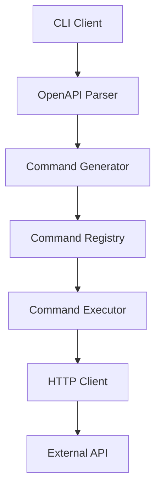
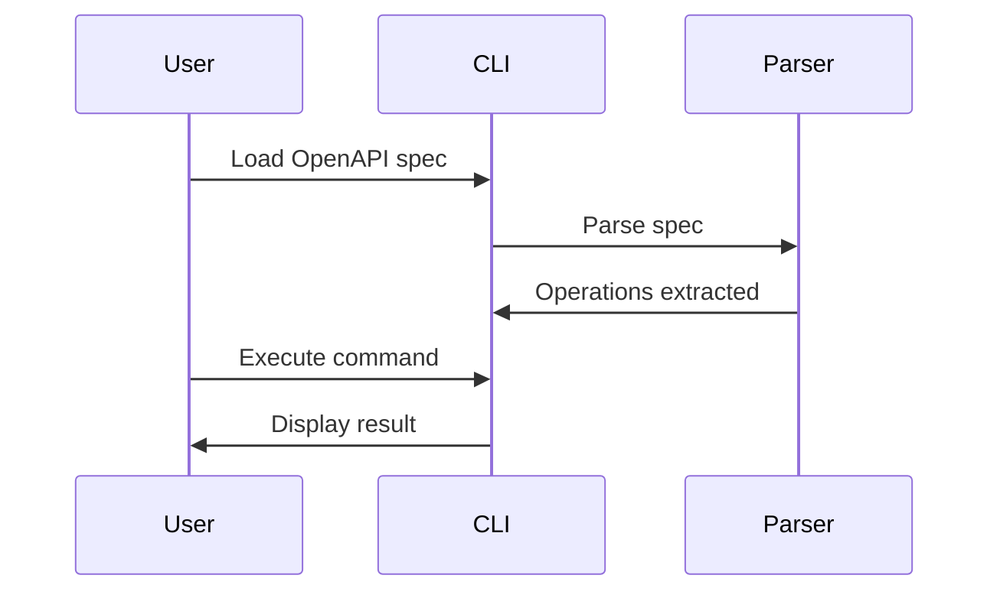

# Ralph Loop Enhancement Summary

## New Features Added (2026-03-05)

### 1. Skill Lifecycle Mapping (SDLC Phases) ✅

**Purpose**: Map all 63 skills to specific SDLC phases

**What was added**:
- Complete mapping of skills to development phases (1-30)
- Phase-specific skill invocation guidance
- Adversarial & quality assurance skill mapping
- Idle-time maintenance skill mapping

**Example usage**:
```
Phase 6-9 (Auth, WASM, MCP, DSL):
- @security-scan - After implementing security features
- @white-hat - During security hardening
- @redteam - After security implementation
- @testing-security - Security validation testing
```

**Benefits**:
- Clear guidance on when to use each skill
- No more guessing which skill to invoke
- Systematic skill usage throughout SDLC
- Ensures skills are used appropriately

---

### 2. Idle-Time Spec Conformance Sweep ✅

**Purpose**: Continuously verify system alignment with specs even when "complete"

**How it works**:
1. Detects when TODO.md has no pending tasks
2. Selects random spec from specs/ directory
3. Analyzes ALL requirements in spec
4. Verifies implementation matches spec exactly
5. Documents gaps with file paths and line numbers
6. Adds remediation tasks to TODO.md
7. Continues with next random spec

**Example execution**:
```
[IDLE SWEEP] No pending tasks found. Starting spec conformance sweep...
[IDLE SWEEP] Selected random spec: specs/WASM-SANDBOX-SECURITY.md
[IDLE SWEEP] Analyzing 23 requirements in spec...
[IDLE SWEEP] ✓ Requirement 1: Module size limits - IMPLEMENTED (pkg/wasm/runtime.go:59)
[IDLE SWEEP] ✗ Requirement 3: Memory limits - NOT IMPLEMENTED (architectural limitation)
[IDLE SWEEP] Found 2 gaps requiring fixes
[IDLE SWEEP] Adding remediation tasks to TODO.md
```

**Spec priority categories**:
- **CRITICAL**: Security, Authentication, Core functionality specs
- **HIGH**: Integration, Performance, Configuration specs
- **MEDIUM**: Feature, Platform, Documentation specs
- **LOW**: Distribution, Advanced features specs

**Benefits**:
- Continuous improvement even when "complete"
- Catches spec violations early
- Ensures implementation matches documentation
- Prevents "drift" from specs over time
- Creates new work items automatically

---

### 3. Extensive Functional Test Suite & Harness ✅

**Purpose**: Test actual functional states, not just basic unit tests

**Test categories**:

1. **System State Tests** - Test initialization, ready states, shutdown
2. **User Workflow Tests** - Test complete user journeys
3. **System Behavior Tests** - Test behavior under various conditions
4. **Error Recovery Tests** - Test graceful degradation
5. **Concurrency Tests** - Test parallel operations
6. **State Transition Tests** - Test state machine correctness

**Functional test harness location**: `test/functional/`

**Structure**:
```
test/functional/
├── harness/
│   ├── system.go          # System test harness
│   ├── state.go           # State management
│   ├── assertions.go      # Custom assertions
│   └── fixtures.go        # Test fixtures
├── workflows/
│   ├── cli_workflow_test.go
│   ├── mcp_workflow_test.go
│   ├── auth_workflow_test.go
│   └── daemon_workflow_test.go
├── states/
│   ├── system_state_test.go
│   ├── cache_state_test.go
│   ├── auth_state_test.go
│   └── mcp_state_test.go
├── behaviors/
│   ├── caching_behavior_test.go
│   ├── error_recovery_test.go
│   ├── concurrency_test.go
│   └── rate_limiting_test.go
```

**Requirements**:
- Test REAL system behavior (not mocks)
- Verify actual state changes
- Assert side effects
- Clean up resources
- Be reproducible
- Run in parallel
- Complete in <5 seconds

**Benefits**:
- Tests real-world usage patterns
- Catches integration bugs unit tests miss
- Validates system behavior, not just functions
- Provides confidence in production readiness
- Documents expected system behavior

---

### 4. Mermaid Diagram Integration for Specs ✅

**Purpose**: Add visual diagrams to specs for better UX understanding

**Diagram types supported**:
1. **Architecture diagrams** - Component relationships
2. **Workflow diagrams** - Step-by-step processes
3. **State diagrams** - State transitions
4. **Sequence diagrams** - Interactions
5. **Flow diagrams** - Decision trees
6. **Component diagrams** - Package structure

**Example architecture diagram**:


**Example workflow diagram**:


**Priority order**:
1. **Priority 1**: master-specification.md, ARCHITECTURE-VISUAL.md, MCP-PROTOCOL.md
2. **Priority 2**: CLI-*.md, DSL-*.md, AUTH-*.md, WASM-*.md specs
3. **Priority 3**: CACHE-*.md, DAEMON-*.md, testing specs

**Quality requirements**:
- Clear node labels
- Consistent styling
- Logical flow direction
- Minimal crossing lines
- Maximum 15 nodes per diagram
- Descriptive edge labels

**Benefits**:
- Visual learning for developers
- Faster comprehension of complex systems
- Better documentation quality
- Easier onboarding for new contributors
- Improved spec clarity

---

## Updated Workflow

**New workflow steps**:
```
1. Read Memory Bank → Get complete context
2. Read TODO.md → Identify current task
3. Read relevant spec(s) → Understand requirements
4. Analyze → Determine execution plan autonomously
5. Implement → Write code + unit tests + integration tests + FUNCTIONAL TESTS
6. Update demo → Add to demo application
7. Run integration tests → Prove it connects
8. Run functional tests → Prove system behaves correctly ← NEW
9. Run skills → @test-gap-analysis, @gap-analysis, @spec-gap-analysis
10. Verify → Check end-to-end functionality
11. Commit → Mark complete in TODO.md
12. Add mermaid diagrams → Enhance spec UX ← NEW
13. Report → Provide clear completion summary
14. Repeat → Next task

IF NO PENDING TASKS:
    → START IDLE-TIME SPEC CONFORMANCE SWEEP ← NEW
    → Select random spec, verify implementation
    → Add gaps to TODO.md, continue sweeping
    → Add mermaid diagrams to specs ← NEW
```

---

## New Implementation Rules

**Rule 9: Functional Test Requirement (NEW)**
- Test real system behavior, not just unit tests
- Test state transitions, user workflows, error recovery, concurrency
- Place in `test/functional/` directory

**Rule 10: Spec Documentation Enhancement (NEW)**
- Add mermaid diagrams to specs
- Include architecture, workflow, and state diagrams
- Enhance UX understanding

**Rule 11: Continuous Improvement (NEW)**
- Run Idle-Time Spec Conformance Sweep when idle
- Verify implementation matches specs
- Never stop improving

---

## Autonomous Execution Checklist Updates

**New tasks added**:
- **Task 4 Priority**: 📊 MEDIUM (Ongoing) - Build functional test suite
- **Task 5 Priority**: 🎨 LOW (Idle Time) - Add mermaid diagrams to specs
- **Task 6 Priority**: 🔄 CONTINUOUS (When No Tasks) - Run Idle-Time Spec Conformance Sweep

---

## Expected Impact

### Immediate Benefits (Week 1)
1. **Better testing coverage** - Functional tests catch real-world bugs
2. **Continuous improvement** - Idle sweep finds gaps automatically
3. **Clearer documentation** - Mermaid diagrams improve understanding
4. **Systematic skill usage** - Know which skill to use when

### Long-term Benefits (Month 1+)
1. **Higher quality** - Continuous verification prevents drift
2. **Better onboarding** - Visual diagrams help new contributors
3. **Reduced bugs** - Functional tests catch integration issues
4. **Maintained quality** - Idle sweep ensures ongoing alignment

---

## How to Use

### For Ralph Loop
1. Follow new workflow steps (includes functional tests + diagrams)
2. When TODO.md is empty, start idle sweep automatically
3. Add mermaid diagrams to specs during idle time
4. Use skill lifecycle mapping for guidance

### For Developers
1. Review mermaid diagrams in specs for quick understanding
2. Run functional tests to validate system behavior
3. Check idle sweep results for ongoing quality improvements
4. Follow skill mapping for systematic quality assurance

### For Review
1. Check that functional tests exist for new features
2. Verify mermaid diagrams added to updated specs
3. Review idle sweep findings for quality issues
4. Confirm skills used appropriately per phase

---

## Metrics to Track

**Functional Tests**:
- Number of functional test files created
- Coverage of system workflows
- State transition test completeness
- Concurrency test coverage

**Spec Conformance**:
- Number of specs swept
- Gaps found per sweep
- Gaps remediated
- Time to remediation

**Mermaid Diagrams**:
- Number of specs with diagrams
- Diagram quality score
- User comprehension improvement
- Onboarding time reduction

**Skill Usage**:
- Skills invoked per phase
- Skill effectiveness rating
- Quality improvement from skills
- Appropriate skill selection rate

---

## Next Steps

1. **Week 1**: Implement functional test harness
2. **Week 2**: Add mermaid diagrams to priority 1 specs
3. **Week 3**: Run first idle sweep cycle
4. **Week 4**: Track metrics and adjust approach

---

## Summary

These enhancements transform the Ralph Loop from a simple implementation engine into a **continuous improvement system** that:

1. **Tests thoroughly** - Functional tests ensure real-world correctness
2. **Verifies continuously** - Idle sweep prevents spec drift
3. **Documents visually** - Mermaid diagrams improve understanding
4. **Improves systematically** - Skill mapping ensures quality

**Result**: A production-ready system that maintains quality over time and continuously improves even when "complete".
