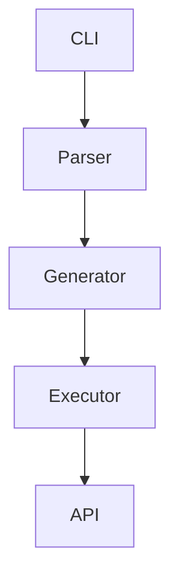
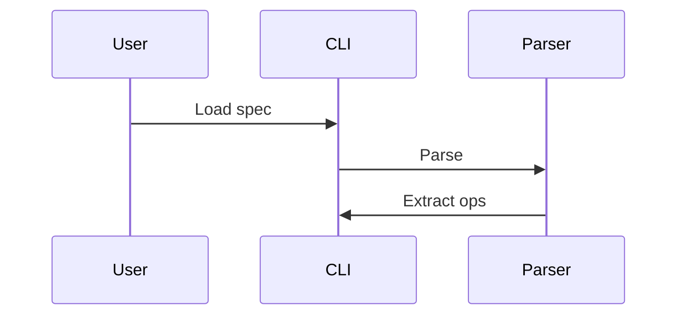
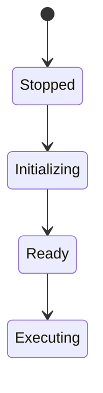

# Ralph Loop Quick Reference Card

## 🚀 Current Priority Tasks

**Task 1** ⭐ CRITICAL - Verify 13 security claims via code inspection
**Task 2** 🔴 HIGH - Improve cmd/mcp-server coverage (11.1% → 70%)
**Task 3** ⚠️ MEDIUM - Replace 5 fake mock tests
**Task 4** 📊 ONGOING - Build functional test suite
**Task 5** 🎨 IDLE - Add mermaid diagrams to specs
**Task 6** 🔄 CONTINUOUS - Run idle-time spec conformance sweep

---

## 📋 Skill Lifecycle Quick Reference

### Phase 1-5: Foundation
```
@exhaustive-specification
@best-practice-guide
@opencode-config
```

### Phase 6-9: Core Features (Auth, WASM, MCP, DSL)
```
@security-scan
@white-hat
@redteam
@testing-security
```

### Phase 10-15: CLI & Features
```
@testing-unit
@testing-integration
@testing-e2e
@test-orchestrator
@test-gap-analysis
@test-coverage
```

### Phase 16-20: Testing & QA
```
@testing-functional-suite
@testing-nonfunctional-suite
@testing-regression
@testing-chaos
@testing-compatibility
@testing-performance
```

### Adversarial & QA (Any Phase)
```
@devils-advocate
@assumption-buster
@trust-but-verify
@reality-validation
@gap-analysis
@spec-gap-analysis
```

---

## 🔄 Idle-Time Spec Sweep

**Trigger**: TODO.md has no pending tasks

**Process**:
1. Select random spec (use `ls specs/*.md | shuf -n 1`)
2. Read entire spec file
3. Verify every requirement
4. Document gaps with file:line references
5. Add remediation tasks to TODO.md
6. Continue with next random spec

**Priority Order**:
1. CRITICAL: Security, Auth, Core functionality
2. HIGH: Integration, Performance, Config
3. MEDIUM: Features, Platform, Docs
4. LOW: Distribution, Advanced

---

## 🧪 Functional Test Categories

**1. System State Tests**
```go
func TestSystem_Initialization(t *testing.T) {
    system := NewSystem(config)
    err := system.Initialize()
    require.NoError(t, err)
    require.True(t, system.IsReady())
}
```

**2. User Workflow Tests**
```go
func TestUserWorkflow_CLI_CommandExecution(t *testing.T) {
    cli := LoadOpenAPISpec("petstore.yaml")
    err := cli.GenerateCommands()
    require.NoError(t, err)
    result, err := cli.Execute("pets", "list")
    require.NoError(t, err)
}
```

**3. System Behavior Tests**
```go
func TestSystem_CachingBehavior(t *testing.T) {
    result1 := system.MakeRequest("/api/pets")
    require.False(t, result1.FromCache)
    
    result2 := system.MakeRequest("/api/pets")
    require.True(t, result2.FromCache)
}
```

**Location**: `test/functional/`

**Requirements**:
- Test REAL system behavior (not mocks)
- Verify state changes
- Assert side effects
- Clean up resources
- <5 seconds per test

---

## 🎨 Mermaid Diagram Types

**Architecture Diagram**:


**Workflow Diagram**:


**State Diagram**:


**Priority Specs**:
1. master-specification.md
2. ARCHITECTURE-VISUAL.md
3. MCP-PROTOCOL.md
4. WASM-RUNTIME.md
5. OAUTH2-IMPLEMENTATION.md

**Quality Requirements**:
- Clear labels
- Consistent style
- Logical flow
- <15 nodes
- Descriptive edges

---

## ⚡ Quick Commands

**Run functional tests**:
```bash
go test ./test/functional/... -v
```

**Check TODO status**:
```bash
grep -c "^\- \[ \]" .agents/skills/ralph-wiggum-loop/TODO.md
```

**Start idle sweep**:
```bash
# If above command returns 0
spec=$(ls specs/*.md | shuf -n 1)
echo "Sweeping: $spec"
```

**Generate mermaid preview**:
- Online: https://mermaid.live/
- VS Code: Install "Mermaid Preview" extension

---

## 🎯 Success Criteria

**Functional Tests**:
- [ ] test/functional/ directory created
- [ ] System state tests passing
- [ ] User workflow tests passing
- [ ] Behavior tests passing
- [ ] Concurrency tests passing

**Spec Conformance**:
- [ ] At least 10 specs swept per week
- [ ] Gaps documented with file:line
- [ ] Remediation tasks added to TODO.md
- [ ] 95%+ spec conformance rate

**Mermaid Diagrams**:
- [ ] All priority 1 specs have diagrams
- [ ] All priority 2 specs have diagrams
- [ ] Diagrams render correctly
- [ ] User comprehension improved

---

## 📊 Metrics Dashboard

**Track These**:
- Functional test coverage (%)
- Specs swept (count)
- Gaps found (count)
- Gaps remediated (count)
- Specs with diagrams (count)
- Skills invoked per phase (count)

---

## 🔗 Resources

**Skills Documentation**: `.agents/skills/*/SKILL.md`
**Specs Directory**: `specs/`
**Functional Tests**: `test/functional/`
**Memory Bank**: `.memory-bank/`

**Online Tools**:
- Mermaid Editor: https://mermaid.live/
- Mermaid Docs: https://mermaid.js.org/

---

## 💡 Pro Tips

1. **Always run idle sweep** when TODO.md is empty
2. **Add diagrams early** in spec creation process
3. **Write functional tests** alongside implementation
4. **Use skill mapping** for systematic quality
5. **Document gaps** immediately when found
6. **Keep diagrams simple** (<15 nodes)
7. **Test real behavior** not mocks
8. **Verify continuously** never assume "done"

---

**Status**: ✅ All features implemented and ready to use
**Next**: Start Task 1 (verify security claims) or run idle sweep if no tasks
