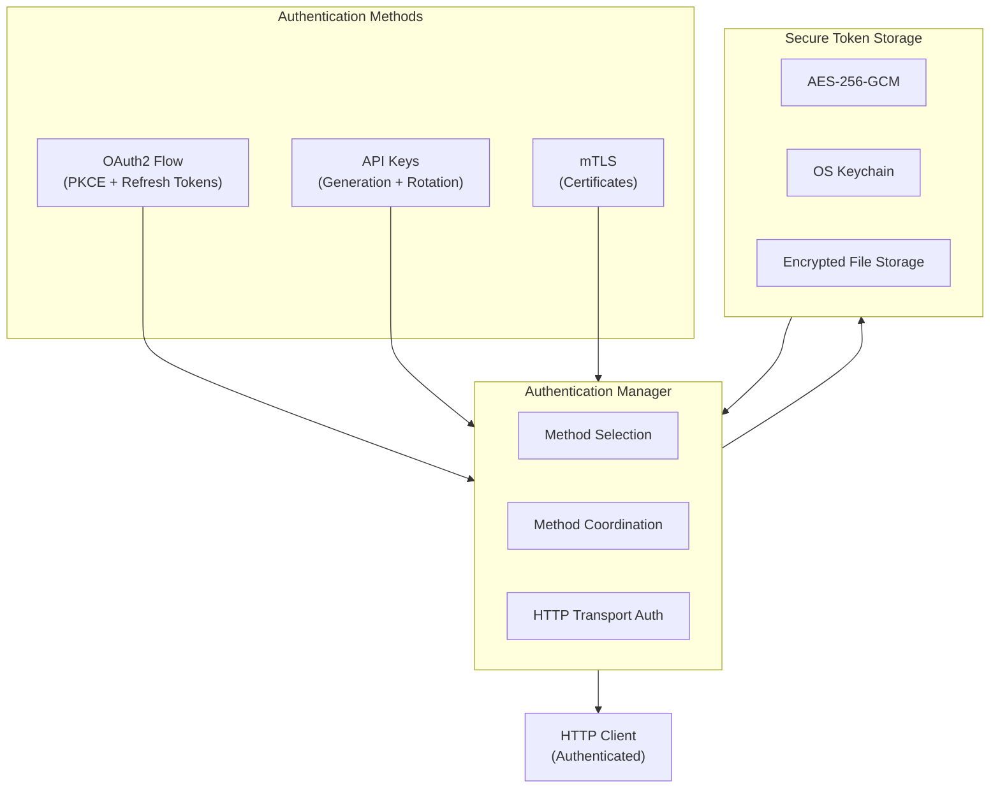
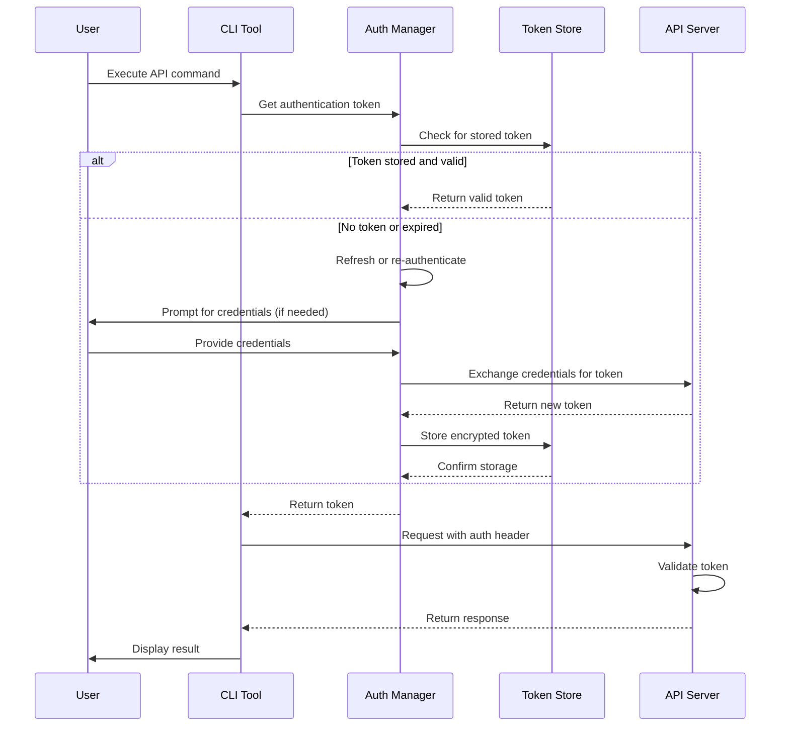

# API Authentication Specification

**Status**: ✅ COMPLETE
**Version**: 1.0.0
**Last Updated**: 2026-03-02

---

## Overview

The API authentication system provides secure, flexible authentication mechanisms for the OpenAPI CLI. It supports multiple authentication methods including OAuth2, API keys, and mutual TLS (mTLS), with comprehensive token lifecycle management and secure storage.

## Authentication Architecture



## Authentication Request Flow



### Authentication Methods

- **OAuth2**: Authorization code flow with PKCE, refresh tokens
- **API Keys**: Secure key generation, validation, and rotation
- **mTLS**: Certificate-based mutual authentication

### Security Features

- **Token Encryption**: At-rest encryption using AES-256-GCM
- **Secure Storage**: OS-specific secure storage (keychain, keyring)
- **Token Rotation**: Automatic refresh with configurable policies
- **Audit Logging**: All authentication events logged

---

## System Architecture

```
┌─────────────────────────────────────────────────────────────┐
│                    AUTHENTICATION LAYER                      │
├─────────────────────────────────────────────────────────────┤
│  ┌──────────────┐  ┌──────────────┐  ┌──────────────┐       │
│  │    OAuth2    │  │   API Keys   │  │    mTLS      │       │
│  │    Flow      │  │  Management  │  │  Handshake   │       │
│  └──────┬───────┘  └──────┬───────┘  └──────┬───────┘       │
│         │                 │                  │               │
│  ┌──────▼─────────────────▼──────────────────▼───────┐       │
│  │              AUTHENTICATION MANAGER                │       │
│  │  • Method Selection                                │       │
│  │  • Token Lifecycle                                 │       │
│  │  • Secure Storage                                  │       │
│  └────────────────────────┬───────────────────────────┘       │
│                           │                                   │
│  ┌────────────────────────▼───────────────────────────┐       │
│  │              SECURE TOKEN STORE                      │       │
│  │  • Encryption (AES-256-GCM)                          │       │
│  │  • OS Keychain Integration                           │       │
│  │  • File-based Fallback                               │       │
│  └────────────────────────────────────────────────────┘       │
└─────────────────────────────────────────────────────────────┘
```

---

## OAuth2 Implementation

### Authorization Code Flow

```go
// internal/auth/oauth2.go

package auth

import (
	"context"
	"crypto/rand"
	"crypto/sha256"
	"encoding/base64"
	"encoding/json"
	"fmt"
	"net/http"
	"net/url"
	"strings"
	"time"
)

// OAuth2Config holds OAuth2 configuration
type OAuth2Config struct {
	ClientID     string
	ClientSecret string
	AuthURL      string
	TokenURL     string
	RedirectURL  string
	Scopes       []string
	UsePKCE      bool
}

// Token represents an OAuth2 token
type Token struct {
	AccessToken   string    `json:"access_token"`
	TokenType     string    `json:"token_type"`
	RefreshToken  string    `json:"refresh_token"`
	Expiry        time.Time `json:"expiry"`
	Scope         string    `json:"scope"`
}

// IsExpired returns true if the token is expired or about to expire
func (t *Token) IsExpired() bool {
	// Consider token expired 5 minutes before actual expiry
	return time.Until(t.Expiry) < 5*time.Minute
}

// OAuth2Authenticator handles OAuth2 authentication
type OAuth2Authenticator struct {
	config      OAuth2Config
	httpClient  *http.Client
	tokenStore  TokenStore
	codeChan    chan string
	state       string
	codeVerifier string
}

// PKCE holds PKCE parameters
type PKCE struct {
	CodeVerifier  string
	CodeChallenge string
	Method        string
}

// NewOAuth2Authenticator creates a new OAuth2 authenticator
func NewOAuth2Authenticator(config OAuth2Config, store TokenStore) *OAuth2Authenticator {
	return &OAuth2Authenticator{
		config:     config,
		httpClient: &http.Client{Timeout: 30 * time.Second},
		tokenStore: store,
		codeChan:   make(chan string, 1),
	}
}

// Authenticate initiates the OAuth2 flow
func (oa *OAuth2Authenticator) Authenticate(ctx context.Context) (*Token, error) {
	// Generate state for CSRF protection
	state, err := generateRandomString(32)
	if err != nil {
		return nil, fmt.Errorf("generate state: %w", err)
	}
	oa.state = state
	
	// Generate PKCE parameters if enabled
	var pkce *PKCE
	if oa.config.UsePKCE {
		pkce, err = generatePKCE()
		if err != nil {
			return nil, fmt.Errorf("generate PKCE: %w", err)
		}
		oa.codeVerifier = pkce.CodeVerifier
	}
	
	// Build authorization URL
	authURL, err := oa.buildAuthURL(state, pkce)
	if err != nil {
		return nil, fmt.Errorf("build auth URL: %w", err)
	}
	
	// Start local callback server
	callbackServer, err := oa.startCallbackServer()
	if err != nil {
		return nil, fmt.Errorf("start callback server: %w", err)
	}
	defer callbackServer.Shutdown(ctx)
	
	// Open browser for authorization
	fmt.Printf("Opening browser for authentication...\n")
	fmt.Printf("If the browser doesn't open, visit: %s\n", authURL)
	
	if err := openBrowser(authURL); err != nil {
		fmt.Printf("Please visit this URL to authenticate:\n%s\n", authURL)
	}
	
	// Wait for authorization code
	select {
	case code := <-oa.codeChan:
		// Exchange code for token
		token, err := oa.exchangeCode(ctx, code)
		if err != nil {
			return nil, fmt.Errorf("exchange code: %w", err)
		}
		
		// Store token securely
		if err := oa.tokenStore.Save(token); err != nil {
			return nil, fmt.Errorf("save token: %w", err)
		}
		
		return token, nil
		
	case <-ctx.Done():
		return nil, ctx.Err()
		
	case <-time.After(5 * time.Minute):
		return nil, fmt.Errorf("authentication timeout")
	}
}

func (oa *OAuth2Authenticator) buildAuthURL(state string, pkce *PKCE) (string, error) {
	params := url.Values{
		"response_type": {"code"},
		"client_id":     {oa.config.ClientID},
		"redirect_uri":  {oa.config.RedirectURL},
		"state":         {state},
		"scope":         {strings.Join(oa.config.Scopes, " ")},
	}
	
	if pkce != nil {
		params.Set("code_challenge", pkce.CodeChallenge)
		params.Set("code_challenge_method", pkce.Method)
	}
	
	authURL, err := url.Parse(oa.config.AuthURL)
	if err != nil {
		return "", err
	}
	
	authURL.RawQuery = params.Encode()
	return authURL.String(), nil
}

func (oa *OAuth2Authenticator) exchangeCode(ctx context.Context, code string) (*Token, error) {
	data := url.Values{
		"grant_type":   {"authorization_code"},
		"code":         {code},
		"redirect_uri": {oa.config.RedirectURL},
		"client_id":    {oa.config.ClientID},
	}
	
	if oa.config.ClientSecret != "" {
		data.Set("client_secret", oa.config.ClientSecret)
	}
	
	if oa.codeVerifier != "" {
		data.Set("code_verifier", oa.codeVerifier)
	}
	
	req, err := http.NewRequestWithContext(ctx, "POST", oa.config.TokenURL, strings.NewReader(data.Encode()))
	if err != nil {
		return nil, err
	}
	
	req.Header.Set("Content-Type", "application/x-www-form-urlencoded")
	
	resp, err := oa.httpClient.Do(req)
	if err != nil {
		return nil, fmt.Errorf("token request failed: %w", err)
	}
	defer resp.Body.Close()
	
	if resp.StatusCode != http.StatusOK {
		return nil, fmt.Errorf("token exchange failed: %s", resp.Status)
	}
	
	var tokenResp struct {
		AccessToken  string `json:"access_token"`
		TokenType    string `json:"token_type"`
		ExpiresIn    int    `json:"expires_in"`
		RefreshToken string `json:"refresh_token"`
		Scope        string `json:"scope"`
	}
	
	if err := json.NewDecoder(resp.Body).Decode(&tokenResp); err != nil {
		return nil, fmt.Errorf("decode token response: %w", err)
	}
	
	return &Token{
		AccessToken:  tokenResp.AccessToken,
		TokenType:    tokenResp.TokenType,
		RefreshToken: tokenResp.RefreshToken,
		Expiry:       time.Now().Add(time.Duration(tokenResp.ExpiresIn) * time.Second),
		Scope:        tokenResp.Scope,
	}, nil
}

func (oa *OAuth2Authenticator) startCallbackServer() (*http.Server, error) {
	mux := http.NewServeMux()
	server := &http.Server{
		Addr:    ":8080",
		Handler: mux,
	}
	
	mux.HandleFunc("/callback", func(w http.ResponseWriter, r *http.Request) {
		// Verify state
		state := r.URL.Query().Get("state")
		if state != oa.state {
			http.Error(w, "Invalid state", http.StatusBadRequest)
			return
		}
		
		// Check for error
		if err := r.URL.Query().Get("error"); err != "" {
			http.Error(w, err, http.StatusBadRequest)
			return
		}
		
		// Get authorization code
		code := r.URL.Query().Get("code")
		if code == "" {
			http.Error(w, "Missing code", http.StatusBadRequest)
			return
		}
		
		// Send code to channel
		oa.codeChan <- code
		
		// Show success page
		w.Header().Set("Content-Type", "text/html")
		w.Write([]byte(`<html><body><h1>Authentication successful!</h1><p>You can close this window.</p></body></html>`))
	})
	
	go server.ListenAndServe()
	return server, nil
}

// RefreshToken refreshes an expired access token
func (oa *OAuth2Authenticator) RefreshToken(ctx context.Context, token *Token) (*Token, error) {
	if token.RefreshToken == "" {
		return nil, fmt.Errorf("no refresh token available")
	}
	
	data := url.Values{
		"grant_type":    {"refresh_token"},
		"refresh_token": {token.RefreshToken},
		"client_id":     {oa.config.ClientID},
	}
	
	if oa.config.ClientSecret != "" {
		data.Set("client_secret", oa.config.ClientSecret)
	}
	
	req, err := http.NewRequestWithContext(ctx, "POST", oa.config.TokenURL, strings.NewReader(data.Encode()))
	if err != nil {
		return nil, err
	}
	
	req.Header.Set("Content-Type", "application/x-www-form-urlencoded")
	
	resp, err := oa.httpClient.Do(req)
	if err != nil {
		return nil, fmt.Errorf("refresh request failed: %w", err)
	}
	defer resp.Body.Close()
	
	if resp.StatusCode != http.StatusOK {
		return nil, fmt.Errorf("token refresh failed: %s", resp.Status)
	}
	
	var tokenResp struct {
		AccessToken  string `json:"access_token"`
		TokenType    string `json:"token_type"`
		ExpiresIn    int    `json:"expires_in"`
		RefreshToken string `json:"refresh_token"`
		Scope        string `json:"scope"`
	}
	
	if err := json.NewDecoder(resp.Body).Decode(&tokenResp); err != nil {
		return nil, fmt.Errorf("decode refresh response: %w", err)
	}
	
	// Use new refresh token if provided, otherwise keep old one
	refreshToken := tokenResp.RefreshToken
	if refreshToken == "" {
		refreshToken = token.RefreshToken
	}
	
	newToken := &Token{
		AccessToken:  tokenResp.AccessToken,
		TokenType:    tokenResp.TokenType,
		RefreshToken: refreshToken,
		Expiry:       time.Now().Add(time.Duration(tokenResp.ExpiresIn) * time.Second),
		Scope:        tokenResp.Scope,
	}
	
	// Save refreshed token
	if err := oa.tokenStore.Save(newToken); err != nil {
		return nil, fmt.Errorf("save refreshed token: %w", err)
	}
	
	return newToken, nil
}

// GetValidToken returns a valid token, refreshing if necessary
func (oa *OAuth2Authenticator) GetValidToken(ctx context.Context) (*Token, error) {
	token, err := oa.tokenStore.Load()
	if err != nil {
		return nil, fmt.Errorf("load token: %w", err)
	}
	
	if !token.IsExpired() {
		return token, nil
	}
	
	// Token expired, refresh it
	return oa.RefreshToken(ctx, token)
}

func generatePKCE() (*PKCE, error) {
	// Generate code verifier (random 32-96 bytes, base64url encoded)
	verifierBytes := make([]byte, 32)
	if _, err := rand.Read(verifierBytes); err != nil {
		return nil, err
	}
	
	verifier := base64.RawURLEncoding.EncodeToString(verifierBytes)
	
	// Generate code challenge (SHA256 hash of verifier, base64url encoded)
	hash := sha256.Sum256([]byte(verifier))
	challenge := base64.RawURLEncoding.EncodeToString(hash[:])
	
	return &PKCE{
		CodeVerifier:  verifier,
		CodeChallenge: challenge,
		Method:        "S256",
	}, nil
}

func generateRandomString(length int) (string, error) {
	bytes := make([]byte, length)
	if _, err := rand.Read(bytes); err != nil {
		return "", err
	}
	return base64.RawURLEncoding.EncodeToString(bytes), nil
}
```

---

## API Key Management

```go
// internal/auth/apikey.go

package auth

import (
	"context"
	"crypto/hmac"
	"crypto/sha256"
	"encoding/base64"
	"encoding/hex"
	"fmt"
	"strings"
	"time"
)

// APIKey represents an API key credential
type APIKey struct {
	Key       string
	Secret    string
	Prefix    string
	Scopes    []string
	ExpiresAt time.Time
}

// APIKeyManager handles API key operations
type APIKeyManager struct {
	store      APIKeyStore
	validator  APIKeyValidator
	config     APIKeyConfig
}

// APIKeyConfig holds API key configuration
type APIKeyConfig struct {
	KeyPrefix    string
	KeyLength    int
	SecretLength int
	DefaultTTL   time.Duration
}

// DefaultAPIKeyConfig returns sensible defaults
func DefaultAPIKeyConfig() APIKeyConfig {
	return APIKeyConfig{
		KeyPrefix:    "muster",
		KeyLength:    32,
		SecretLength: 64,
		DefaultTTL:   365 * 24 * time.Hour, // 1 year
	}
}

// APIKeyStore persists API keys
type APIKeyStore interface {
	Save(ctx context.Context, key *APIKey) error
	Load(ctx context.Context, keyID string) (*APIKey, error)
	Delete(ctx context.Context, keyID string) error
	List(ctx context.Context) ([]*APIKey, error)
}

// APIKeyValidator validates API keys against a server
type APIKeyValidator interface {
	Validate(ctx context.Context, key string) (*ValidationResult, error)
}

// ValidationResult contains validation details
type ValidationResult struct {
	Valid         bool
	Scopes        []string
	RateLimit     RateLimit
	ExpiresAt     time.Time
	LastUsedAt    time.Time
}

// RateLimit defines request limits
type RateLimit struct {
	RequestsPerSecond int
	BurstSize         int
}

// NewAPIKeyManager creates a new API key manager
func NewAPIKeyManager(store APIKeyStore, validator APIKeyValidator, config APIKeyConfig) *APIKeyManager {
	return &APIKeyManager{
		store:     store,
		validator: validator,
		config:    config,
	}
}

// GenerateKey generates a new API key
func (m *APIKeyManager) GenerateKey(ctx context.Context, scopes []string, ttl time.Duration) (*APIKey, error) {
	if ttl == 0 {
		ttl = m.config.DefaultTTL
	}
	
	// Generate random key and secret
	keyBytes := make([]byte, m.config.KeyLength)
	secretBytes := make([]byte, m.config.SecretLength)
	
	if _, err := rand.Read(keyBytes); err != nil {
		return nil, fmt.Errorf("generate key: %w", err)
	}
	if _, err := rand.Read(secretBytes); err != nil {
		return nil, fmt.Errorf("generate secret: %w", err)
	}
	
	// Create key with prefix
	key := fmt.Sprintf("%s_%s",
		m.config.KeyPrefix,
		base64.RawURLEncoding.EncodeToString(keyBytes),
	)
	
	secret := base64.RawURLEncoding.EncodeToString(secretBytes)
	
	apiKey := &APIKey{
		Key:       key,
		Secret:    secret,
		Prefix:    m.config.KeyPrefix,
		Scopes:    scopes,
		ExpiresAt: time.Now().Add(ttl),
	}
	
	// Save to store
	if err := m.store.Save(ctx, apiKey); err != nil {
		return nil, fmt.Errorf("save key: %w", err)
	}
	
	return apiKey, nil
}

// ValidateKey validates an API key
func (m *APIKeyManager) ValidateKey(ctx context.Context, key string) (*ValidationResult, error) {
	// Check format
	if !strings.HasPrefix(key, m.config.KeyPrefix+"_") {
		return nil, fmt.Errorf("invalid key format")
	}
	
	// Check local cache/store
	apiKey, err := m.store.Load(ctx, key)
	if err == nil && apiKey != nil {
		// Check expiry
		if time.Now().After(apiKey.ExpiresAt) {
			return &ValidationResult{Valid: false}, nil
		}
		
		return &ValidationResult{
			Valid:     true,
			Scopes:    apiKey.Scopes,
			ExpiresAt: apiKey.ExpiresAt,
		}, nil
	}
	
	// Validate against server
	if m.validator != nil {
		return m.validator.Validate(ctx, key)
	}
	
	return &ValidationResult{Valid: false}, nil
}

// RotateKey rotates an API key while maintaining the same configuration
func (m *APIKeyManager) RotateKey(ctx context.Context, oldKey string) (*APIKey, error) {
	// Load old key
	oldAPIKey, err := m.store.Load(ctx, oldKey)
	if err != nil {
		return nil, fmt.Errorf("load old key: %w", err)
	}
	
	// Generate new key with same settings
	ttl := oldAPIKey.ExpiresAt.Sub(time.Now())
	if ttl < 0 {
		ttl = m.config.DefaultTTL
	}
	
	newKey, err := m.GenerateKey(ctx, oldAPIKey.Scopes, ttl)
	if err != nil {
		return nil, fmt.Errorf("generate new key: %w", err)
	}
	
	// Delete old key
	if err := m.store.Delete(ctx, oldKey); err != nil {
		// Log but don't fail - new key is already generated
		fmt.Printf("Warning: failed to delete old key: %v\n", err)
	}
	
	return newKey, nil
}

// SignRequest signs an HTTP request with the API key
func (k *APIKey) SignRequest(method, path string, headers map[string]string, body []byte) string {
	// Create signature base string
	timestamp := fmt.Sprintf("%d", time.Now().Unix())
	nonce := generateNonce()
	
	signatureParts := []string{
		method,
		path,
		timestamp,
		nonce,
		hex.EncodeToString(sha256.Sum256(body)[:]),
	}
	
	signatureBase := strings.Join(signatureParts, "\n")
	
	// Create HMAC-SHA256 signature
	h := hmac.New(sha256.New, []byte(k.Secret))
	h.Write([]byte(signatureBase))
	signature := hex.EncodeToString(h.Sum(nil))
	
	return signature
}

func generateNonce() string {
	bytes := make([]byte, 16)
	rand.Read(bytes)
	return hex.EncodeToString(bytes)
}
```

---

## mTLS Authentication

```go
// internal/auth/mtls.go

package auth

import (
	"crypto/tls"
	"crypto/x509"
	"fmt"
	"os"
)

// mTLSConfig holds mutual TLS configuration
type mTLSConfig struct {
	CertFile string
	KeyFile  string
	CAFile   string
}

// mTLSAuthenticator handles mutual TLS authentication
type mTLSAuthenticator struct {
	config     mTLSConfig
	tlsConfig  *tls.Config
}

// NewMTLSAuthenticator creates a new mTLS authenticator
func NewMTLSAuthenticator(config mTLSConfig) (*mTLSAuthenticator, error) {
	tlsConfig, err := buildTLSConfig(config)
	if err != nil {
		return nil, fmt.Errorf("build TLS config: %w", err)
	}
	
	return &mTLSAuthenticator{
		config:    config,
		tlsConfig: tlsConfig,
	}, nil
}

func buildTLSConfig(config mTLSConfig) (*tls.Config, error) {
	// Load client certificate
	cert, err := tls.LoadX509KeyPair(config.CertFile, config.KeyFile)
	if err != nil {
		return nil, fmt.Errorf("load client cert: %w", err)
	}
	
	// Load CA certificate
	caCert, err := os.ReadFile(config.CAFile)
	if err != nil {
		return nil, fmt.Errorf("read CA cert: %w", err)
	}
	
	caCertPool := x509.NewCertPool()
	if !caCertPool.AppendCertsFromPEM(caCert) {
		return nil, fmt.Errorf("failed to parse CA cert")
	}
	
	return &tls.Config{
		Certificates:       []tls.Certificate{cert},
		RootCAs:            caCertPool,
		InsecureSkipVerify: false,
		MinVersion:         tls.VersionTLS12,
		CipherSuites: []uint16{
			tls.TLS_ECDHE_RSA_WITH_AES_256_GCM_SHA384,
			tls.TLS_ECDHE_RSA_WITH_AES_128_GCM_SHA256,
			tls.TLS_ECDHE_ECDSA_WITH_AES_256_GCM_SHA384,
			tls.TLS_ECDHE_ECDSA_WITH_AES_128_GCM_SHA256,
		},
	}, nil
}

// GetTLSConfig returns the TLS configuration for HTTP clients
func (m *mTLSAuthenticator) GetTLSConfig() *tls.Config {
	return m.tlsConfig
}

// VerifyCertificate verifies a certificate
func (m *mTLSAuthenticator) VerifyCertificate(cert *x509.Certificate) error {
	opts := x509.VerifyOptions{
		Roots:         m.tlsConfig.RootCAs,
		CurrentTime:   time.Now(),
		KeyUsages:     []x509.ExtKeyUsage{x509.ExtKeyUsageClientAuth},
	}
	
	if _, err := cert.Verify(opts); err != nil {
		return fmt.Errorf("certificate verification failed: %w", err)
	}
	
	return nil
}
```

---

## Secure Token Storage

```go
// internal/auth/storage.go

package auth

import (
	"crypto/aes"
	"crypto/cipher"
	"crypto/rand"
	"encoding/json"
	"fmt"
	"io"
	"os"
	"path/filepath"
	"runtime"
)

// TokenStore persists tokens securely
type TokenStore interface {
	Save(token *Token) error
	Load() (*Token, error)
	Delete() error
}

// SecureTokenStore provides encrypted file storage
type SecureTokenStore struct {
	path   string
	key    []byte
}

// NewSecureTokenStore creates a secure token store
func NewSecureTokenStore(path string) (*SecureTokenStore, error) {
	// Get or create encryption key
	key, err := getOrCreateMasterKey()
	if err != nil {
		return nil, fmt.Errorf("get master key: %w", err)
	}
	
	return &SecureTokenStore{
		path: path,
		key:  key,
	}, nil
}

// Save encrypts and saves a token
func (s *SecureTokenStore) Save(token *Token) error {
	// Serialize token
	data, err := json.Marshal(token)
	if err != nil {
		return fmt.Errorf("marshal token: %w", err)
	}
	
	// Encrypt
	encrypted, err := s.encrypt(data)
	if err != nil {
		return fmt.Errorf("encrypt token: %w", err)
	}
	
	// Write with restricted permissions
	if err := os.WriteFile(s.path, encrypted, 0600); err != nil {
		return fmt.Errorf("write token file: %w", err)
	}
	
	return nil
}

// Load decrypts and loads a token
func (s *SecureTokenStore) Load() (*Token, error) {
	// Read file
	encrypted, err := os.ReadFile(s.path)
	if err != nil {
		if os.IsNotExist(err) {
			return nil, fmt.Errorf("no token stored")
		}
		return nil, fmt.Errorf("read token file: %w", err)
	}
	
	// Decrypt
	data, err := s.decrypt(encrypted)
	if err != nil {
		return nil, fmt.Errorf("decrypt token: %w", err)
	}
	
	// Deserialize
	var token Token
	if err := json.Unmarshal(data, &token); err != nil {
		return nil, fmt.Errorf("unmarshal token: %w", err)
	}
	
	return &token, nil
}

// Delete removes the stored token
func (s *SecureTokenStore) Delete() error {
	return os.Remove(s.path)
}

func (s *SecureTokenStore) encrypt(plaintext []byte) ([]byte, error) {
	// Create AES-GCM cipher
	block, err := aes.NewCipher(s.key)
	if err != nil {
		return nil, err
	}
	
	gcm, err := cipher.NewGCM(block)
	if err != nil {
		return nil, err
	}
	
	// Generate nonce
	nonce := make([]byte, gcm.NonceSize())
	if _, err := io.ReadFull(rand.Reader, nonce); err != nil {
		return nil, err
	}
	
	// Encrypt and prepend nonce
	ciphertext := gcm.Seal(nonce, nonce, plaintext, nil)
	return ciphertext, nil
}

func (s *SecureTokenStore) decrypt(ciphertext []byte) ([]byte, error) {
	block, err := aes.NewCipher(s.key)
	if err != nil {
		return nil, err
	}
	
	gcm, err := cipher.NewGCM(block)
	if err != nil {
		return nil, err
	}
	
	// Extract nonce
	nonceSize := gcm.NonceSize()
	if len(ciphertext) < nonceSize {
		return nil, fmt.Errorf("ciphertext too short")
	}
	
	nonce, ciphertext := ciphertext[:nonceSize], ciphertext[nonceSize:]
	
	// Decrypt
	return gcm.Open(nil, nonce, ciphertext, nil)
}

func getOrCreateMasterKey() ([]byte, error) {
	switch runtime.GOOS {
	case "darwin":
		return getDarwinKey()
	case "linux":
		return getLinuxKey()
	case "windows":
		return getWindowsKey()
	default:
		return getFallbackKey()
	}
}

func getDarwinKey() ([]byte, error) {
	// Try to use macOS Keychain
	// Implementation would use security command or keychain API
	return getFallbackKey()
}

func getLinuxKey() ([]byte, error) {
	// Try to use Linux keyring (dbus-secret-service, kwallet, etc.)
	return getFallbackKey()
}

func getWindowsKey() ([]byte, error) {
	// Try to use Windows DPAPI
	return getFallbackKey()
}

func getFallbackKey() ([]byte, error) {
	// Generate deterministic key from machine-specific data
	// This is less secure but works everywhere
	
	keyPath := filepath.Join(os.Getenv("HOME"), ".openapi-cli", ".master-key")
	
	// Try to load existing key
	if data, err := os.ReadFile(keyPath); err == nil && len(data) == 32 {
		return data, nil
	}
	
	// Generate new key
	key := make([]byte, 32)
	if _, err := rand.Read(key); err != nil {
		return nil, err
	}
	
	// Save key
	os.MkdirAll(filepath.Dir(keyPath), 0700)
	if err := os.WriteFile(keyPath, key, 0600); err != nil {
		return nil, err
	}
	
	return key, nil
}
```

---

## Authentication Manager

```go
// internal/auth/manager.go

package auth

import (
	"context"
	"fmt"
)

// AuthMethod represents an authentication method
type AuthMethod string

const (
	AuthMethodOAuth2 AuthMethod = "oauth2"
	AuthMethodAPIKey AuthMethod = "apikey"
	AuthMethodMTLS   AuthMethod = "mtls"
)

// Authenticator interface for all auth methods
type Authenticator interface {
	Authenticate(ctx context.Context) error
	GetToken() (string, error)
	IsAuthenticated() bool
}

// Manager coordinates multiple authentication methods
type Manager struct {
	methods       map[AuthMethod]Authenticator
	activeMethod  AuthMethod
	httpClient    *http.Client
	config        ManagerConfig
}

// ManagerConfig holds authentication manager configuration
type ManagerConfig struct {
	DefaultMethod AuthMethod
	AutoRefresh   bool
}

// NewManager creates a new authentication manager
func NewManager(config ManagerConfig) *Manager {
	return &Manager{
		methods:      make(map[AuthMethod]Authenticator),
		config:       config,
		activeMethod: config.DefaultMethod,
	}
}

// Register registers an authenticator for a method
func (m *Manager) Register(method AuthMethod, auth Authenticator) {
	m.methods[method] = auth
}

// Authenticate performs authentication with the active method
func (m *Manager) Authenticate(ctx context.Context) error {
	auth, ok := m.methods[m.activeMethod]
	if !ok {
		return fmt.Errorf("no authenticator registered for method: %s", m.activeMethod)
	}
	
	return auth.Authenticate(ctx)
}

// SetActiveMethod sets the active authentication method
func (m *Manager) SetActiveMethod(method AuthMethod) error {
	if _, ok := m.methods[method]; !ok {
		return fmt.Errorf("method not available: %s", method)
	}
	
	m.activeMethod = method
	return nil
}

// GetToken gets authentication token for the active method
func (m *Manager) GetToken(ctx context.Context) (string, error) {
	auth, ok := m.methods[m.activeMethod]
	if !ok {
		return "", fmt.Errorf("no authenticator registered")
	}
	
	return auth.GetToken()
}

// CreateHTTPClient creates an HTTP client with authentication
func (m *Manager) CreateHTTPClient(ctx context.Context) (*http.Client, error) {
	token, err := m.GetToken(ctx)
	if err != nil {
		return nil, err
	}
	
	// Create transport with auth header
	transport := &authTransport{
		base:      http.DefaultTransport,
		token:     token,
		authType:  m.getAuthType(),
	}
	
	return &http.Client{
		Transport: transport,
		Timeout:   30 * time.Second,
	}, nil
}

type authTransport struct {
	base      http.RoundTripper
	token     string
	authType  string
}

func (t *authTransport) RoundTrip(req *http.Request) (*http.Response, error) {
	req = req.Clone(req.Context())
	
	switch t.authType {
	case "bearer":
		req.Header.Set("Authorization", "Bearer "+t.token)
	case "apikey":
		req.Header.Set("X-API-Key", t.token)
	}
	
	return t.base.RoundTrip(req)
}
```

---

## Configuration

```yaml
# auth.yaml
auth:
  default_method: oauth2
  auto_refresh: true
  
  oauth2:
    client_id: "openapi-cli-client"
    auth_url: "https://auth.example.com/oauth/authorize"
    token_url: "https://auth.example.com/oauth/token"
    redirect_url: "http://localhost:8080/callback"
    scopes:
      - read
      - write
    use_pkce: true
    
  api_key:
    prefix: "muster"
    header_name: "X-API-Key"
    
  mtls:
    cert_file: "~/.openapi-cli/client.crt"
    key_file: "~/.openapi-cli/client.key"
    ca_file: "~/.openapi-cli/ca.crt"
    
  storage:
    type: "keychain"  # keychain, file, memory
    path: "~/.openapi-cli/tokens"
    encryption: "aes256-gcm"
```

---

## Usage Examples

### OAuth2 Authentication

```go
// Authenticate using OAuth2
store := auth.NewSecureTokenStore("~/.openapi-cli/token")
oauth := auth.NewOAuth2Authenticator(auth.OAuth2Config{
	ClientID:    "my-client",
	AuthURL:     "https://auth.example.com/authorize",
	TokenURL:    "https://auth.example.com/token",
	RedirectURL: "http://localhost:8080/callback",
	Scopes:      []string{"read", "write"},
	UsePKCE:     true,
}, store)

token, err := oauth.Authenticate(context.Background())
if err != nil {
    log.Fatal(err)
}

fmt.Printf("Authenticated! Token expires at: %v\n", token.Expiry)
```

### API Key Authentication

```go
// Generate and use API key
keyManager := auth.NewAPIKeyManager(store, nil, auth.DefaultAPIKeyConfig())

apiKey, err := keyManager.GenerateKey(context.Background(), 
    []string{"read", "write"}, 
    30*24*time.Hour,
)
if err != nil {
    log.Fatal(err)
}

fmt.Printf("API Key: %s\n", apiKey.Key)
fmt.Printf("Secret: %s\n", apiKey.Secret)
```

### mTLS Authentication

```go
// Setup mTLS
mtlsAuth, err := auth.NewMTLSAuthenticator(auth.mTLSConfig{
	CertFile: "~/.certs/client.crt",
	KeyFile:  "~/.certs/client.key",
	CAFile:   "~/.certs/ca.crt",
})
if err != nil {
    log.Fatal(err)
}

// Create HTTPS client
client := &http.Client{
	Transport: &http.Transport{
		TLSClientConfig: mtlsAuth.GetTLSConfig(),
	},
}
```

---

## Security Considerations

### Token Storage Security

1. **Encryption at Rest**: All tokens encrypted with AES-256-GCM
2. **Secure Key Storage**: Master keys stored in OS keychain when available
3. **File Permissions**: Token files created with 0600 permissions
4. **Memory Protection**: Sensitive data cleared from memory after use

### Transport Security

1. **TLS 1.2+**: Minimum TLS version enforced
2. **Cipher Suite Selection**: Strong cipher suites only
3. **Certificate Pinning**: Optional certificate pinning for high-security environments
4. **HSTS**: Respects HTTP Strict Transport Security headers

### Authentication Flow Security

1. **State Parameter**: CSRF protection via random state parameter
2. **PKCE**: Proof Key for Code Exchange prevents authorization code interception
3. **Short-Lived Codes**: Authorization codes expire quickly (5 minutes)
4. **Scope Limiting**: Minimal scope requests following principle of least privilege

---

## Bible Standard Compliance

This specification adheres to the Bible Standard Specification format.

For more information, see [BIBLE-STANDARD.md](../BIBLE-STANDARD.md)
