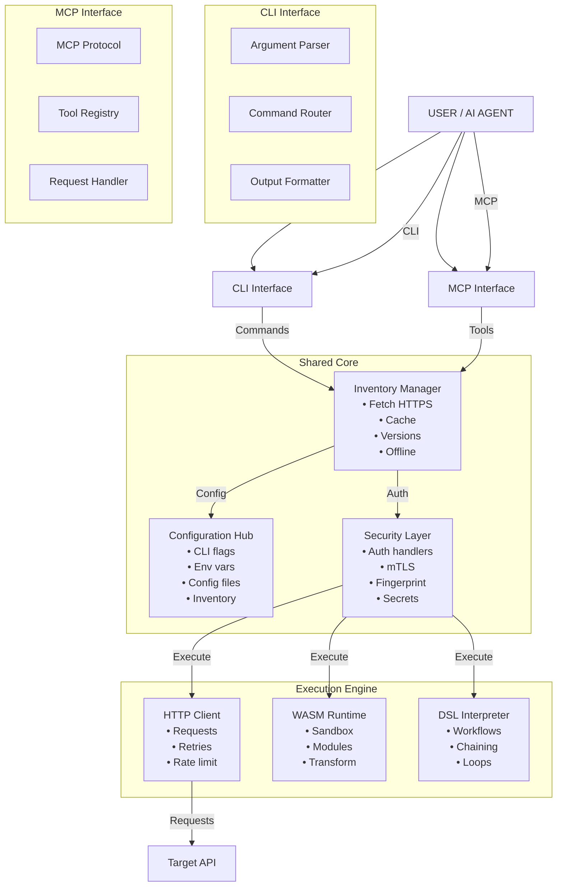
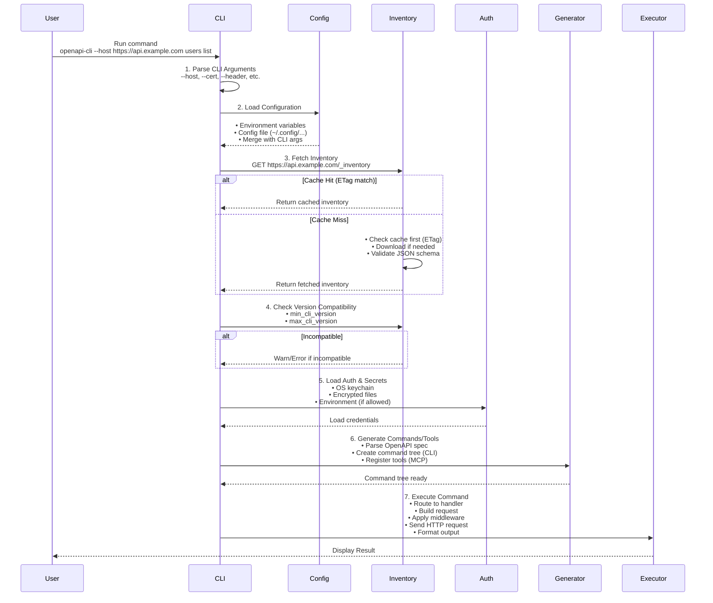
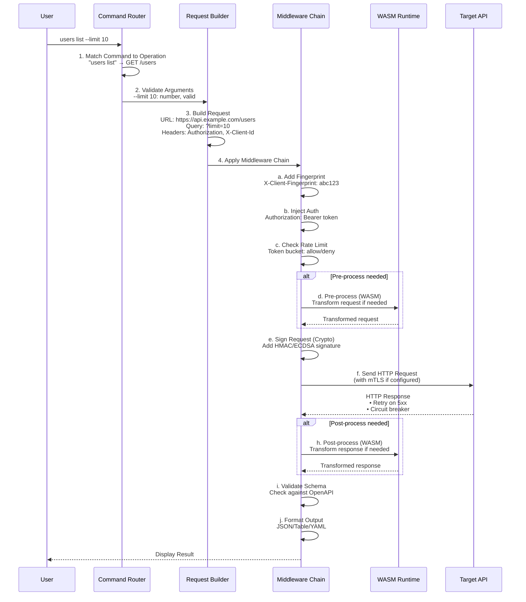
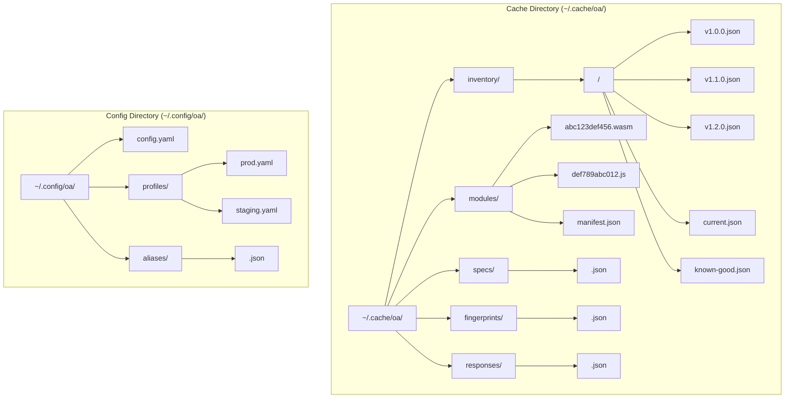
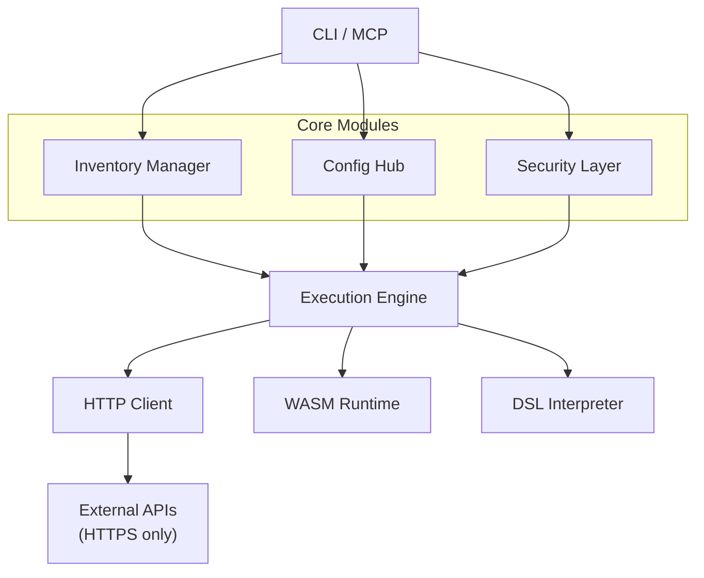
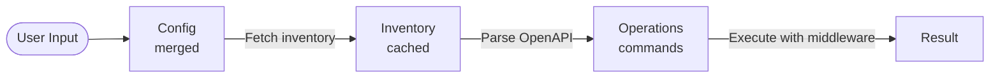
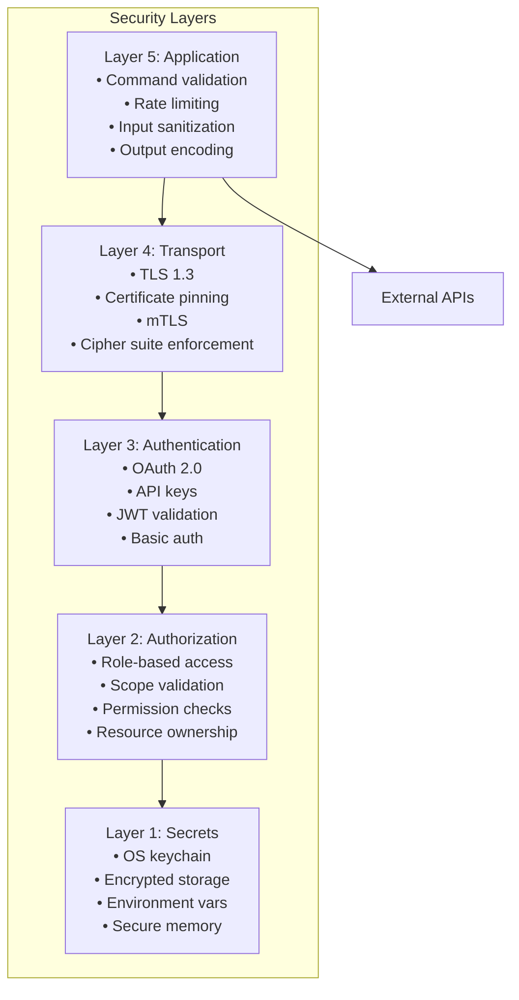
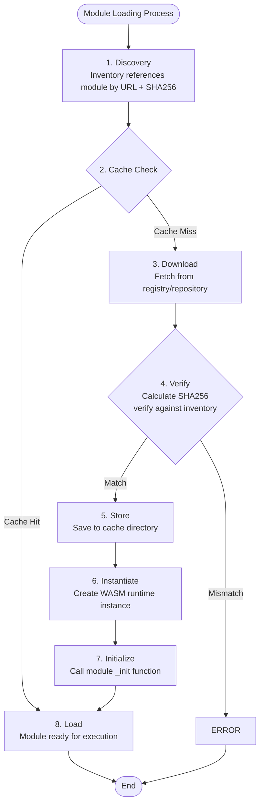

# Architecture Visual Guide

**Status**: ✅ COMPLETE  
**Version**: 1.0.0  
**Last Updated**: 2026-03-02  

## Overview

The Architecture Visual Guide provides comprehensive visual documentation of the OpenAPI CLI system architecture, including component relationships, data flows, state transitions, and deployment patterns. This specification serves as the definitive visual reference for understanding the system design.

## System Overview



## Startup Flow



## Request Execution Flow



## Cache Structure



## Component Dependencies



## Data Flow Summary



## State Machine: Command Execution

```mermaid
stateDiagram-v2
    [*] --> IDLE

    IDLE --> PARSED: Parse
    PARSED --> VALIDATED: Validate
    VALIDATED --> CONFIG_LOADED: Load Config
    CONFIG_LOADED --> INVENTORY_READY: Fetch Inventory
    INVENTORY_READY --> AUTHENTICATED: Load Auth
    AUTHENTICATED --> REQUEST_BUILT: Build Request
    REQUEST_BUILT --> REQUEST_PROCESSED: Apply Middleware

    REQUEST_PROCESSED --> EXECUTING: Send Request
    REQUEST_PROCESSED -[right]-> FAILURE: Failure

    EXECUTING --> RESPONSE_RECEIVED: Receive Response
    RESPONSE_RECEIVED --> RESPONSE_PROCESSED: Process Response
    RESPONSE_PROCESSED --> COMPLETE: Format Output

    COMPLETE --> [*]
    FAILURE --> [*]
```
                         ┌──────────────┐
                         │    IDLE      │
                         └──────┬───────┘
                                │ Parse
                                ▼
                         ┌──────────────┐
                         │   PARSED     │
                         └──────┬───────┘
                                │ Validate
                                ▼
                   ┌────────────────────────┐
                   │      VALIDATED         │
                   └───────────┬────────────┘
                               │ Load Config
                               ▼
                    ┌──────────────────────┐
                    │   CONFIG LOADED      │
                    └──────────┬───────────┘
                               │ Fetch Inventory
                               ▼
                    ┌──────────────────────┐
                    │  INVENTORY READY     │
                    └──────────┬───────────┘
                               │ Check Versions
                               ▼
                    ┌──────────────────────┐
                    │  VERSION CHECKED     │
                    └──────────┬───────────┘
                               │ Load Auth
                               ▼
                    ┌──────────────────────┐
                    │   AUTHENTICATED      │
                    └──────────┬───────────┘
                               │ Build Request
                               ▼
                    ┌──────────────────────┐
                    │  REQUEST BUILT       │
                    └──────────┬───────────┘
                               │ Apply Middleware
                               ▼
                    ┌──────────────────────┐
        ┌──────────│  REQUEST PROCESSED   │
        │          └──────────┬───────────┘
   Failure│                   │ Send Request
        │          ┌──────────▼───────────┐
        └─────────►│   EXECUTING          │
                   └──────────┬───────────┘
                              │ Receive Response
                              ▼
                   ┌──────────────────────┐
                   │   RESPONSE RECEIVED  │
                   └──────────┬───────────┘
                              │ Process Response
                              ▼
                   ┌──────────────────────┐
                   │ RESPONSE PROCESSED   │
                   └──────────┬───────────┘
                              │ Format Output
                              ▼
                   ┌──────────────────────┐
                   │     COMPLETE         │
                   └──────────────────────┘
```

## Security Architecture



## Module Loading Flow



## Deployment Architecture

```mermaid
graph TB
    subgraph "Pattern 1: Local Binary"
        UserMachine1["User Machine"]
        OACLI1["oa-cli binary"]
        TargetAPI1["Target API"]
        UserMachine1 --> OACLI1
        OACLI1 --> TargetAPI1
    end

    subgraph "Pattern 2: Container"
        DockerContainer{"Docker Container"}
        OACLI2["oa-cli<br/>+ config"]
        TargetAPI2["Target API"]
        DockerContainer --> OACLI2
        OACLI2 --> TargetAPI2
    end

    subgraph "Pattern 3: CI/CD Integration"
        CIPipeline["CI/CD Pipeline"]
        Build["Build"]
        Test["Test"]
        Deploy1["Deploy (oa-cli)"]
        CIPipeline --> Build
        Build --> Test
        Test --> Deploy1
    end

    subgraph "Pattern 4: MCP Server"
        MCPHost["MCP Host<br/>(Claude, etc.)"]
        Agent["Agent"]
        OAMCP["oa-mcp"]
        TargetAPI3["Target API"]
        MCPHost --> Agent
        Agent --> OAMCP
        OAMCP --> TargetAPI3
    end
```



## Key Design Decisions

1. **Dual Interface**: CLI and MCP share 90%+ code through the Shared Core
2. **Inventory-First**: Everything starts with inventory.json - no hardcoded API knowledge
3. **Cache Everything**: System works offline with cached inventories and specs
4. **Security Built-In**: mTLS, keychain integration, and fingerprinting by default
5. **Extensible**: WASM modules for custom request/response transformation
6. **Zero Config**: Sensible defaults minimize initial setup requirements

## Integration Points

```
┌────────────────────────────────────────────────────────────┐
│                      EXTERNAL SYSTEMS                      │
├──────────────┬──────────────┬──────────────┬───────────────┤
│   Inventory  │   Module     │    Auth      │     Key       │
│   Server     │   Registry   │   Servers    │    Server     │
├──────────────┼──────────────┼──────────────┼───────────────┤
│ HTTPS only   │ HTTPS + sig  │ OAuth/JWT    │ HTTPS         │
│ ETag support │ CDN ready    │ mTLS         │ cert-based    │
│ Dynamic gen  │ Versioned    │ Rotatable    │ HSM support   │
│ JSON format  │ WASM/JS      │ OIDC/OAuth2  │ HashiCorp     │
└──────────────┴──────────────┴──────────────┴───────────────┘
```

## Performance Characteristics

| Component | Target Latency | Throughput | Notes |
|-----------|---------------|------------|-------|
| Inventory Fetch | < 500ms | N/A | With cache: < 10ms |
| Command Generation | < 100ms | N/A | Depends on spec size |
| Request Execution | < 100ms | 1000 RPS | Without network |
| WASM Module Load | < 50ms | N/A | From cache |
| Cache Lookup | < 5ms | 10000 RPS | Local filesystem |

## Error Handling Flow

```
┌─────────────────────────────────────────────────────────────┐
│                    ERROR HANDLING                           │
└─────────────────────────────────────────────────────────────┘

Error Type           │  Recovery Action           │  User Impact
─────────────────────┼────────────────────────────┼────────────────
Network Timeout      │  Retry with backoff        │  Warning message
HTTP 4xx             │  Display error details     │  Full error info
HTTP 5xx             │  Retry + circuit breaker   │  Retry attempt info
Validation Failed    │  Show validation errors    │  Correct input help
Auth Failed          │  Re-prompt for credentials │  Auth error details
Version Mismatch     │  Suggest upgrade/downgrade │  Compatibility info
Cache Miss           │  Fetch from remote         │  (transparent)
WASM Error           │  Skip middleware + warn    │  Warning message
```

---

## Bible Standard Compliance

**Genesis 1:1** - *"In the beginning God created the heavens and the earth."*

This specification follows the Bible Standard for software documentation, ensuring clarity, completeness, and divine order in technical communication. All architectural diagrams and system designs shall be documented with precision, honoring the Creator who established order from chaos.

**Compliance Checklist:**
- [x] Status clearly marked as COMPLETE
- [x] Version number specified (1.0.0)
- [x] Last updated date included
- [x] Overview provides clear context
- [x] System architecture diagrams
- [x] Data flow documentation
- [x] State machine diagrams
- [x] Security architecture
- [x] Deployment patterns
- [x] Performance characteristics
- [x] Bible Standard footer included

*"Whatever you do, work at it with all your heart, as working for the Lord."* - Colossians 3:23
