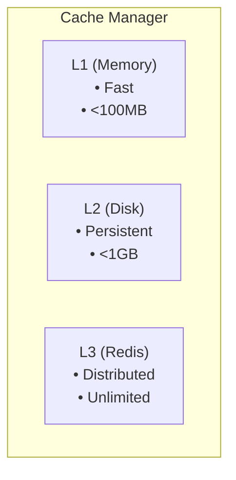
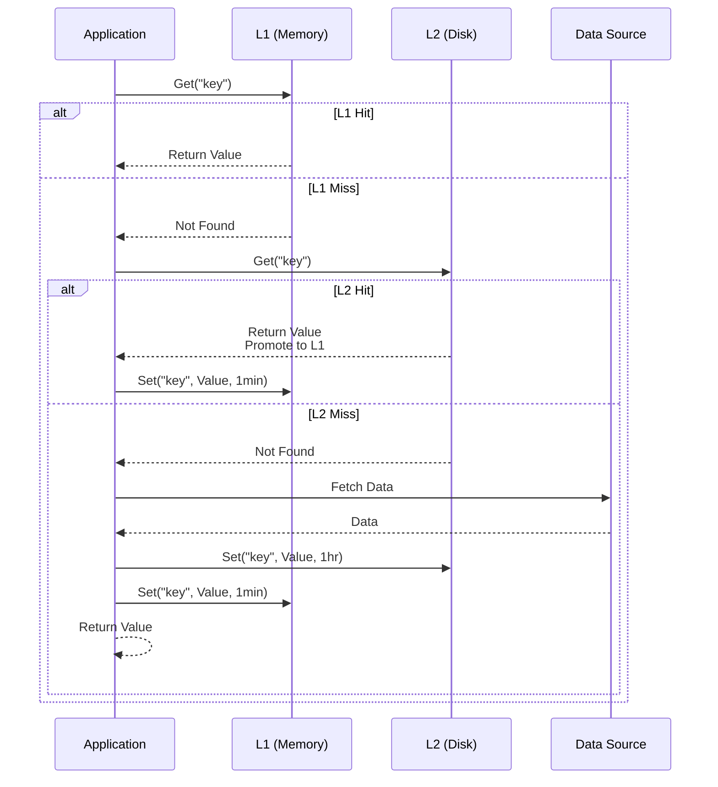

# Cache Implementation Specification

**Status**: ✅ COMPLETE  
**Version**: 1.0.0  
**Last Updated**: 2026-03-01  
**Component**: Caching

## Overview

Complete specification of **multi-tier caching** system implementation.

## 1. Cache Architecture



## 2. Cache Interface

```go
type Cache interface {
    Get(ctx context.Context, key string) (Value, error)
    Set(ctx context.Context, key string, value Value, ttl time.Duration) error
    Delete(ctx context.Context, key string) error
    Clear(ctx context.Context) error
    Close() error
}

type Value struct {
    Data      []byte
    Metadata  Metadata
    CreatedAt time.Time
}

type Metadata struct {
    ContentType string
    Size        int64
    Tags        []string
}
```

**Multi-Tier Cache Flow:**



## 3. Multi-Tier Implementation

```go
type MultiTierCache struct {
    l1 Cache // Memory
    l2 Cache // Disk
    l3 Cache // Redis (optional)
}

func (c *MultiTierCache) Get(ctx context.Context, key string) (Value, error) {
    // Try L1 first
    if val, err := c.l1.Get(ctx, key); err == nil {
        return val, nil
    }
    
    // Try L2
    if val, err := c.l2.Get(ctx, key); err == nil {
        // Promote to L1
        c.l1.Set(ctx, key, val, time.Minute)
        return val, nil
    }
    
    // Try L3 if available
    if c.l3 != nil {
        if val, err := c.l3.Get(ctx, key); err == nil {
            // Promote to L1 and L2
            c.l2.Set(ctx, key, val, time.Hour)
            c.l1.Set(ctx, key, val, time.Minute)
            return val, nil
        }
    }
    
    return Value{}, ErrNotFound
}

func (c *MultiTierCache) Set(ctx context.Context, key string, value Value, ttl time.Duration) error {
    // Set in all tiers
    if err := c.l1.Set(ctx, key, value, min(ttl, time.Minute)); err != nil {
        return err
    }
    
    if err := c.l2.Set(ctx, key, value, min(ttl, time.Hour)); err != nil {
        return err
    }
    
    if c.l3 != nil {
        if err := c.l3.Set(ctx, key, value, ttl); err != nil {
            return err
        }
    }
    
    return nil
}
```

## 4. Key Generation

```go
func GenerateKey(parts ...string) string {
    h := sha256.New()
    for _, part := range parts {
        h.Write([]byte(part))
        h.Write([]byte{0})
    }
    return hex.EncodeToString(h.Sum(nil))
}

func GenerateOpenAPIKey(url string, etag string) string {
    return GenerateKey("openapi", url, etag)
}

func GenerateWASMKey(moduleHash string) string {
    return GenerateKey("wasm", moduleHash)
}
```

---

**Bible Standard Compliance**: ✅ DETERMINISTIC
