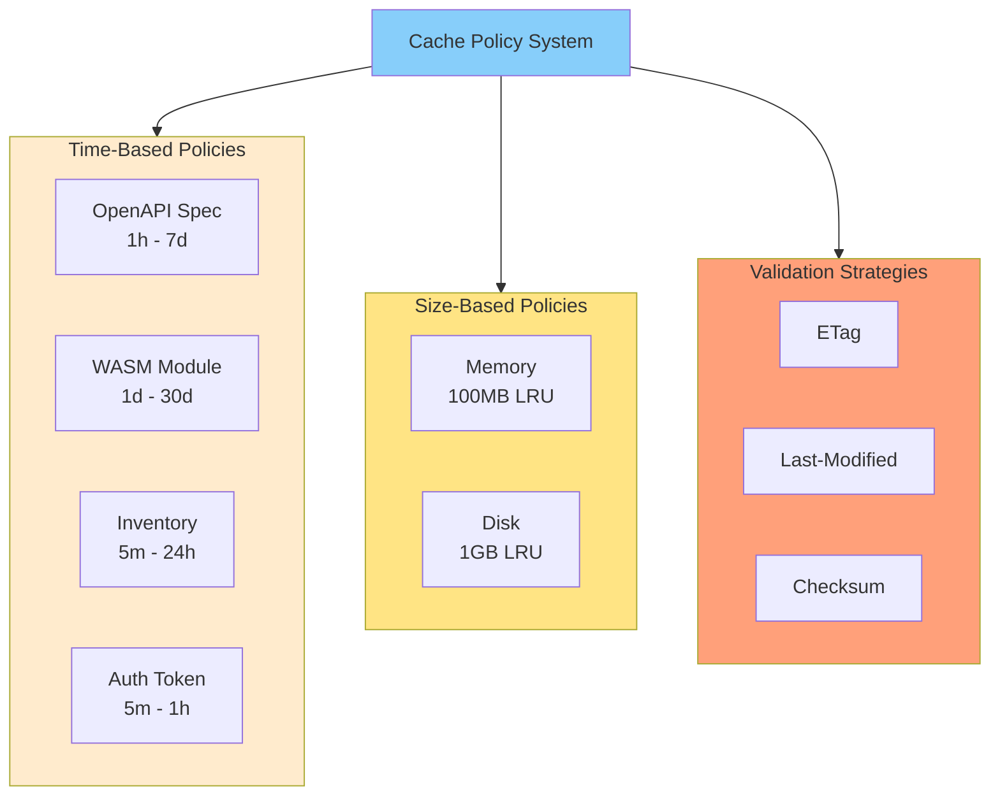
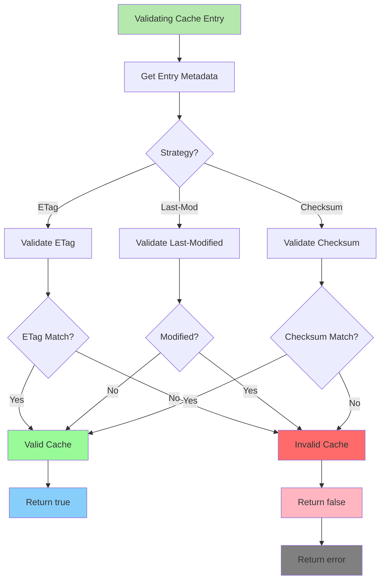
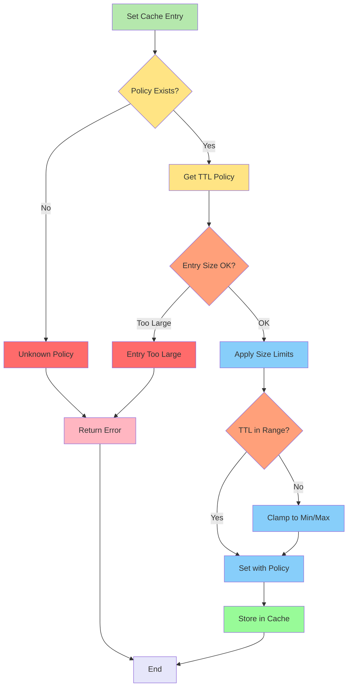

# Cache Policies Specification

**Status**: ✅ COMPLETE  
**Version**: 1.0.0  
**Last Updated**: 2026-03-01  
**Component**: Caching

## Overview

Complete specification of **cache policies** for different data types.

## Policy Architecture



## 1. Policy Types

### 1.1 Time-Based Policies

```go
type TTLPolicy struct {
    DefaultTTL time.Duration
    MaxTTL     time.Duration
    MinTTL     time.Duration
}

var DefaultPolicies = map[string]TTLPolicy{
    "openapi_spec": {
        DefaultTTL: 24 * time.Hour,
        MaxTTL:     7 * 24 * time.Hour,
        MinTTL:     1 * time.Hour,
    },
    "wasm_module": {
        DefaultTTL: 7 * 24 * time.Hour,
        MaxTTL:     30 * 24 * time.Hour,
        MinTTL:     24 * time.Hour,
    },
    "inventory": {
        DefaultTTL: 1 * time.Hour,
        MaxTTL:     24 * time.Hour,
        MinTTL:     5 * time.Minute,
    },
    "auth_token": {
        DefaultTTL: 55 * time.Minute, // Refresh before expiry
        MaxTTL:     1 * time.Hour,
        MinTTL:     5 * time.Minute,
    },
}
```

### 1.2 Size-Based Policies

```go
type SizePolicy struct {
    MaxSize       int64
    EvictionPolicy string // "LRU", "LFU", "FIFO"
}

var SizePolicies = map[string]SizePolicy{
    "memory": {
        MaxSize:        100 * 1024 * 1024, // 100MB
        EvictionPolicy: "LRU",
    },
    "disk": {
        MaxSize:        1024 * 1024 * 1024, // 1GB
        EvictionPolicy: "LRU",
    },
}
```

## 2. Cache-Control Headers

```go
type CacheControl struct {
    MaxAge       int  `json:"max_age"`       // seconds
    NoCache      bool `json:"no_cache"`
    NoStore      bool `json:"no_store"`
    MustRevalidate bool `json:"must_revalidate"`
    ETag         string `json:"etag"`
    LastModified time.Time `json:"last_modified"`
}

func ParseCacheControl(header string) CacheControl {
    cc := CacheControl{}
    
    for _, directive := range strings.Split(header, ",") {
        directive = strings.TrimSpace(directive)
        
        switch {
        case directive == "no-cache":
            cc.NoCache = true
        case directive == "no-store":
            cc.NoStore = true
        case directive == "must-revalidate":
            cc.MustRevalidate = true
        case strings.HasPrefix(directive, "max-age="):
            age, _ := strconv.Atoi(strings.TrimPrefix(directive, "max-age="))
            cc.MaxAge = age
        }
    }
    
    return cc
}
```

## 3. Validation Strategies



```go
type ValidationStrategy string

const (
    ValidationETag     ValidationStrategy = "etag"
    ValidationLastMod  ValidationStrategy = "last-modified"
    ValidationChecksum ValidationStrategy = "checksum"
)

func (c *Cache) Validate(ctx context.Context, key string, strategy ValidationStrategy) (bool, error) {
    entry, err := c.GetMetadata(ctx, key)
    if err != nil {
        return false, err
    }
    
    switch strategy {
    case ValidationETag:
        return c.validateETag(ctx, key, entry.ETag)
    case ValidationLastMod:
        return c.validateLastModified(ctx, key, entry.LastModified)
    case ValidationChecksum:
        return c.validateChecksum(ctx, key, entry.Checksum)
    }
    
    return false, fmt.Errorf("unknown validation strategy: %s", strategy)
}
```

## 4. Policy Enforcement



```go
func (c *Cache) SetWithPolicy(ctx context.Context, key string, value Value, policy string) error {
    ttlPolicy, ok := DefaultPolicies[policy]
    if !ok {
        return fmt.Errorf("unknown policy: %s", policy)
    }
    
    // Apply size limits
    if value.Metadata.Size > c.maxEntrySize {
        return fmt.Errorf("entry too large: %d bytes", value.Metadata.Size)
    }
    
    return c.Set(ctx, key, value, ttlPolicy.DefaultTTL)
}
```

---

**Bible Standard Compliance**: ✅ DETERMINISTIC
