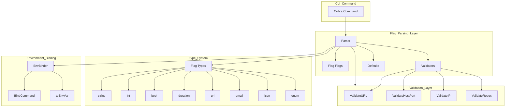
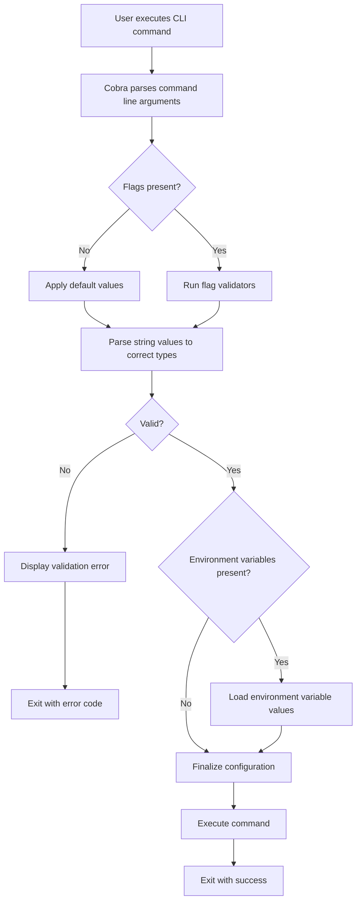

# CLI Flag Parsing Specification

**Status**: ✅ COMPLETE  
**Date**: 2026-02-28  
**Purpose**: Comprehensive flag parsing, validation, and binding system  
**Language**: Go 1.21+ with Cobra  

---

## Overview

Flag parsing system handles command-line argument parsing, type conversion, validation, defaults, and environment variable binding for all CLI commands.

## Architecture



## Parsing Workflow



---

## Argument Parsing

### Parser Core

```go
// internal/cli/flags/parser.go
package flags

import (
	"fmt"
	"strconv"
	"strings"
	"time"

	"github.com/spf13/cobra"
	"github.com/spf13/pflag"
)

// Parser handles flag parsing with validation
type Parser struct {
	validators map[string]Validator
	defaults   map[string]interface{}
}

// Validator is a function that validates a flag value
type Validator func(value interface{}) error

// NewParser creates a new flag parser
func NewParser() *Parser {
	return &Parser{
		validators: make(map[string]Validator),
		defaults:   make(map[string]interface{}),
	}
}

// RegisterValidator adds a validator for a flag
func (p *Parser) RegisterValidator(name string, validator Validator) {
	p.validators[name] = validator
}

// RegisterDefault sets a default value for a flag
func (p *Parser) RegisterDefault(name string, value interface{}) {
	p.defaults[name] = value
}

// Parse validates and parses all flags
func (p *Parser) Parse(cmd *cobra.Command) error {
	var errors []string

	// Check required flags
	cmd.Flags().VisitAll(func(flag *pflag.Flag) {
		if err := p.validateFlag(cmd, flag); err != nil {
			errors = append(errors, fmt.Sprintf("--%s: %v", flag.Name, err))
		}
	})

	if len(errors) > 0 {
		return fmt.Errorf("validation failed:\n  - %s", strings.Join(errors, "\n  - "))
	}

	return nil
}

func (p *Parser) validateFlag(cmd *cobra.Command, flag *pflag.Flag) error {
	// Check if flag was set
	if !flag.Changed {
		return nil
	}

	// Get value based on type
	var value interface{}
	var err error

	switch flag.Value.Type() {
	case "string":
		value, err = cmd.Flags().GetString(flag.Name)
	case "int":
		value, err = cmd.Flags().GetInt(flag.Name)
	case "int64":
		value, err = cmd.Flags().GetInt64(flag.Name)
	case "bool":
		value, err = cmd.Flags().GetBool(flag.Name)
	case "stringSlice":
		value, err = cmd.Flags().GetStringSlice(flag.Name)
	case "duration":
		value, err = cmd.Flags().GetDuration(flag.Name)
	default:
		value = flag.Value.String()
	}

	if err != nil {
		return err
	}

	// Run custom validator
	if validator, ok := p.validators[flag.Name]; ok {
		if err := validator(value); err != nil {
			return err
		}
	}

	return nil
}
```

### Flag Types

```go
// internal/cli/flags/types.go
package flags

import (
	"fmt"
	"net/url"
	"regexp"
	"strconv"
	"time"

	"github.com/spf13/cobra"
	"github.com/spf13/pflag"
)

// FlagType represents supported flag types
type FlagType int

const (
	TypeString FlagType = iota
	TypeInt
	TypeInt64
	TypeBool
	TypeStringSlice
	TypeDuration
	TypeURL
	TypeEmail
	TypeJSON
	TypeEnum
)

// FlagDefinition defines a flag with type and validation
type FlagDefinition struct {
	Name         string
	Shorthand    string
	Type         FlagType
	Default      interface{}
	Description  string
	Required     bool
	EnumValues   []string
	ValidateFunc func(interface{}) error
}

// AddTypedFlag adds a flag with type information
func AddTypedFlag(cmd *cobra.Command, def FlagDefinition) error {
	switch def.Type {
	case TypeString:
		defaultVal := ""
		if def.Default != nil {
			defaultVal = def.Default.(string)
		}
		cmd.Flags().StringP(def.Name, def.Shorthand, defaultVal, def.Description)

	case TypeInt:
		defaultVal := 0
		if def.Default != nil {
			defaultVal = def.Default.(int)
		}
		cmd.Flags().IntP(def.Name, def.Shorthand, defaultVal, def.Description)

	case TypeInt64:
		defaultVal := int64(0)
		if def.Default != nil {
			defaultVal = def.Default.(int64)
		}
		cmd.Flags().Int64P(def.Name, def.Shorthand, defaultVal, def.Description)

	case TypeBool:
		defaultVal := false
		if def.Default != nil {
			defaultVal = def.Default.(bool)
		}
		cmd.Flags().BoolP(def.Name, def.Shorthand, defaultVal, def.Description)

	case TypeStringSlice:
		var defaultVal []string
		if def.Default != nil {
			defaultVal = def.Default.([]string)
		}
		cmd.Flags().StringSliceP(def.Name, def.Shorthand, defaultVal, def.Description)

	case TypeDuration:
		defaultVal := time.Duration(0)
		if def.Default != nil {
			defaultVal = def.Default.(time.Duration)
		}
		cmd.Flags().DurationP(def.Name, def.Shorthand, defaultVal, def.Description)

	case TypeURL:
		cmd.Flags().StringP(def.Name, def.Shorthand, "", def.Description)

	case TypeEmail:
		cmd.Flags().StringP(def.Name, def.Shorthand, "", def.Description)

	case TypeJSON:
		cmd.Flags().StringP(def.Name, def.Shorthand, "", def.Description)

	case TypeEnum:
		cmd.Flags().StringP(def.Name, def.Shorthand, "", def.Description)
	}

	if def.Required {
		cmd.MarkFlagRequired(def.Name)
	}

	return nil
}

// ParseValue parses a string value to the correct type
func ParseValue(value string, flagType FlagType) (interface{}, error) {
	switch flagType {
	case TypeString:
		return value, nil

	case TypeInt:
		return strconv.Atoi(value)

	case TypeInt64:
		return strconv.ParseInt(value, 10, 64)

	case TypeBool:
		return strconv.ParseBool(value)

	case TypeStringSlice:
		return strings.Split(value, ","), nil

	case TypeDuration:
		return time.ParseDuration(value)

	case TypeURL:
		return url.Parse(value)

	case TypeEmail:
		emailRegex := regexp.MustCompile(`^[a-zA-Z0-9._%+-]+@[a-zA-Z0-9.-]+\.[a-zA-Z]{2,}$`)
		if !emailRegex.MatchString(value) {
			return nil, fmt.Errorf("invalid email format")
		}
		return value, nil

	case TypeJSON:
		// Validate JSON
		var result interface{}
		if err := json.Unmarshal([]byte(value), &result); err != nil {
			return nil, fmt.Errorf("invalid JSON: %w", err)
		}
		return value, nil

	default:
		return value, nil
	}
}
```

### Validation

```go
// internal/cli/flags/validation.go
package flags

import (
	"fmt"
	"net"
	"net/url"
	"regexp"
	"strconv"
	"strings"
)

// Common validators

// ValidateURL checks if value is a valid URL
func ValidateURL(value interface{}) error {
	str, ok := value.(string)
	if !ok {
		return fmt.Errorf("expected string, got %T", value)
	}

	u, err := url.Parse(str)
	if err != nil {
		return fmt.Errorf("invalid URL: %w", err)
	}

	if u.Scheme == "" || u.Host == "" {
		return fmt.Errorf("URL must have scheme and host")
	}

	return nil
}

// ValidateHostPort checks if value is a valid host:port
func ValidateHostPort(value interface{}) error {
	str, ok := value.(string)
	if !ok {
		return fmt.Errorf("expected string, got %T", value)
	}

	parts := strings.Split(str, ":")
	if len(parts) != 2 {
		return fmt.Errorf("expected format host:port")
	}

	if parts[0] == "" {
		return fmt.Errorf("host cannot be empty")
	}

	port, err := strconv.Atoi(parts[1])
	if err != nil {
		return fmt.Errorf("invalid port: %w", err)
	}

	if port < 1 || port > 65535 {
		return fmt.Errorf("port must be between 1 and 65535")
	}

	return nil
}

// ValidateIP checks if value is a valid IP address
func ValidateIP(value interface{}) error {
	str, ok := value.(string)
	if !ok {
		return fmt.Errorf("expected string, got %T", value)
	}

	if net.ParseIP(str) == nil {
		return fmt.Errorf("invalid IP address")
	}

	return nil
}

// ValidateRegex creates a validator for regex pattern matching
func ValidateRegex(pattern string) Validator {
	re := regexp.MustCompile(pattern)
	return func(value interface{}) error {
		str, ok := value.(string)
		if !ok {
			return fmt.Errorf("expected string, got %T", value)
		}
		if !re.MatchString(str) {
			return fmt.Errorf("value does not match pattern: %s", pattern)
		}
		return nil
	}
}

// ValidateRange creates a numeric range validator
func ValidateRange(min, max int) Validator {
	return func(value interface{}) error {
		var num int
		switch v := value.(type) {
		case int:
			num = v
		case int64:
			num = int(v)
		case string:
			var err error
			num, err = strconv.Atoi(v)
			if err != nil {
				return fmt.Errorf("expected numeric value")
			}
		default:
			return fmt.Errorf("expected numeric value, got %T", value)
		}

		if num < min || num > max {
			return fmt.Errorf("value must be between %d and %d", min, max)
		}
		return nil
	}
}

// ValidateOneOf creates an enum validator
func ValidateOneOf(values ...string) Validator {
	return func(value interface{}) error {
		str, ok := value.(string)
		if !ok {
			return fmt.Errorf("expected string, got %T", value)
		}

		for _, v := range values {
			if str == v {
				return nil
			}
		}

		return fmt.Errorf("value must be one of: %s", strings.Join(values, ", "))
	}
}

// ValidateNotEmpty checks if string is not empty
func ValidateNotEmpty(value interface{}) error {
	str, ok := value.(string)
	if !ok {
		return fmt.Errorf("expected string, got %T", value)
	}

	if strings.TrimSpace(str) == "" {
		return fmt.Errorf("value cannot be empty")
	}

	return nil
}
```

### Defaults

```go
// internal/cli/flags/defaults.go
package flags

import (
	"fmt"
	"os"
	"path/filepath"
	"runtime"
	"time"

	"github.com/spf13/cobra"
	"github.com/spf13/viper"
)

// DefaultProvider manages default values
type DefaultProvider struct {
	defaults map[string]interface{}
}

// NewDefaultProvider creates a new default provider
func NewDefaultProvider() *DefaultProvider {
	return &DefaultProvider{
		defaults: make(map[string]interface{}),
	}
}

// SetDefault sets a default value
func (dp *DefaultProvider) SetDefault(key string, value interface{}) {
	dp.defaults[key] = value
}

// GetDefault retrieves a default value
func (dp *DefaultProvider) GetDefault(key string) (interface{}, bool) {
	val, ok := dp.defaults[key]
	return val, ok
}

// ApplyDefaults applies all defaults to viper
func (dp *DefaultProvider) ApplyDefaults() {
	for key, value := range dp.defaults {
		viper.SetDefault(key, value)
	}
}

// CommonDefaults returns standard CLI defaults
func CommonDefaults() map[string]interface{} {
	return map[string]interface{}{
		"host":             "localhost:8080",
		"timeout":          "30s",
		"max_retries":      3,
		"log_level":        "info",
		"log_format":       "console",
		"config_file":      defaultConfigPath(),
		"output_format":    "table",
		"color":            true,
		"cache_dir":        defaultCacheDir(),
		"request_timeout":  30 * time.Second,
	}
}

func defaultConfigPath() string {
	home, err := os.UserHomeDir()
	if err != nil {
		return ".muster/config.yaml"
	}
	return filepath.Join(home, ".muster", "config.yaml")
}

func defaultCacheDir() string {
	home, err := os.UserHomeDir()
	if err != nil {
		return ".muster/cache"
	}
	return filepath.Join(home, ".muster", "cache")
}

// ApplyFlagDefaults applies defaults to command flags
func ApplyFlagDefaults(cmd *cobra.Command, defaults map[string]interface{}) {
	cmd.Flags().VisitAll(func(flag *pflag.Flag) {
		if def, ok := defaults[flag.Name]; ok {
			flag.DefValue = fmt.Sprintf("%v", def)
		}
	})
}
```

### Environment Variable Binding

```go
// internal/cli/flags/env.go
package flags

import (
	"strings"

	"github.com/spf13/cobra"
	"github.com/spf13/viper"
)

// EnvBinder manages environment variable binding
type EnvBinder struct {
	prefix string
}

// NewEnvBinder creates a new environment binder
func NewEnvBinder(prefix string) *EnvBinder {
	return &EnvBinder{prefix: prefix}
}

// BindCommand binds all flags to environment variables
func (eb *EnvBinder) BindCommand(cmd *cobra.Command) error {
	viper.SetEnvPrefix(eb.prefix)
	viper.SetEnvKeyReplacer(strings.NewReplacer("-", "_", ".", "_"))
	viper.AutomaticEnv()

	return eb.bindFlags(cmd)
}

func (eb *EnvBinder) bindFlags(cmd *cobra.Command) error {
	return cmd.Flags().VisitAll(func(flag *pflag.Flag) {
		envVar := eb.toEnvVar(flag.Name)

		// Bind to viper
		if err := viper.BindPFlag(flag.Name, flag); err != nil {
			return
		}

		// Set env var name in flag usage
		if flag.Usage != "" {
			flag.Usage = fmt.Sprintf("%s [env: %s]", flag.Usage, envVar)
		}
	})
}

func (eb *EnvBinder) toEnvVar(flagName string) string {
	// Convert flag name to env var format
	// e.g., "api-key" -> "MUSTER_API_KEY"
	replacer := strings.NewReplacer("-", "_", ".", "_")
	name := replacer.Replace(flagName)
	name = strings.ToUpper(name)
	return fmt.Sprintf("%s_%s", eb.prefix, name)
}

// GetEnvValue retrieves value from environment
func (eb *EnvBinder) GetEnvValue(flagName string) (string, bool) {
	envVar := eb.toEnvVar(flagName)
	val := viper.GetString(envVar)
	return val, val != ""
}

// BindNested binds nested configuration values
func (eb *EnvBinder) BindNested(cmd *cobra.Command, parent string) error {
	return cmd.Flags().VisitAll(func(flag *pflag.Flag) {
		key := fmt.Sprintf("%s.%s", parent, flag.Name)
		viper.BindPFlag(key, flag)
	})
}
```

---

## Usage Example

```go
// Create parser
parser := flags.NewParser()

// Register validators
parser.RegisterValidator("host", flags.ValidateHostPort)
parser.RegisterValidator("log-level", flags.ValidateOneOf("debug", "info", "warn", "error"))

// Define flags
cmd.Flags().StringP("host", "H", "localhost:8080", "Server host")
cmd.Flags().String("log-level", "info", "Log level")
cmd.Flags().Int("max-retries", 3, "Max retries")

// Bind environment
envBinder := flags.NewEnvBinder("MUSTER")
envBinder.BindCommand(cmd)

// Parse and validate
if err := parser.Parse(cmd); err != nil {
    return err
}
```
