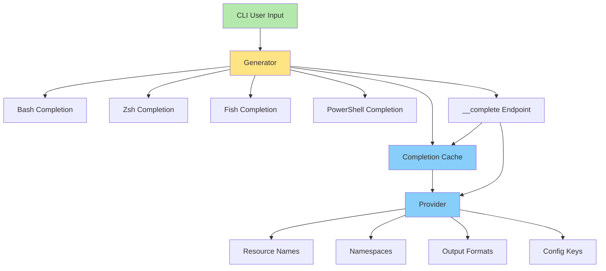
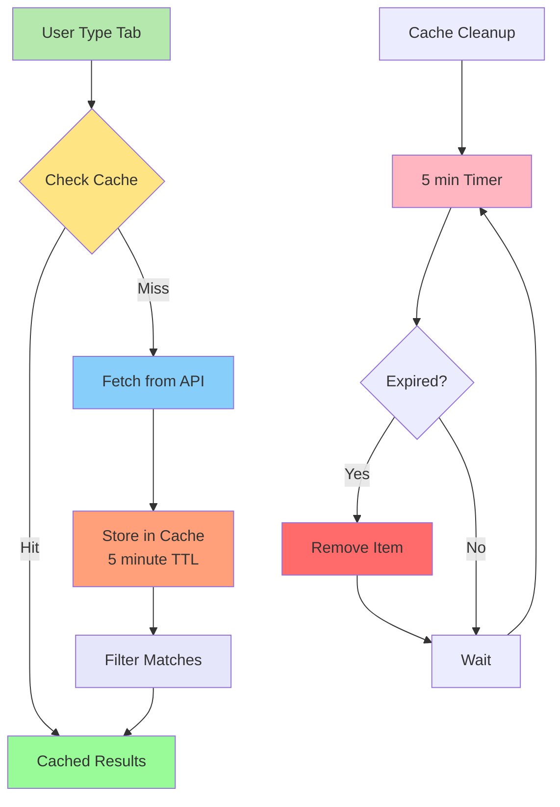

# CLI Shell Completion Specification

## Overview

Shell completion provides intelligent command-line suggestions for bash, zsh, fish, and PowerShell shells.

## Architecture



## Completion Script Generation

```go
package completion

import (
	"fmt"
	"os"

	"github.com/spf13/cobra"
)

// Generator creates shell completion scripts
type Generator struct {
	rootCmd *cobra.Command
}

// NewGenerator creates a new completion generator
func NewGenerator(rootCmd *cobra.Command) *Generator {
	return &Generator{rootCmd: rootCmd}
}

// GenerateBash creates bash completion script
func (g *Generator) GenerateBash() string {
	var buf strings.Builder
	
	buf.WriteString(`#!/bin/bash
# Bash completion script for muster CLI
# Source this file: source <(muster completion bash)

_muster_completion() {
    local cur prev opts
    COMPREPLY=()
    cur="${COMP_WORDS[COMP_CWORD]}"
    prev="${COMP_WORDS[COMP_CWORD-1]}"
    
    # Get completions from muster
    local completions
    completions=$(muster __complete "${COMP_WORDS[@]:1}")
    
    COMPREPLY=( $(compgen -W "${completions}" -- "${cur}") )
    return 0
}

complete -F _muster_completion muster
`)
	
	return buf.String()
}

// GenerateZsh creates zsh completion script
func (g *Generator) GenerateZsh() string {
	var buf strings.Builder
	
	buf.WriteString(`#compdef muster
# Zsh completion script for muster CLI
# Place in $fpath: muster completion zsh > "${fpath[1]}/_muster"

_muster() {
    local context state line
    typeset -A opt_args
    
    _arguments -C \
        '(-h --help)'{-h,--help}'[Show help]' \
        '(-v --verbose)'{-v,--verbose}'[Verbose output]' \
        '(-c --config)'{-c,--config}'[Config file]:config:_files' \
        '*::command:->command'
    
    case "$state" in
        command)
            local -a subcmds
            subcmds=(
                'version:Show version'
                'config:Manage configuration'
                'auth:Authentication'
                'inventory:Manage inventory'
                'daemon:Control daemon'
            )
            _describe -t commands 'muster command' subcmds
            ;;
    esac
}

compdef _muster muster
`)
	
	return buf.String()
}

// GenerateFish creates fish completion script
func (g *Generator) GenerateFish() string {
	var buf strings.Builder
	
	buf.WriteString(`# Fish completion script for muster CLI
# Source: muster completion fish | source

complete -c muster -f
complete -c muster -n '__fish_use_subcommand' -a 'version' -d 'Show version'
complete -c muster -n '__fish_use_subcommand' -a 'config' -d 'Manage configuration'
complete -c muster -n '__fish_use_subcommand' -a 'auth' -d 'Authentication'
complete -c muster -n '__fish_use_subcommand' -a 'inventory' -d 'Manage inventory'
complete -c muster -n '__fish_use_subcommand' -a 'daemon' -d 'Control daemon'

# Global flags
complete -c muster -s h -l help -d 'Show help'
complete -c muster -s v -l verbose -d 'Verbose output'
complete -c muster -s c -l config -r -d 'Config file'

# Config subcommands
complete -c muster -n '__fish_seen_subcommand_from config' -a 'get' -d 'Get value'
complete -c muster -n '__fish_seen_subcommand_from config' -a 'set' -d 'Set value'
complete -c muster -n '__fish_seen_subcommand_from config' -a 'list' -d 'List config'
`)
	
	return buf.String()
}

// GeneratePowerShell creates PowerShell completion script
func (g *Generator) GeneratePowerShell() string {
	var buf strings.Builder
	
	buf.WriteString(`# PowerShell completion script for muster CLI
# Load: muster completion powershell | Out-String | Invoke-Expression

Register-ArgumentCompleter -Native -CommandName muster -ScriptBlock {
    param($wordToComplete, $commandAst, $cursorPosition)
    
    $commands = $commandAst.CommandElements | ForEach-Object { $_.ToString() }
    $completions = & muster __complete @commands
    
    $completions | ForEach-Object {
        [System.Management.Automation.CompletionResult]::new($_, $_, 'ParameterValue', $_)
    }
}
`)
	
	return buf.String()
}
```

## Dynamic Completion

```go
package completion

import (
	"context"
	"fmt"
	"strings"

	"github.com/spf13/cobra"
)

// Provider provides dynamic completions
type Provider struct {
	cache *Cache
}

// NewProvider creates a new completion provider
func NewProvider() *Provider {
	return &Provider{
		cache: NewCache(),
	}
}

// CompleteResources provides resource name completions
func (p *Provider) CompleteResources(ctx context.Context, resourceType, toComplete string) ([]string, cobra.ShellCompDirective) {
	cacheKey := fmt.Sprintf("resources:%s", resourceType)
	
	if cached, ok := p.cache.Get(cacheKey); ok {
		return p.filter(cached.([]string), toComplete), cobra.ShellCompDirectiveNoFileComp
	}
	
	names, err := fetchResourceNames(ctx, resourceType)
	if err != nil {
		return nil, cobra.ShellCompDirectiveError
	}
	
	p.cache.Set(cacheKey, names, 5*time.Minute)
	return p.filter(names, toComplete), cobra.ShellCompDirectiveNoFileComp
}

// CompleteNamespaces provides namespace completions
func (p *Provider) CompleteNamespaces(ctx context.Context, toComplete string) ([]string, cobra.ShellCompDirective) {
	namespaces := []string{"default", "production", "staging", "development"}
	return p.filter(namespaces, toComplete), cobra.ShellCompDirectiveNoFileComp
}

// CompleteOutputFormats provides output format completions
func (p *Provider) CompleteOutputFormats(toComplete string) ([]string, cobra.ShellCompDirective) {
	formats := []string{"table", "json", "yaml", "csv", "custom"}
	return p.filter(formats, toComplete), cobra.ShellCompDirectiveNoFileComp
}

// CompleteConfigKeys provides config key completions
func (p *Provider) CompleteConfigKeys(toComplete string) ([]string, cobra.ShellCompDirective) {
	keys := []string{
		"api.url", "api.timeout", "api.retries",
		"auth.token", "auth.method",
		"log.level", "log.format",
	}
	return p.filter(keys, toComplete), cobra.ShellCompDirectiveNoFileComp
}

func (p *Provider) filter(items []string, prefix string) []string {
	if prefix == "" {
		return items
	}
	
	var result []string
	lowerPrefix := strings.ToLower(prefix)
	
	for _, item := range items {
		if strings.HasPrefix(strings.ToLower(item), lowerPrefix) {
			result = append(result, item)
		}
	}
	
	return result
}

func fetchResourceNames(ctx context.Context, resourceType string) ([]string, error) {
	// Implementation would query the API or cache
	return []string{}, nil
}
```

## Completion Command

```mermaid
sequenceDiagram
    participant User
    participant Shell
    participant CLI
    participant Gen as Generator
    participant Prov as Provider
    participant Cache

    User->>Shell: openapi-cli <TAB>
    Shell->>CLI: __complete command
    CLI->>Gen: GenerateCompletion()
    Gen->>Cache: Check Cache
    alt Cache Hit
        Cache-->>Gen: Cached Value
    else Cache Miss
        Gen->>Prov: Request Completion
        Prov-->>Gen: Completion Results
        Gen->>Cache: Store in Cache
    end
    Gen-->>CLI: Completion List
    CLI-->>Shell: Completions
    Shell-->>User: Display Suggestions

    style User fill:#ffebcd
    style Shell fill:#98fb98
    style CLI fill:#ffe484
    style Gen fill:#87cefa
    style Prov fill:#ffa07a
    style Cache fill:#e6e6fa
```

```go
package cmd

import (
	"fmt"
	"os"

	"github.com/spf13/cobra"
)

func newCompletionCommand() *cobra.Command {
	cmd := &cobra.Command{
		Use:   "completion [bash|zsh|fish|powershell]",
		Short: "Generate shell completion script",
		Long: `Generate shell completion script for muster.

To load completions:

Bash:
  $ source <(muster completion bash)
  # Or permanently:
  $ muster completion bash > /etc/bash_completion.d/muster

Zsh:
  $ source <(muster completion zsh)
  # Or permanently:
  $ muster completion zsh > "${fpath[1]}/_muster"

Fish:
  $ muster completion fish | source
  # Or permanently:
  $ muster completion fish > ~/.config/fish/completions/muster.fish

PowerShell:
  PS> muster completion powershell | Out-String | Invoke-Expression
  # Or permanently, source from your profile`,
		DisableFlagsInUseLine: true,
		ValidArgs:             []string{"bash", "zsh", "fish", "powershell"},
		Args:                  cobra.ExactValidArgs(1),
		Run: func(cmd *cobra.Command, args []string) {
			shell := args[0]
			rootCmd := cmd.Root()
			
			switch shell {
			case "bash":
				rootCmd.GenBashCompletion(os.Stdout)
			case "zsh":
				rootCmd.GenZshCompletion(os.Stdout)
			case "fish":
				rootCmd.GenFishCompletion(os.Stdout, true)
			case "powershell":
				rootCmd.GenPowerShellCompletionWithDesc(os.Stdout)
			}
		},
	}

	return cmd
}
```

## Completion Cache



```go
package completion

import (
	"sync"
	"time"
)

// Cache provides caching for completions
type Cache struct {
	mu    sync.RWMutex
	items map[string]cacheItem
}

type cacheItem struct {
	value      interface{}
	expiration time.Time
}

// NewCache creates a new completion cache
func NewCache() *Cache {
	c := &Cache{
		items: make(map[string]cacheItem),
	}
	go c.cleanup()
	return c
}

// Get retrieves a cached value
func (c *Cache) Get(key string) (interface{}, bool) {
	c.mu.RLock()
	defer c.mu.RUnlock()
	
	item, exists := c.items[key]
	if !exists || time.Now().After(item.expiration) {
		return nil, false
	}
	
	return item.value, true
}

// Set stores a value in the cache
func (c *Cache) Set(key string, value interface{}, ttl time.Duration) {
	c.mu.Lock()
	defer c.mu.Unlock()
	
	c.items[key] = cacheItem{
		value:      value,
		expiration: time.Now().Add(ttl),
	}
}

// cleanup removes expired items
func (c *Cache) cleanup() {
	ticker := time.NewTicker(5 * time.Minute)
	defer ticker.Stop()
	
	for range ticker.C {
		c.mu.Lock()
		now := time.Now()
		for key, item := range c.items {
			if now.After(item.expiration) {
				delete(c.items, key)
			}
		}
		c.mu.Unlock()
	}
}
```

## Shell-Specific Features

| Shell | Features | Installation Path |
|-------|----------|-------------------|
| Bash | Tab completion, description support | `/etc/bash_completion.d/` |
| Zsh | Rich completions, descriptions, groups | `$fpath[1]/_muster` |
| Fish | Automatic loading, descriptions | `~/.config/fish/completions/` |
| PowerShell | Argument completers, descriptions | Profile script |
