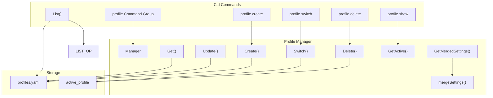
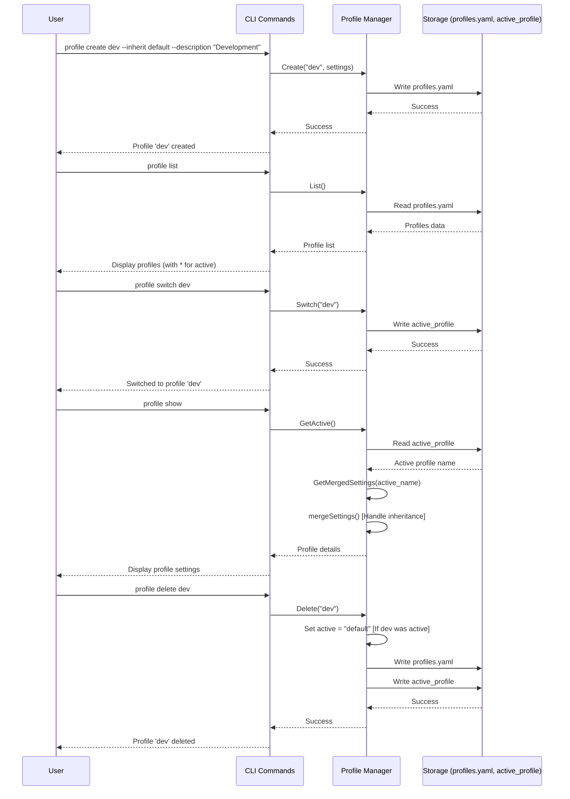
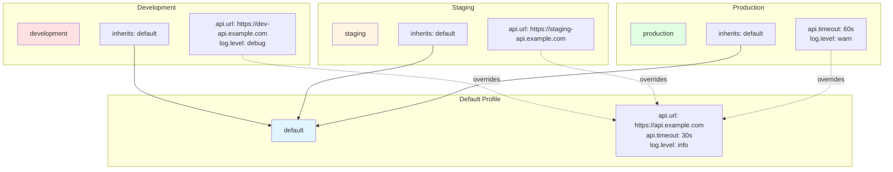

# CLI Profile System Specification

## Overview

Profiles manage different environment configurations for development, staging, and production contexts.

## System Architecture



## Profile Management Workflow



## Profile Inheritance Model



## Architecture

```
internal/profile/
├── manager.go       # Profile management
├── switcher.go      # Profile switching
├── config.go        # Profile configuration
└── storage.go       # Profile persistence
```

## Profile Manager

```go
package profile

import (
	"fmt"
	"os"
	"path/filepath"
	"sync"

	"gopkg.in/yaml.v3"
)

// Manager handles profile operations
type Manager struct {
	mu         sync.RWMutex
	profiles   map[string]*Profile
	active     string
	configDir  string
}

// Profile represents an environment configuration
type Profile struct {
	Name        string                 `yaml:"name"`
	Description string                 `yaml:"description"`
	Settings    map[string]interface{} `yaml:"settings"`
	Inherits    []string               `yaml:"inherits,omitempty"`
}

// NewManager creates a new profile manager
func NewManager(configDir string) (*Manager, error) {
	m := &Manager{
		profiles:  make(map[string]*Profile),
		configDir: configDir,
	}
	
	if err := m.load(); err != nil && !os.IsNotExist(err) {
		return nil, fmt.Errorf("failed to load profiles: %w", err)
	}
	
	return m, nil
}

// Create adds a new profile
func (m *Manager) Create(name string, settings map[string]interface{}) error {
	m.mu.Lock()
	defer m.mu.Unlock()
	
	if _, exists := m.profiles[name]; exists {
		return fmt.Errorf("profile '%s' already exists", name)
	}
	
	m.profiles[name] = &Profile{
		Name:     name,
		Settings: settings,
	}
	
	return m.save()
}

// Update modifies an existing profile
func (m *Manager) Update(name string, settings map[string]interface{}) error {
	m.mu.Lock()
	defer m.mu.Unlock()
	
	profile, exists := m.profiles[name]
	if !exists {
		return fmt.Errorf("profile '%s' not found", name)
	}
	
	// Merge settings
	for k, v := range settings {
		profile.Settings[k] = v
	}
	
	return m.save()
}

// Delete removes a profile
func (m *Manager) Delete(name string) error {
	m.mu.Lock()
	defer m.mu.Unlock()
	
	if name == "default" {
		return fmt.Errorf("cannot delete default profile")
	}
	
	if _, exists := m.profiles[name]; !exists {
		return fmt.Errorf("profile '%s' not found", name)
	}
	
	// Switch to default if deleting active
	if m.active == name {
		m.active = "default"
	}
	
	delete(m.profiles, name)
	return m.save()
}

// Switch activates a profile
func (m *Manager) Switch(name string) error {
	m.mu.Lock()
	defer m.mu.Unlock()
	
	if _, exists := m.profiles[name]; !exists {
		return fmt.Errorf("profile '%s' not found", name)
	}
	
	m.active = name
	return m.save()
}

// Get returns a profile by name
func (m *Manager) Get(name string) (*Profile, error) {
	m.mu.RLock()
	defer m.mu.RUnlock()
	
	profile, exists := m.profiles[name]
	if !exists {
		return nil, fmt.Errorf("profile '%s' not found", name)
	}
	
	return profile, nil
}

// GetActive returns the currently active profile
func (m *Manager) GetActive() (*Profile, error) {
	return m.Get(m.active)
}

// List returns all profiles
func (m *Manager) List() []*Profile {
	m.mu.RLock()
	defer m.mu.RUnlock()
	
	result := make([]*Profile, 0, len(m.profiles))
	for _, p := range m.profiles {
		result = append(result, p)
	}
	return result
}

// GetMergedSettings returns settings with inheritance applied
func (m *Manager) GetMergedSettings(name string) (map[string]interface{}, error) {
	m.mu.RLock()
	defer m.mu.RUnlock()
	
	profile, exists := m.profiles[name]
	if !exists {
		return nil, fmt.Errorf("profile '%s' not found", name)
	}
	
	return m.mergeSettings(profile, make(map[string]bool))
}

func (m *Manager) mergeSettings(profile *Profile, visited map[string]bool) (map[string]interface{}, error) {
	if visited[profile.Name] {
		return nil, fmt.Errorf("circular inheritance detected")
	}
	visited[profile.Name] = true
	
	result := make(map[string]interface{})
	
	// Apply inherited profiles first
	for _, parentName := range profile.Inherits {
		parent, exists := m.profiles[parentName]
		if !exists {
			return nil, fmt.Errorf("inherited profile '%s' not found", parentName)
		}
		
		parentSettings, err := m.mergeSettings(parent, visited)
		if err != nil {
			return nil, err
		}
		
		for k, v := range parentSettings {
			result[k] = v
		}
	}
	
	// Apply profile's own settings (override inherited)
	for k, v := range profile.Settings {
		result[k] = v
	}
	
	return result, nil
}

func (m *Manager) load() error {
	// Load profiles
	profilesFile := filepath.Join(m.configDir, "profiles.yaml")
	data, err := os.ReadFile(profilesFile)
	if err != nil {
		return err
	}
	
	if err := yaml.Unmarshal(data, &m.profiles); err != nil {
		return err
	}
	
	// Load active profile
	activeFile := filepath.Join(m.configDir, "active_profile")
	if data, err := os.ReadFile(activeFile); err == nil {
		m.active = string(data)
	} else {
		m.active = "default"
	}
	
	return nil
}

func (m *Manager) save() error {
	m.mu.RLock()
	defer m.mu.RUnlock()
	
	// Ensure directory exists
	if err := os.MkdirAll(m.configDir, 0755); err != nil {
		return err
	}
	
	// Save profiles
	profilesFile := filepath.Join(m.configDir, "profiles.yaml")
	data, err := yaml.Marshal(m.profiles)
	if err != nil {
		return err
	}
	
	if err := os.WriteFile(profilesFile, data, 0644); err != nil {
		return err
	}
	
	// Save active profile
	activeFile := filepath.Join(m.configDir, "active_profile")
	return os.WriteFile(activeFile, []byte(m.active), 0644)
}
```

## Profile Commands

```go
package cmd

import (
	"fmt"
	"os"
	"text/tabwriter"

	"github.com/anomalyco/muster/internal/profile"
	"github.com/spf13/cobra"
)

// NewProfileCommand creates profile management commands
func NewProfileCommand(manager *profile.Manager) *cobra.Command {
	cmd := &cobra.Command{
		Use:   "profile",
		Short: "Manage configuration profiles",
		Long:  "Create, switch, and manage environment profiles.",
	}

	cmd.AddCommand(newProfileListCommand(manager))
	cmd.AddCommand(newProfileCreateCommand(manager))
	cmd.AddCommand(newProfileSwitchCommand(manager))
	cmd.AddCommand(newProfileDeleteCommand(manager))
	cmd.AddCommand(newProfileShowCommand(manager))

	return cmd
}

func newProfileListCommand(manager *profile.Manager) *cobra.Command {
	return &cobra.Command{
		Use:   "list",
		Short: "List all profiles",
		RunE: func(cmd *cobra.Command, args []string) error {
			profiles := manager.List()
			active, _ := manager.GetActive()
			
			w := tabwriter.NewWriter(os.Stdout, 0, 0, 2, ' ', 0)
			fmt.Fprintln(w, "ACTIVE\tNAME\tDESCRIPTION")
			
			for _, p := range profiles {
				activeMarker := " "
				if active != nil && p.Name == active.Name {
					activeMarker = "*"
				}
				fmt.Fprintf(w, "%s\t%s\t%s\n", activeMarker, p.Name, p.Description)
			}
			
			return w.Flush()
		},
	}
}

func newProfileCreateCommand(manager *profile.Manager) *cobra.Command {
	var inherits []string
	var desc string
	
	cmd := &cobra.Command{
		Use:   "create <name>",
		Short: "Create a new profile",
		Args:  cobra.ExactArgs(1),
		RunE: func(cmd *cobra.Command, args []string) error {
			name := args[0]
			
			settings := map[string]interface{}{
				"description": desc,
				"inherits":    inherits,
			}
			
			if err := manager.Create(name, settings); err != nil {
				return err
			}
			
			fmt.Printf("Profile '%s' created\n", name)
			return nil
		},
	}
	
	cmd.Flags().StringSliceVarP(&inherits, "inherit", "i", []string{}, "Profiles to inherit from")
	cmd.Flags().StringVarP(&desc, "description", "d", "", "Profile description")
	
	return cmd
}

func newProfileSwitchCommand(manager *profile.Manager) *cobra.Command {
	return &cobra.Command{
		Use:   "switch <name>",
		Short: "Switch to a profile",
		Args:  cobra.ExactArgs(1),
		RunE: func(cmd *cobra.Command, args []string) error {
			name := args[0]
			
			if err := manager.Switch(name); err != nil {
				return err
			}
			
			fmt.Printf("Switched to profile '%s'\n", name)
			return nil
		},
	}
}

func newProfileDeleteCommand(manager *profile.Manager) *cobra.Command {
	return &cobra.Command{
		Use:   "delete <name>",
		Short: "Delete a profile",
		Args:  cobra.ExactArgs(1),
		RunE: func(cmd *cobra.Command, args []string) error {
			name := args[0]
			
			if err := manager.Delete(name); err != nil {
				return err
			}
			
			fmt.Printf("Profile '%s' deleted\n", name)
			return nil
		},
	}
}

func newProfileShowCommand(manager *profile.Manager) *cobra.Command {
	return &cobra.Command{
		Use:   "show [name]",
		Short: "Show profile details",
		RunE: func(cmd *cobra.Command, args []string) error {
			var p *profile.Profile
			var err error
			
			if len(args) > 0 {
				p, err = manager.Get(args[0])
			} else {
				p, err = manager.GetActive()
			}
			
			if err != nil {
				return err
			}
			
			fmt.Printf("Name:        %s\n", p.Name)
			fmt.Printf("Description: %s\n", p.Description)
			
			if len(p.Inherits) > 0 {
				fmt.Printf("Inherits:    %v\n", p.Inherits)
			}
			
			fmt.Println("\nSettings:")
			for k, v := range p.Settings {
				fmt.Printf("  %s: %v\n", k, v)
			}
			
			return nil
		},
	}
}
```

## Profile Configuration

```yaml
# ~/.muster/profiles.yaml
default:
  name: default
  description: Default configuration
  settings:
    api.url: https://api.example.com
    api.timeout: 30s
    log.level: info

development:
  name: development
  description: Development environment
  inherits:
    - default
  settings:
    api.url: https://dev-api.example.com
    log.level: debug

staging:
  name: staging
  description: Staging environment
  inherits:
    - default
  settings:
    api.url: https://staging-api.example.com

production:
  name: production
  description: Production environment
  inherits:
    - default
  settings:
    api.url: https://api.example.com
    log.level: warn
    api.timeout: 60s
```
