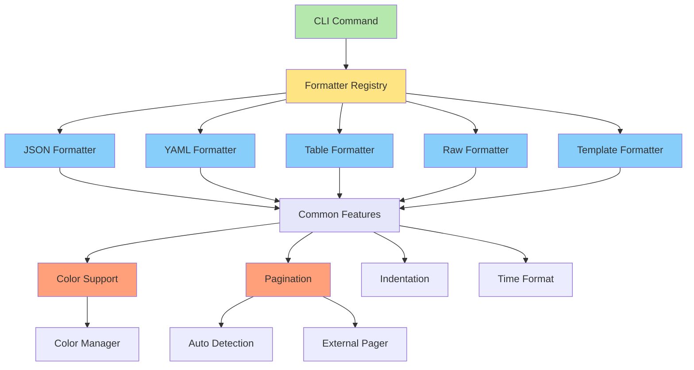
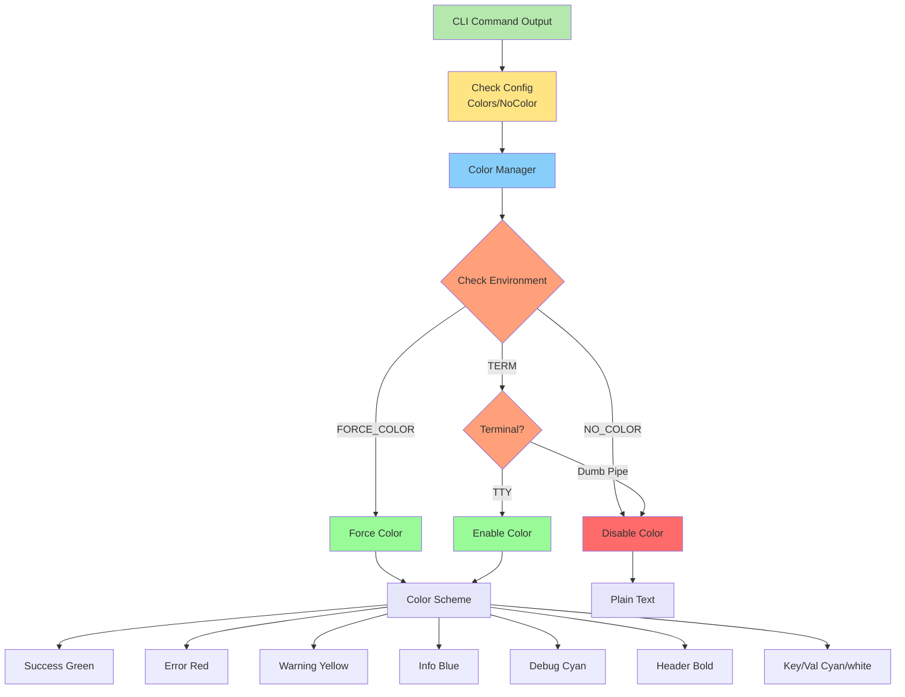

# CLI Output Formatters Specification

## Overview

Complete output formatting system for the Muster CLI supporting multiple output formats, color management, pagination, and progress indicators. Provides consistent, flexible formatting across all CLI commands.

## Formatter Architecture Overview



---

## Core Architecture

### Output Format Interface

```go
// Package output provides output formatting capabilities for the CLI.
package output

import (
	"context"
	"io"
	"time"
)

// Formatter is the core interface for all output formatters.
type Formatter interface {
	// Format writes formatted output to the writer.
	Format(w io.Writer, data interface{}) error
	
	// FormatBytes returns formatted output as bytes.
	FormatBytes(data interface{}) ([]byte, error)
	
	// FormatString returns formatted output as string.
	FormatString(data interface{}) (string, error)
	
	// ContentType returns the MIME content type.
	ContentType() string
	
	// SupportsStreaming indicates if this formatter supports streaming.
	SupportsStreaming() bool
}

// StreamingFormatter extends Formatter with streaming capabilities.
type StreamingFormatter interface {
	Formatter
	
	// CreateStream creates a new output stream.
	CreateStream(w io.Writer) Stream
}

// Stream represents a streaming output channel.
type Stream interface {
	// Write writes a data item to the stream.
	Write(data interface{}) error
	
	// Close closes the stream and flushes any buffered data.
	Close() error
	
	// Error returns any error encountered during streaming.
	Error() error
}

// Config holds formatter configuration.
type Config struct {
	// Indent is the indentation string (default: "  ").
	Indent string
	
	// Colors enables color output.
	Colors bool
	
	// NoColor forces no-color mode when true.
	NoColor bool
	
	// Pager enables automatic pagination.
	Pager bool
	
	// PagerCommand is the pager command (default: "less -R").
	PagerCommand string
	
	// TerminalWidth is the terminal width for table formatting.
	TerminalWidth int
	
	// TimeFormat is the time formatting string.
	TimeFormat string
	
	// NullValue is the string to use for nil values.
	NullValue string
}

// DefaultConfig returns default formatter configuration.
func DefaultConfig() Config {
	return Config{
		Indent:        "  ",
		Colors:        true,
		NoColor:       false,
		Pager:         false,
		PagerCommand:  "less -R",
		TerminalWidth: 80,
		TimeFormat:    time.RFC3339,
		NullValue:     "null",
	}
}

// FormatterRegistry manages available formatters.
type FormatterRegistry struct {
	formatters map[string]Formatter
}

// NewFormatterRegistry creates a new formatter registry.
func NewFormatterRegistry() *FormatterRegistry {
	return &FormatterRegistry{
		formatters: make(map[string]Formatter),
	}
}

// Register adds a formatter to the registry.
func (r *FormatterRegistry) Register(name string, formatter Formatter) {
	r.formatters[name] = formatter
}

// Get retrieves a formatter by name.
func (r *FormatterRegistry) Get(name string) (Formatter, bool) {
	f, ok := r.formatters[name]
	return f, ok
}

// Names returns all registered formatter names.
func (r *FormatterRegistry) Names() []string {
	names := make([]string, 0, len(r.formatters))
	for name := range r.formatters {
		names = append(names, name)
	}
	return names
}

// SupportedFormatters lists all supported formatter names.
var SupportedFormatters = []string{
	"json",
	"yaml",
	"table",
	"raw",
	"template",
}
```

---

## JSON Formatter

### JSON Formatter Implementation

```go
// Package output provides output formatting capabilities for the CLI.
package output

import (
	"bytes"
	"encoding/json"
	"fmt"
	"io"
)

// JSONFormatter formats output as JSON.
type JSONFormatter struct {
	config   Config
	compact  bool
	streaming bool
}

// NewJSONFormatter creates a new JSON formatter.
func NewJSONFormatter(config Config) *JSONFormatter {
	return &JSONFormatter{
		config:   config,
		compact:  false,
		streaming: false,
	}
}

// NewCompactJSONFormatter creates a compact JSON formatter.
func NewCompactJSONFormatter(config Config) *JSONFormatter {
	return &JSONFormatter{
		config:   config,
		compact:  true,
		streaming: false,
	}
}

// NewStreamingJSONFormatter creates a streaming JSON formatter.
func NewStreamingJSONFormatter(config Config) *JSONFormatter {
	return &JSONFormatter{
		config:    config,
		compact:   false,
		streaming: true,
	}
}

// Format implements Formatter.Format.
func (f *JSONFormatter) Format(w io.Writer, data interface{}) error {
	encoder := json.NewEncoder(w)
	
	if !f.compact {
		encoder.SetIndent("", f.config.Indent)
	}
	
	return encoder.Encode(data)
}

// FormatBytes implements Formatter.FormatBytes.
func (f *JSONFormatter) FormatBytes(data interface{}) ([]byte, error) {
	var buf bytes.Buffer
	if err := f.Format(&buf, data); err != nil {
		return nil, err
	}
	return buf.Bytes(), nil
}

// FormatString implements Formatter.FormatString.
func (f *JSONFormatter) FormatString(data interface{}) (string, error) {
	bytes, err := f.FormatBytes(data)
	if err != nil {
		return "", err
	}
	return string(bytes), nil
}

// ContentType implements Formatter.ContentType.
func (f *JSONFormatter) ContentType() string {
	return "application/json"
}

// SupportsStreaming implements Formatter.SupportsStreaming.
func (f *JSONFormatter) SupportsStreaming() bool {
	return f.streaming
}

// CreateStream implements StreamingFormatter.CreateStream.
func (f *JSONFormatter) CreateStream(w io.Writer) Stream {
	return &jsonStream{
		writer:  w,
		encoder: json.NewEncoder(w),
		first:   true,
		config:  f.config,
	}
}

// jsonStream implements Stream for JSON output.
type jsonStream struct {
	writer  io.Writer
	encoder *json.Encoder
	first   bool
	closed  bool
	err     error
	config  Config
}

// Write implements Stream.Write.
func (s *jsonStream) Write(data interface{}) error {
	if s.closed {
		return fmt.Errorf("stream is closed")
	}
	
	if s.first {
		if _, err := s.writer.Write([]byte("[\n")); err != nil {
			s.err = err
			return err
		}
		s.first = false
	} else {
		if _, err := s.writer.Write([]byte(",\n")); err != nil {
			s.err = err
			return err
		}
	}
	
	// Indent each line
	var buf bytes.Buffer
	encoder := json.NewEncoder(&buf)
	encoder.SetIndent(s.config.Indent, s.config.Indent)
	
	if err := encoder.Encode(data); err != nil {
		s.err = err
		return err
	}
	
	if _, err := s.writer.Write(buf.Bytes()); err != nil {
		s.err = err
		return err
	}
	
	return nil
}

// Close implements Stream.Close.
func (s *jsonStream) Close() error {
	if s.closed {
		return nil
	}
	
	if s.first {
		// No data written, output empty array
		if _, err := s.writer.Write([]byte("[]\n")); err != nil {
			s.err = err
			return err
		}
	} else {
		if _, err := s.writer.Write([]byte("\n]\n")); err != nil {
			s.err = err
			return err
		}
	}
	
	s.closed = true
	return nil
}

// Error implements Stream.Error.
func (s *jsonStream) Error() error {
	return s.err
}

// SetCompact enables or disables compact output.
func (f *JSONFormatter) SetCompact(compact bool) {
	f.compact = compact
}

// IndentJSON adds custom indentation to JSON output.
func IndentJSON(data []byte, indent string) ([]byte, error) {
	var buf bytes.Buffer
	if err := json.Indent(&buf, data, "", indent); err != nil {
		return nil, err
	}
	return buf.Bytes(), nil
}
```

---

## YAML Formatter

### YAML Formatter Implementation

```go
// Package output provides output formatting capabilities for the CLI.
package output

import (
	"bytes"
	"fmt"
	"io"
	"strings"
)

// YAMLStyle represents YAML output styles.
type YAMLStyle int

const (
	// YAMLStyleCanonical uses canonical YAML format.
	YAMLStyleCanonical YAMLStyle = iota
	// YAMLStyleCompact uses compact YAML format.
	YAMLStyleCompact
	// YAMLStyleFlow uses flow-style YAML.
	YAMLStyleFlow
)

// YAMLFormatter formats output as YAML.
type YAMLFormatter struct {
	config Config
	style  YAMLStyle
}

// NewYAMLFormatter creates a new YAML formatter.
func NewYAMLFormatter(config Config) *YAMLFormatter {
	return &YAMLFormatter{
		config: config,
		style:  YAMLStyleCanonical,
	}
}

// NewYAMLFormatterWithStyle creates a YAML formatter with custom style.
func NewYAMLFormatterWithStyle(config Config, style YAMLStyle) *YAMLFormatter {
	return &YAMLFormatter{
		config: config,
		style:  style,
	}
}

// Format implements Formatter.Format.
func (f *YAMLFormatter) Format(w io.Writer, data interface{}) error {
	output, err := f.FormatBytes(data)
	if err != nil {
		return err
	}
	_, err = w.Write(output)
	return err
}

// FormatBytes implements Formatter.FormatBytes.
func (f *YAMLFormatter) FormatBytes(data interface{}) ([]byte, error) {
	var buf bytes.Buffer
	if err := f.marshal(&buf, data, 0); err != nil {
		return nil, err
	}
	return buf.Bytes(), nil
}

// FormatString implements Formatter.FormatString.
func (f *YAMLFormatter) FormatString(data interface{}) (string, error) {
	bytes, err := f.FormatBytes(data)
	if err != nil {
		return "", err
	}
	return string(bytes), nil
}

// ContentType implements Formatter.ContentType.
func (f *YAMLFormatter) ContentType() string {
	return "application/yaml"
}

// SupportsStreaming implements Formatter.SupportsStreaming.
func (f *YAMLFormatter) SupportsStreaming() bool {
	return false
}

// SetStyle sets the YAML output style.
func (f *YAMLFormatter) SetStyle(style YAMLStyle) {
	f.style = style
}

// marshal recursively marshals data to YAML.
func (f *YAMLFormatter) marshal(w io.Writer, data interface{}, indent int) error {
	prefix := strings.Repeat(f.config.Indent, indent)
	
	switch v := data.(type) {
	case nil:
		fmt.Fprint(w, f.config.NullValue)
		
	case bool:
		fmt.Fprintf(w, "%t", v)
		
	case int:
		fmt.Fprintf(w, "%d", v)
	case int8:
		fmt.Fprintf(w, "%d", v)
	case int16:
		fmt.Fprintf(w, "%d", v)
	case int32:
		fmt.Fprintf(w, "%d", v)
	case int64:
		fmt.Fprintf(w, "%d", v)
	case uint:
		fmt.Fprintf(w, "%d", v)
	case uint8:
		fmt.Fprintf(w, "%d", v)
	case uint16:
		fmt.Fprintf(w, "%d", v)
	case uint32:
		fmt.Fprintf(w, "%d", v)
	case uint64:
		fmt.Fprintf(w, "%d", v)
	case float32:
		fmt.Fprintf(w, "%g", v)
	case float64:
		fmt.Fprintf(w, "%g", v)
		
	case string:
		f.writeString(w, v)
		
	case []byte:
		fmt.Fprintf(w, "!!binary \"%s\"", string(v))
		
	case time.Time:
		fmt.Fprintf(w, "%s", v.Format(f.config.TimeFormat))
		
	case []interface{}:
		if len(v) == 0 {
			fmt.Fprint(w, "[]")
			return nil
		}
		
		for i, item := range v {
			if i > 0 {
				fmt.Fprintln(w)
			}
			fmt.Fprintf(w, "%s- ", prefix)
			if err := f.marshal(w, item, indent+1); err != nil {
				return err
			}
		}
		
	case map[string]interface{}:
		if len(v) == 0 {
			fmt.Fprint(w, "{}")
			return nil
		}
		
		first := true
		for key, value := range v {
			if !first {
				fmt.Fprintln(w)
			}
			first = false
			
			fmt.Fprintf(w, "%s%s: ", prefix, key)
			
			// Check if value needs new line
			switch value.(type) {
			case map[string]interface{}, []interface{}:
				fmt.Fprintln(w)
				if err := f.marshal(w, value, indent+1); err != nil {
					return err
				}
			default:
				if err := f.marshal(w, value, indent); err != nil {
					return err
				}
			}
		}
		
	default:
		// Try to convert to map[string]interface{}
		if m, ok := toMap(v); ok {
			return f.marshal(w, m, indent)
		}
		
		// Try to convert to []interface{}
		if s, ok := toSlice(v); ok {
			return f.marshal(w, s, indent)
		}
		
		fmt.Fprintf(w, "%v", v)
	}
	
	return nil
}

// writeString writes a YAML string with proper escaping.
func (f *YAMLFormatter) writeString(w io.Writer, s string) {
	// Check if string needs quoting
	needsQuote := false
	if s == "" {
		needsQuote = true
	} else if strings.ContainsAny(s, `:#{}[]|>&*!"'\`) {
		needsQuote = true
	} else if strings.Contains(s, "\n") || strings.Contains(s, "\r") {
		needsQuote = true
	} else if s[0] == ' ' || s[0] == '-' || s[0] == '?' {
		needsQuote = true
	}
	
	if needsQuote {
		// Escape special characters
		s = strings.ReplaceAll(s, `\`, `\\`)
		s = strings.ReplaceAll(s, `"`, `\"`)
		fmt.Fprintf(w, `"%s"`, s)
	} else {
		fmt.Fprint(w, s)
	}
}

// toMap attempts to convert a value to map[string]interface{}.
func toMap(v interface{}) (map[string]interface{}, bool) {
	// This is a simplified version. In production, use reflection
	// or a library like go-yaml/yaml
	return nil, false
}

// toSlice attempts to convert a value to []interface{}.
func toSlice(v interface{}) ([]interface{}, bool) {
	// This is a simplified version. In production, use reflection
	// or a library like go-yaml/yaml
	return nil, false
}
```

---

## Table Formatter

### Table Formatter Implementation

```go
// Package output provides output formatting capabilities for the CLI.
package output

import (
	"bytes"
	"fmt"
	"io"
	"strings"
	"unicode/utf8"
)

// Alignment represents text alignment in table columns.
type Alignment int

const (
	AlignLeft Alignment = iota
	AlignRight
	AlignCenter
)

// Column represents a table column definition.
type Column struct {
	Name      string
	Alignment Alignment
	Width     int
	MinWidth  int
	MaxWidth  int
	Truncate  bool
}

// TableFormatter formats output as ASCII tables.
type TableFormatter struct {
	config      Config
	headers     []string
	columns     []Column
	showHeaders bool
	borderStyle BorderStyle
	autoWidth   bool
}

// BorderStyle represents table border styles.
type BorderStyle int

const (
	BorderStyleASCII BorderStyle = iota
	BorderStyleUnicode
	BorderStyleSimple
	BorderStyleNone
)

// NewTableFormatter creates a new table formatter.
func NewTableFormatter(config Config) *TableFormatter {
	return &TableFormatter{
		config:      config,
		showHeaders: true,
		borderStyle: BorderStyleASCII,
		autoWidth:   true,
	}
}

// SetHeaders sets the table headers.
func (f *TableFormatter) SetHeaders(headers []string) {
	f.headers = headers
	f.columns = make([]Column, len(headers))
	for i, h := range headers {
		f.columns[i] = Column{
			Name:      h,
			Alignment: AlignLeft,
			MinWidth:  len(h),
			MaxWidth:  0, // 0 means no limit
			Truncate:  true,
		}
	}
}

// SetColumns sets detailed column definitions.
func (f *TableFormatter) SetColumns(columns []Column) {
	f.columns = columns
	f.headers = make([]string, len(columns))
	for i, c := range columns {
		f.headers[i] = c.Name
	}
}

// ShowHeaders controls whether to show headers.
func (f *TableFormatter) ShowHeaders(show bool) {
	f.showHeaders = show
}

// SetBorderStyle sets the table border style.
func (f *TableFormatter) SetBorderStyle(style BorderStyle) {
	f.borderStyle = style
}

// SetAutoWidth enables/disables auto-width calculation.
func (f *TableFormatter) SetAutoWidth(auto bool) {
	f.autoWidth = auto
}

// Format implements Formatter.Format.
func (f *TableFormatter) Format(w io.Writer, data interface{}) error {
	// Convert data to rows
	rows, ok := data.([][]string)
	if !ok {
		return fmt.Errorf("table formatter requires [][]string data")
	}
	
	// Calculate column widths
	widths := f.calculateWidths(rows)
	
	// Build table
	var buf bytes.Buffer
	
	// Top border
	if f.borderStyle != BorderStyleNone {
		f.writeBorder(&buf, widths, BorderTop)
	}
	
	// Headers
	if f.showHeaders {
		f.writeRow(&buf, f.headers, widths, true)
		if f.borderStyle != BorderStyleNone {
			f.writeBorder(&buf, widths, BorderMiddle)
		}
	}
	
	// Data rows
	for i, row := range rows {
		if i > 0 && f.borderStyle == BorderStyleSimple {
			buf.WriteString(strings.Repeat("-", f.calculateTotalWidth(widths)))
			buf.WriteString("\n")
		}
		f.writeRow(&buf, row, widths, false)
	}
	
	// Bottom border
	if f.borderStyle != BorderStyleNone {
		f.writeBorder(&buf, widths, BorderBottom)
	}
	
	_, err := w.Write(buf.Bytes())
	return err
}

// FormatBytes implements Formatter.FormatBytes.
func (f *TableFormatter) FormatBytes(data interface{}) ([]byte, error) {
	var buf bytes.Buffer
	if err := f.Format(&buf, data); err != nil {
		return nil, err
	}
	return buf.Bytes(), nil
}

// FormatString implements Formatter.FormatString.
func (f *TableFormatter) FormatString(data interface{}) (string, error) {
	bytes, err := f.FormatBytes(data)
	if err != nil {
		return "", err
	}
	return string(bytes), nil
}

// ContentType implements Formatter.ContentType.
func (f *TableFormatter) ContentType() string {
	return "text/plain"
}

// SupportsStreaming implements Formatter.SupportsStreaming.
func (f *TableFormatter) SupportsStreaming() bool {
	return false
}

// BorderPosition represents border positions.
type BorderPosition int

const (
	BorderTop BorderPosition = iota
	BorderMiddle
	BorderBottom
)

// writeBorder writes a horizontal border.
func (f *TableFormatter) writeBorder(w io.Writer, widths []int, position BorderPosition) {
	var left, mid, right, horizontal string
	
	switch f.borderStyle {
	case BorderStyleUnicode:
		switch position {
		case BorderTop:
			left, mid, right = "┌", "┬", "┐"
		case BorderMiddle:
			left, mid, right = "├", "┼", "┤"
		case BorderBottom:
			left, mid, right = "└", "┴", "┘"
		}
		horizontal = "─"
	case BorderStyleASCII:
		left, mid, right = "+", "+", "+"
		horizontal = "-"
	case BorderStyleSimple:
		return
	case BorderStyleNone:
		return
	}
	
	fmt.Fprint(w, left)
	for i, width := range widths {
		if i > 0 {
			fmt.Fprint(w, mid)
		}
		fmt.Fprint(w, strings.Repeat(horizontal, width+2))
	}
	fmt.Fprintln(w, right)
}

// writeRow writes a table row.
func (f *TableFormatter) writeRow(w io.Writer, row []string, widths []int, isHeader bool) {
	// Ensure row has correct number of columns
	cells := make([]string, len(widths))
	copy(cells, row)
	for i := len(row); i < len(widths); i++ {
		cells[i] = ""
	}
	
	// Format cells
	for i, cell := range cells {
		if i == 0 {
			if f.borderStyle != BorderStyleNone {
				fmt.Fprint(w, "| ")
			}
		} else {
			if f.borderStyle != BorderStyleNone {
				fmt.Fprint(w, " | ")
			} else {
				fmt.Fprint(w, "  ")
			}
		}
		
		content := f.formatCell(cell, widths[i], f.columns[i].Alignment)
		if isHeader && f.borderStyle != BorderStyleNone {
			content = strings.ToUpper(content)
		}
		fmt.Fprint(w, content)
	}
	
	if f.borderStyle != BorderStyleNone {
		fmt.Fprintln(w, " |")
	} else {
		fmt.Fprintln(w)
	}
}

// formatCell formats a cell with alignment and width.
func (f *TableFormatter) formatCell(cell string, width int, align Alignment) string {
	cellWidth := stringWidth(cell)
	
	if cellWidth > width {
		// Truncate if necessary
		if f.columns[0].Truncate {
			return truncateString(cell, width-3) + "..."
		}
		return cell
	}
	
	// Pad to width
	padding := width - cellWidth
	switch align {
	case AlignRight:
		return strings.Repeat(" ", padding) + cell
	case AlignCenter:
		leftPad := padding / 2
		rightPad := padding - leftPad
		return strings.Repeat(" ", leftPad) + cell + strings.Repeat(" ", rightPad)
	default: // AlignLeft
		return cell + strings.Repeat(" ", padding)
	}
}

// calculateWidths calculates column widths based on content.
func (f *TableFormatter) calculateWidths(rows [][]string) []int {
	widths := make([]int, len(f.columns))
	
	// Initialize with header widths
	if f.showHeaders {
		for i, h := range f.headers {
			widths[i] = stringWidth(h)
		}
	}
	
	if !f.autoWidth {
		// Use configured widths
		for i, col := range f.columns {
			if col.Width > 0 {
				widths[i] = col.Width
			}
			if col.MinWidth > 0 && widths[i] < col.MinWidth {
				widths[i] = col.MinWidth
			}
			if col.MaxWidth > 0 && widths[i] > col.MaxWidth {
				widths[i] = col.MaxWidth
			}
		}
		return widths
	}
	
	// Calculate from data
	for _, row := range rows {
		for i, cell := range row {
			if i >= len(widths) {
				break
			}
			cellWidth := stringWidth(cell)
			if cellWidth > widths[i] {
				widths[i] = cellWidth
			}
		}
	}
	
	// Apply constraints
	for i, col := range f.columns {
		if col.MinWidth > 0 && widths[i] < col.MinWidth {
			widths[i] = col.MinWidth
		}
		if col.MaxWidth > 0 && widths[i] > col.MaxWidth {
			widths[i] = col.MaxWidth
		}
	}
	
	return widths
}

// calculateTotalWidth calculates the total width of the table.
func (f *TableFormatter) calculateTotalWidth(widths []int) int {
	total := 0
	for _, w := range widths {
		total += w + 3 // cell + " | " or "  "
	}
	if f.borderStyle != BorderStyleNone {
		total += 1 // final "|"
	}
	return total - 2 // adjust for spacing
}

// stringWidth returns the display width of a string.
func stringWidth(s string) int {
	width := 0
	for _, r := range s {
		if r == '\t' {
			width += 4 - (width % 4)
		} else if utf8.RuneLen(r) == 1 {
			width++
		} else {
			// For simplicity, treat wide characters as 2 columns
			width += 2
		}
	}
	return width
}

// truncateString truncates a string to the specified width.
func truncateString(s string, width int) string {
	if width <= 0 {
		return ""
	}
	
	currentWidth := 0
	for i, r := range s {
		runeWidth := 1
		if utf8.RuneLen(r) > 1 {
			runeWidth = 2
		}
		
		if currentWidth+runeWidth > width {
			return s[:i]
		}
		currentWidth += runeWidth
	}
	
	return s
}
```

---

## Raw Formatter

### Raw Formatter Implementation

```go
// Package output provides output formatting capabilities for the CLI.
package output

import (
	"fmt"
	"io"
)

// RawFormatter outputs data without formatting.
type RawFormatter struct {
	config      Config
	binaryMode  bool
	newline     bool
}

// NewRawFormatter creates a new raw formatter.
func NewRawFormatter(config Config) *RawFormatter {
	return &RawFormatter{
		config:     config,
		binaryMode: false,
		newline:    true,
	}
}

// NewBinaryFormatter creates a raw formatter for binary data.
func NewBinaryFormatter(config Config) *RawFormatter {
	return &RawFormatter{
		config:     config,
		binaryMode: true,
		newline:    false,
	}
}

// Format implements Formatter.Format.
func (f *RawFormatter) Format(w io.Writer, data interface{}) error {
	switch v := data.(type) {
	case []byte:
		_, err := w.Write(v)
		if err == nil && f.newline && !f.binaryMode {
			w.Write([]byte("\n"))
		}
		return err
		
	case string:
		_, err := io.WriteString(w, v)
		if err == nil && f.newline && !f.binaryMode && (len(v) == 0 || v[len(v)-1] != '\n') {
			w.Write([]byte("\n"))
		}
		return err
		
	case nil:
		if f.newline && !f.binaryMode {
			w.Write([]byte("\n"))
		}
		return nil
		
	default:
		// For other types, use fmt.Fprintf
		_, err := fmt.Fprintf(w, "%v", v)
		if err == nil && f.newline && !f.binaryMode {
			w.Write([]byte("\n"))
		}
		return err
	}
}

// FormatBytes implements Formatter.FormatBytes.
func (f *RawFormatter) FormatBytes(data interface{}) ([]byte, error) {
	switch v := data.(type) {
	case []byte:
		return v, nil
	case string:
		return []byte(v), nil
	case nil:
		return []byte{}, nil
	default:
		return []byte(fmt.Sprintf("%v", v)), nil
	}
}

// FormatString implements Formatter.FormatString.
func (f *RawFormatter) FormatString(data interface{}) (string, error) {
	switch v := data.(type) {
	case string:
		return v, nil
	case []byte:
		return string(v), nil
	case nil:
		return "", nil
	default:
		return fmt.Sprintf("%v", v), nil
	}
}

// ContentType implements Formatter.ContentType.
func (f *RawFormatter) ContentType() string {
	if f.binaryMode {
		return "application/octet-stream"
	}
	return "text/plain"
}

// SupportsStreaming implements Formatter.SupportsStreaming.
func (f *RawFormatter) SupportsStreaming() bool {
	return true
}

// SetBinaryMode enables or disables binary mode.
func (f *RawFormatter) SetBinaryMode(binary bool) {
	f.binaryMode = binary
}

// SetNewline enables or disables automatic newline.
func (f *RawFormatter) SetNewline(newline bool) {
	f.newline = newline
}
```

---

## Template Formatter

### Template Formatter Implementation

```go
// Package output provides output formatting capabilities for the CLI.
package output

import (
	"bytes"
	"fmt"
	"io"
	"strings"
	"text/template"
	"time"
)

// TemplateFormatter formats output using Go templates.
type TemplateFormatter struct {
	config    Config
	template  *template.Template
	templateStr string
	funcs     template.FuncMap
}

// NewTemplateFormatter creates a new template formatter.
func NewTemplateFormatter(config Config, tmpl string) (*TemplateFormatter, error) {
	f := &TemplateFormatter{
		config:      config,
		templateStr: tmpl,
		funcs:       make(template.FuncMap),
	}
	
	// Register built-in functions
	f.registerBuiltins()
	
	var err error
	f.template, err = template.New("output").Funcs(f.funcs).Parse(tmpl)
	if err != nil {
		return nil, fmt.Errorf("failed to parse template: %w", err)
	}
	
	return f, nil
}

// NewTemplateFormatterFromFile creates a formatter from a template file.
func NewTemplateFormatterFromFile(config Config, filepath string) (*TemplateFormatter, error) {
	// In real implementation, read file
	return nil, fmt.Errorf("not implemented")
}

// Format implements Formatter.Format.
func (f *TemplateFormatter) Format(w io.Writer, data interface{}) error {
	return f.template.Execute(w, data)
}

// FormatBytes implements Formatter.FormatBytes.
func (f *TemplateFormatter) FormatBytes(data interface{}) ([]byte, error) {
	var buf bytes.Buffer
	if err := f.Format(&buf, data); err != nil {
		return nil, err
	}
	return buf.Bytes(), nil
}

// FormatString implements Formatter.FormatString.
func (f *TemplateFormatter) FormatString(data interface{}) (string, error) {
	bytes, err := f.FormatBytes(data)
	if err != nil {
		return "", err
	}
	return string(bytes), nil
}

// ContentType implements Formatter.ContentType.
func (f *TemplateFormatter) ContentType() string {
	return "text/plain"
}

// SupportsStreaming implements Formatter.SupportsStreaming.
func (f *TemplateFormatter) SupportsStreaming() bool {
	return false
}

// AddFunc adds a custom function to the template.
func (f *TemplateFormatter) AddFunc(name string, fn interface{}) {
	f.funcs[name] = fn
	
	// Re-parse template with new functions
	var err error
	f.template, err = template.New("output").Funcs(f.funcs).Parse(f.templateStr)
	if err != nil {
		// Log error but don't panic
		fmt.Fprintf(io.Discard, "failed to re-parse template: %v", err)
	}
}

// registerBuiltins registers built-in template functions.
func (f *TemplateFormatter) registerBuiltins() {
	// String functions
	f.funcs["upper"] = strings.ToUpper
	f.funcs["lower"] = strings.ToLower
	f.funcs["title"] = strings.Title
	f.funcs["trim"] = strings.TrimSpace
	f.funcs["repeat"] = strings.Repeat
	f.funcs["join"] = strings.Join
	f.funcs["split"] = strings.Split
	f.funcs["contains"] = strings.Contains
	f.funcs["hasPrefix"] = strings.HasPrefix
	f.funcs["hasSuffix"] = strings.HasSuffix
	f.funcs["replace"] = strings.ReplaceAll
	f.funcs["substring"] = func(s string, start, end int) string {
		if start < 0 {
			start = 0
		}
		if end > len(s) {
			end = len(s)
		}
		if start > end {
			return ""
		}
		return s[start:end]
	}
	
	// Time functions
	f.funcs["now"] = time.Now
	f.funcs["formatTime"] = func(t time.Time, layout string) string {
		return t.Format(layout)
	}
	f.funcs["timeFromUnix"] = func(sec int64) time.Time {
		return time.Unix(sec, 0)
	}
	
	// Collection functions
	f.funcs["len"] = func(v interface{}) int {
		switch val := v.(type) {
		case []interface{}:
			return len(val)
		case map[string]interface{}:
			return len(val)
		case string:
			return len(val)
		default:
			return 0
		}
	}
	
	f.funcs["first"] = func(v []interface{}) interface{} {
		if len(v) == 0 {
			return nil
		}
		return v[0]
	}
	
	f.funcs["last"] = func(v []interface{}) interface{} {
		if len(v) == 0 {
			return nil
		}
		return v[len(v)-1]
	}
	
	// Formatting functions
	f.funcs["indent"] = func(n int, s string) string {
		indent := strings.Repeat(f.config.Indent, n)
		lines := strings.Split(s, "\n")
		for i, line := range lines {
			lines[i] = indent + line
		}
		return strings.Join(lines, "\n")
	}
	
	f.funcs["color"] = func(color, text string) string {
		if !f.config.Colors || f.config.NoColor {
			return text
		}
		return Colorize(text, color)
	}
	
	// Utility functions
	f.funcs["ternary"] = func(cond bool, ifTrue, ifFalse interface{}) interface{} {
		if cond {
			return ifTrue
		}
		return ifFalse
	}
	
	f.funcs["default"] = func(def, val interface{}) interface{} {
		if val == nil {
			return def
		}
		return val
	}
}

// DefaultTemplates provides common template strings.
var DefaultTemplates = struct {
	List   string
	Detail string
	Simple string
}{
	List: `{{range .}}{{.Name}} - {{.Status}}
{{end}}`,
	Detail: `Name: {{.Name}}
Status: {{.Status}}
Created: {{.CreatedAt}}
{{if .Description}}Description: {{.Description}}{{end}}`,
	Simple: `{{range $k, $v := .}}{{$k}}: {{$v}}
{{end}}`,
}
```

---

## Color Support

### Color Implementation



```go
// Package output provides output formatting capabilities for the CLI.
package output

import (
	"fmt"
	"os"
	"strings"
)

// ANSI color codes.
const (
	// Reset
	Reset = "\033[0m"
	
	// Foreground colors
	Black         = "\033[30m"
	Red           = "\033[31m"
	Green         = "\033[32m"
	Yellow        = "\033[33m"
	Blue          = "\033[34m"
	Magenta       = "\033[35m"
	Cyan          = "\033[36m"
	White         = "\033[37m"
	BrightBlack   = "\033[90m"
	BrightRed     = "\033[91m"
	BrightGreen   = "\033[92m"
	BrightYellow  = "\033[93m"
	BrightBlue    = "\033[94m"
	BrightMagenta = "\033[95m"
	BrightCyan    = "\033[96m"
	BrightWhite   = "\033[97m"
	
	// Background colors
	BgBlack         = "\033[40m"
	BgRed           = "\033[41m"
	BgGreen         = "\033[42m"
	BgYellow        = "\033[43m"
	BgBlue          = "\033[44m"
	BgMagenta       = "\033[45m"
	BgCyan          = "\033[46m"
	BgWhite         = "\033[47m"
	
	// Text styles
	Bold       = "\033[1m"
	Dim        = "\033[2m"
	Italic     = "\033[3m"
	Underline  = "\033[4m"
	Blink      = "\033[5m"
	Inverse    = "\033[7m"
	Hidden     = "\033[8m"
	Strikethrough = "\033[9m"
)

// ColorMap maps color names to ANSI codes.
var ColorMap = map[string]string{
	"black":         Black,
	"red":           Red,
	"green":         Green,
	"yellow":        Yellow,
	"blue":          Blue,
	"magenta":       Magenta,
	"cyan":          Cyan,
	"white":         White,
	"brightblack":   BrightBlack,
	"brightred":     BrightRed,
	"brightgreen":   BrightGreen,
	"brightyellow":  BrightYellow,
	"brightblue":    BrightBlue,
	"brightmagenta": BrightMagenta,
	"brightcyan":    BrightCyan,
	"brightwhite":   BrightWhite,
	
	"bold":       Bold,
	"dim":        Dim,
	"italic":     Italic,
	"underline":  Underline,
	"blink":      Blink,
	"inverse":    Inverse,
	"hidden":     Hidden,
	"strikethrough": Strikethrough,
}

// Colorize applies color codes to text.
func Colorize(text string, color string) string {
	if color == "" || text == "" {
		return text
	}
	
	// Handle multiple colors (comma-separated)
	colors := strings.Split(color, ",")
	var codes strings.Builder
	for _, c := range colors {
		c = strings.TrimSpace(strings.ToLower(c))
		if code, ok := ColorMap[c]; ok {
			codes.WriteString(code)
		}
	}
	
	if codes.Len() == 0 {
		return text
	}
	
	return codes.String() + text + Reset
}

// ColorManager manages color output state.
type ColorManager struct {
	enabled    bool
	noColor    bool
	forceColor bool
}

// NewColorManager creates a new color manager.
func NewColorManager() *ColorManager {
	return &ColorManager{
		enabled:    shouldEnableColors(),
		noColor:    os.Getenv("NO_COLOR") != "",
		forceColor: os.Getenv("FORCE_COLOR") != "",
	}
}

// Enabled returns whether colors are enabled.
func (cm *ColorManager) Enabled() bool {
	if cm.noColor {
		return false
	}
	if cm.forceColor {
		return true
	}
	return cm.enabled
}

// SetEnabled manually enables/disables colors.
func (cm *ColorManager) SetEnabled(enabled bool) {
	cm.enabled = enabled
}

// SetNoColor forces no-color mode.
func (cm *ColorManager) SetNoColor(noColor bool) {
	cm.noColor = noColor
}

// SetForceColor forces color output.
func (cm *ColorManager) SetForceColor(force bool) {
	cm.forceColor = force
}

// Color applies color if enabled.
func (cm *ColorManager) Color(text string, color string) string {
	if !cm.Enabled() {
		return text
	}
	return Colorize(text, color)
}

// shouldEnableColors detects if colors should be enabled.
func shouldEnableColors() bool {
	// Check NO_COLOR
	if os.Getenv("NO_COLOR") != "" {
		return false
	}
	
	// Check FORCE_COLOR
	if os.Getenv("FORCE_COLOR") != "" {
		return true
	}
	
	// Check TERM
	term := os.Getenv("TERM")
	if term == "dumb" {
		return false
	}
	
	// Check if stdout is a terminal
	// In a real implementation, use golang.org/x/term
	return isTerminal()
}

// isTerminal checks if stdout is a terminal.
func isTerminal() bool {
	// Simplified check - in production use term.IsTerminal
	return os.Getenv("CI") == "" && os.Getenv("TERM") != ""
}

// ColorScheme defines a color scheme for different output types.
type ColorScheme struct {
	Success string
	Error   string
	Warning string
	Info    string
	Debug   string
	Header  string
	Key     string
	Value   string
}

// DefaultColorScheme is the default color scheme.
var DefaultColorScheme = ColorScheme{
	Success: "green",
	Error:   "red",
	Warning: "yellow",
	Info:    "blue",
	Debug:   "cyan",
	Header:  "bold,white",
	Key:     "cyan",
	Value:   "white",
}

// Apply applies colors based on the scheme.
func (cs *ColorScheme) Apply(cm *ColorManager, text string, colorType string) string {
	if !cm.Enabled() {
		return text
	}
	
	var color string
	switch colorType {
	case "success":
		color = cs.Success
	case "error":
		color = cs.Error
	case "warning":
		color = cs.Warning
	case "info":
		color = cs.Info
	case "debug":
		color = cs.Debug
	case "header":
		color = cs.Header
	case "key":
		color = cs.Key
	case "value":
		color = cs.Value
	default:
		return text
	}
	
	return cm.Color(text, color)
}

// Common colored output helpers.
func (cm *ColorManager) Success(text string) string {
	return cm.Color(text, "green")
}

func (cm *ColorManager) Error(text string) string {
	return cm.Color(text, "red")
}

func (cm *ColorManager) Warning(text string) string {
	return cm.Color(text, "yellow")
}

func (cm *ColorManager) Info(text string) string {
	return cm.Color(text, "blue")
}

func (cm *ColorManager) Debug(text string) string {
	return cm.Color(text, "cyan")
}

func (cm *ColorManager) Bold(text string) string {
	return cm.Color(text, "bold")
}
```

---

## Pagination

### Pagination Implementation

```mermaid
flowchart TD
    Start[Output Generated] --> Enabled{Pagination Enabled?}
    Enabled -->|No| Direct[Write Direct to Stdout]
    Enabled -->|Yes| IsTTY{Output is TTY?}

    IsTTY -->|No| Direct
    IsTTY -->|Yes> Length{Length > Term Height?}

    Length -->|No| Direct
    Length -->|Yes> CheckCommand{Pager Command Set?}

    CheckCommand -->|No| Direct
    CheckCommand -->|Yes> Execute[Execute Pager<br/>less -R -F -X]

    Execute --> Display[Display Content]
    Direct --> Display

    style Start fill:#b5e8ad
    style Enabled fill:#ffe484
    style IsTTY fill:#ffa07a
    style Length fill:#ffa07a
    style Direct fill:#e6e6fa
    style CheckCommand fill:#ffa07a
    style Execute fill:#98fb98
    style Display fill:#87cefa
```

```go
// Package output provides output formatting capabilities for the CLI.
package output

import (
	"bytes"
	"fmt"
	"io"
	"os"
	"os/exec"
	"strings"
)

// Pager handles pagination of output.
type Pager struct {
	config   Config
	enabled  bool
	command  string
	cm       *ColorManager
}

// NewPager creates a new pager.
func NewPager(config Config, cm *ColorManager) *Pager {
	p := &Pager{
		config:  config,
		enabled: config.Pager,
		command: config.PagerCommand,
		cm:      cm,
	}
	
	// Check PAGER environment variable
	if pagerEnv := os.Getenv("PAGER"); pagerEnv != "" {
		p.command = pagerEnv
	}
	
	return p
}

// Enabled returns whether pagination is enabled.
func (p *Pager) Enabled() bool {
	return p.enabled && p.command != ""
}

// SetEnabled enables or disables pagination.
func (p *Pager) SetEnabled(enabled bool) {
	p.enabled = enabled
}

// SetCommand sets the pager command.
func (p *Pager) SetCommand(command string) {
	p.command = command
}

// Page pages the given content through the pager.
func (p *Pager) Page(content string) error {
	return p.PageBytes([]byte(content))
}

// PageBytes pages the given content through the pager.
func (p *Pager) PageBytes(content []byte) error {
	if !p.Enabled() {
		// Write directly to stdout
		_, err := os.Stdout.Write(content)
		return err
	}
	
	// Don't page if output is being piped
	if !isTerminalOutput() {
		_, err := os.Stdout.Write(content)
		return err
	}
	
	// Don't page short content
	if p.shouldSkipPage(content) {
		_, err := os.Stdout.Write(content)
		return err
	}
	
	return p.executePager(content)
}

// PageReader pages content from a reader.
func (p *Pager) PageReader(r io.Reader) error {
	if !p.Enabled() || !isTerminalOutput() {
		_, err := io.Copy(os.Stdout, r)
		return err
	}
	
	// Read all content
	content, err := io.ReadAll(r)
	if err != nil {
		return err
	}
	
	return p.PageBytes(content)
}

// shouldSkipPage checks if content is short enough to skip paging.
func (p *Pager) shouldSkipPage(content []byte) bool {
	// Get terminal height
	height := getTerminalHeight()
	if height <= 0 {
		return false
	}
	
	// Count lines
	lines := bytes.Count(content, []byte("\n"))
	
	// Page if more than terminal height minus a buffer
	return lines < height-2
}

// executePager runs the pager command.
func (p *Pager) executePager(content []byte) error {
	parts := strings.Fields(p.command)
	if len(parts) == 0 {
		return fmt.Errorf("empty pager command")
	}
	
	cmd := exec.Command(parts[0], parts[1:]...)
	cmd.Stdin = bytes.NewReader(content)
	cmd.Stdout = os.Stdout
	cmd.Stderr = os.Stderr
	
	return cmd.Run()
}

// PageWriter returns an io.Writer that buffers output for paging.
func (p *Pager) PageWriter() io.WriteCloser {
	return &pageWriter{pager: p}
}

// pageWriter buffers output and pages it on close.
type pageWriter struct {
	pager  *Pager
	buffer bytes.Buffer
}

// Write implements io.Writer.
func (w *pageWriter) Write(p []byte) (n int, err error) {
	return w.buffer.Write(p)
}

// Close implements io.Closer.
func (w *pageWriter) Close() error {
	return w.pager.PageBytes(w.buffer.Bytes())
}

// getTerminalHeight returns the terminal height.
func getTerminalHeight() int {
	// Simplified - in production use golang.org/x/term
	// or stty size command
	return 24 // default
}

// isTerminalOutput checks if stdout is a terminal.
func isTerminalOutput() bool {
	// Simplified - in production use term.IsTerminal
	return os.Getenv("CI") == "" && os.Stdout.Fd() < 3
}

// LessPager provides less-specific pager functionality.
type LessPager struct {
	*Pager
	options []string
}

// NewLessPager creates a less pager.
func NewLessPager(config Config, cm *ColorManager) *LessPager {
	p := NewPager(config, cm)
	p.SetCommand("less")
	
	return &LessPager{
		Pager:   p,
		options: []string{"-R", "-F", "-X"}, // -R (raw), -F (quit if one screen), -X (disable init)
	}
}

// SetOptions sets less options.
func (lp *LessPager) SetOptions(options []string) {
	lp.options = options
	lp.SetCommand("less " + strings.Join(options, " "))
}

// MorePager provides more-specific pager functionality.
type MorePager struct {
	*Pager
}

// NewMorePager creates a more pager.
func NewMorePager(config Config, cm *ColorManager) *MorePager {
	p := NewPager(config, cm)
	p.SetCommand("more")
	
	return &MorePager{Pager: p}
}

// CustomPager executes a custom pager command.
type CustomPager struct {
	*Pager
}

// NewCustomPager creates a custom pager.
func NewCustomPager(config Config, cm *ColorManager, command string) *CustomPager {
	p := NewPager(config, cm)
	p.SetCommand(command)
	
	return &CustomPager{Pager: p}
}
```

---

## Progress Indicators

### Progress Indicators Implementation

```go
// Package output provides output formatting capabilities for the CLI.
package output

import (
	"context"
	"fmt"
	"io"
	"os"
	"strings"
	"sync"
	"sync/atomic"
	"time"
)

// ProgressBar represents a progress bar.
type ProgressBar struct {
	writer    io.Writer
	width     int
	prefix    string
	suffix    string
	current   int64
	total     int64
	startTime time.Time
	mu        sync.RWMutex
	cm        *ColorManager
	
	// Visual settings
	filledChar  string
	emptyChar   string
	leftBorder  string
	rightBorder string
}

// NewProgressBar creates a new progress bar.
func NewProgressBar(writer io.Writer, total int64) *ProgressBar {
	if writer == nil {
		writer = os.Stdout
	}
	
	return &ProgressBar{
		writer:      writer,
		width:       40,
		total:       total,
		startTime:   time.Now(),
		filledChar:  "█",
		emptyChar:   "░",
		leftBorder:  "[",
		rightBorder: "]",
		cm:          NewColorManager(),
	}
}

// SetWidth sets the progress bar width.
func (pb *ProgressBar) SetWidth(width int) {
	pb.mu.Lock()
	defer pb.mu.Unlock()
	pb.width = width
}

// SetPrefix sets the prefix text.
func (pb *ProgressBar) SetPrefix(prefix string) {
	pb.mu.Lock()
	defer pb.mu.Unlock()
	pb.prefix = prefix
}

// SetSuffix sets the suffix text.
func (pb *ProgressBar) SetSuffix(suffix string) {
	pb.mu.Lock()
	defer pb.mu.Unlock()
	pb.suffix = suffix
}

// SetChars sets the progress bar characters.
func (pb *ProgressBar) SetChars(filled, empty string) {
	pb.mu.Lock()
	defer pb.mu.Unlock()
	pb.filledChar = filled
	pb.emptyChar = empty
}

// Add increments the progress.
func (pb *ProgressBar) Add(n int64) {
	atomic.AddInt64(&pb.current, n)
	pb.Render()
}

// Set sets the current progress.
func (pb *ProgressBar) Set(current int64) {
	atomic.StoreInt64(&pb.current, current)
	pb.Render()
}

// Inc increments the progress by 1.
func (pb *ProgressBar) Inc() {
	pb.Add(1)
}

// IsComplete returns whether the progress is complete.
func (pb *ProgressBar) IsComplete() bool {
	return atomic.LoadInt64(&pb.current) >= pb.total
}

// Render draws the progress bar.
func (pb *ProgressBar) Render() {
	pb.mu.RLock()
	defer pb.mu.RUnlock()
	
	current := atomic.LoadInt64(&pb.current)
	if pb.total == 0 {
		return
	}
	
	// Calculate percentage
	percent := float64(current) / float64(pb.total)
	if percent > 1.0 {
		percent = 1.0
	}
	
	// Calculate bar
	filled := int(percent * float64(pb.width))
	empty := pb.width - filled
	
	// Build bar
	bar := pb.leftBorder
	bar += strings.Repeat(pb.filledChar, filled)
	bar += strings.Repeat(pb.emptyChar, empty)
	bar += pb.rightBorder
	
	// Calculate stats
	elapsed := time.Since(pb.startTime)
	var eta time.Duration
	if current > 0 {
		rate := float64(current) / elapsed.Seconds()
		remaining := float64(pb.total-current) / rate
		eta = time.Duration(remaining * float64(time.Second))
	}
	
	// Format output
	var sb strings.Builder
	if pb.prefix != "" {
		sb.WriteString(pb.prefix)
		sb.WriteString(" ")
	}
	
	sb.WriteString(fmt.Sprintf("%3.0f%%", percent*100))
	sb.WriteString(" ")
	sb.WriteString(bar)
	sb.WriteString(" ")
	sb.WriteString(fmt.Sprintf("%d/%d", current, pb.total))
	sb.WriteString(" ")
	sb.WriteString(formatDuration(elapsed))
	
	if eta > 0 && current < pb.total {
		sb.WriteString(" ")
		sb.WriteString(fmt.Sprintf("ETA: %s", formatDuration(eta)))
	}
	
	if pb.suffix != "" {
		sb.WriteString(" ")
		sb.WriteString(pb.suffix)
	}
	
	// Clear line and print
	fmt.Fprintf(pb.writer, "\r\033[K%s", sb.String())
}

// Finish completes the progress bar.
func (pb *ProgressBar) Finish() {
	pb.Set(pb.total)
	fmt.Fprintln(pb.writer)
}

// Close closes the progress bar.
func (pb *ProgressBar) Close() error {
	if !pb.IsComplete() {
		pb.Finish()
	}
	return nil
}

// formatDuration formats a duration for display.
func formatDuration(d time.Duration) string {
	if d < time.Second {
		return fmt.Sprintf("%dms", d.Milliseconds())
	}
	if d < time.Minute {
		return fmt.Sprintf("%ds", int(d.Seconds()))
	}
	if d < time.Hour {
		return fmt.Sprintf("%dm%ds", int(d.Minutes()), int(d.Seconds())%60)
	}
	return fmt.Sprintf("%dh%dm", int(d.Hours()), int(d.Minutes())%60)
}

// Spinner represents a loading spinner.
type Spinner struct {
	writer   io.Writer
	frames   []string
	prefix   string
	suffix   string
	interval time.Duration
	current  int
	active   bool
	stopChan chan struct{}
	mu       sync.RWMutex
	cm       *ColorManager
}

// SpinnerFrames provides predefined spinner animations.
var SpinnerFrames = map[string][]string{
	"dots":   {"⣾", "⣽", "⣻", "⢿", "⡿", "⣟", "⣯", "⣷"},
	"line":   {"-", "\\", "|", "/"},
	"arrow":  {"←", "↑", "→", "↓"},
	"pulse":  {"█", "▉", "▊", "▋", "▌", "▍", "▎", "▏", "▎", "▍", "▌", "▋", "▊", "▉"},
	"circle": {"◐", "◓", "◑", "◒"},
}

// NewSpinner creates a new spinner.
func NewSpinner(writer io.Writer) *Spinner {
	if writer == nil {
		writer = os.Stdout
	}
	
	return &Spinner{
		writer:   writer,
		frames:   SpinnerFrames["dots"],
		interval: 100 * time.Millisecond,
		stopChan: make(chan struct{}),
		cm:       NewColorManager(),
	}
}

// SetFrames sets the spinner frames.
func (s *Spinner) SetFrames(frames []string) {
	s.mu.Lock()
	defer s.mu.Unlock()
	s.frames = frames
}

// SetFramesByName sets frames by predefined name.
func (s *Spinner) SetFramesByName(name string) {
	if frames, ok := SpinnerFrames[name]; ok {
		s.SetFrames(frames)
	}
}

// SetPrefix sets the prefix text.
func (s *Spinner) SetPrefix(prefix string) {
	s.mu.Lock()
	defer s.mu.Unlock()
	s.prefix = prefix
}

// SetSuffix sets the suffix text.
func (s *Spinner) SetSuffix(suffix string) {
	s.mu.Lock()
	defer s.mu.Unlock()
	s.suffix = suffix
}

// SetInterval sets the animation interval.
func (s *Spinner) SetInterval(interval time.Duration) {
	s.mu.Lock()
	defer s.mu.Unlock()
	s.interval = interval
}

// Start starts the spinner animation.
func (s *Spinner) Start() {
	s.mu.Lock()
	if s.active {
		s.mu.Unlock()
		return
	}
	s.active = true
	s.stopChan = make(chan struct{})
	s.mu.Unlock()
	
	go s.run()
}

// Stop stops the spinner animation.
func (s *Spinner) Stop() {
	s.mu.Lock()
	if !s.active {
		s.mu.Unlock()
		return
	}
	s.active = false
	close(s.stopChan)
	s.mu.Unlock()
	
	// Clear the spinner line
	fmt.Fprintf(s.writer, "\r\033[K")
}

// run runs the spinner animation.
func (s *Spinner) run() {
	ticker := time.NewTicker(s.interval)
	defer ticker.Stop()
	
	for {
		select {
		case <-ticker.C:
			s.render()
		case <-s.stopChan:
			return
		}
	}
}

// render renders the current spinner frame.
func (s *Spinner) render() {
	s.mu.RLock()
	defer s.mu.RUnlock()
	
	if !s.active {
		return
	}
	
	frame := s.frames[s.current%len(s.frames)]
	s.current++
	
	var sb strings.Builder
	if s.prefix != "" {
		sb.WriteString(s.prefix)
		sb.WriteString(" ")
	}
	
	sb.WriteString(frame)
	
	if s.suffix != "" {
		sb.WriteString(" ")
		sb.WriteString(s.suffix)
	}
	
	fmt.Fprintf(s.writer, "\r\033[K%s", sb.String())
}

// StatusMessage represents a status message with optional spinner.
type StatusMessage struct {
	writer   io.Writer
	spinner  *Spinner
	message  string
	status   StatusType
	cm       *ColorManager
}

// StatusType represents status message types.
type StatusType int

const (
	StatusInfo StatusType = iota
	StatusSuccess
	StatusWarning
	StatusError
	StatusProgress
)

// StatusIcons provides icons for each status type.
var StatusIcons = map[StatusType]string{
	StatusInfo:     "ℹ",
	StatusSuccess:  "✓",
	StatusWarning:  "⚠",
	StatusError:    "✗",
	StatusProgress: "⏳",
}

// NewStatusMessage creates a new status message.
func NewStatusMessage(writer io.Writer, message string, status StatusType) *StatusMessage {
	if writer == nil {
		writer = os.Stdout
	}
	
	sm := &StatusMessage{
		writer:  writer,
		message: message,
		status:  status,
		cm:      NewColorManager(),
	}
	
	if status == StatusProgress {
		sm.spinner = NewSpinner(writer)
		sm.spinner.SetPrefix(message)
	}
	
	return sm
}

// Start starts the status display.
func (sm *StatusMessage) Start() {
	if sm.spinner != nil {
		sm.spinner.Start()
	} else {
		sm.render()
	}
}

// Stop stops the status display.
func (sm *StatusMessage) Stop() {
	if sm.spinner != nil {
		sm.spinner.Stop()
	}
}

// Complete marks the status as complete.
func (sm *StatusMessage) Complete(status StatusType) {
	sm.Stop()
	sm.status = status
	sm.render()
}

// render renders the status message.
func (sm *StatusMessage) render() {
	icon := StatusIcons[sm.status]
	var color string
	
	switch sm.status {
	case StatusSuccess:
		color = "green"
	case StatusError:
		color = "red"
	case StatusWarning:
		color = "yellow"
	case StatusInfo:
		color = "blue"
	case StatusProgress:
		color = "cyan"
	}
	
	if sm.cm.Enabled() {
		icon = sm.cm.Color(icon, color)
	}
	
	fmt.Fprintf(sm.writer, "%s %s\n", icon, sm.message)
}

// ProgressManager manages multiple progress operations.
type ProgressManager struct {
	writer     io.Writer
	operations map[string]*ProgressBar
	spinners   map[string]*Spinner
	messages   []*StatusMessage
	cm         *ColorManager
	mu         sync.RWMutex
}

// NewProgressManager creates a new progress manager.
func NewProgressManager(writer io.Writer) *ProgressManager {
	if writer == nil {
		writer = os.Stdout
	}
	
	return &ProgressManager{
		writer:     writer,
		operations: make(map[string]*ProgressBar),
		spinners:   make(map[string]*Spinner),
		cm:         NewColorManager(),
	}
}

// AddProgressBar adds a named progress bar.
func (pm *ProgressManager) AddProgressBar(name string, total int64) *ProgressBar {
	pm.mu.Lock()
	defer pm.mu.Unlock()
	
	pb := NewProgressBar(pm.writer, total)
	pb.SetPrefix(name)
	pm.operations[name] = pb
	return pb
}

// AddSpinner adds a named spinner.
func (pm *ProgressManager) AddSpinner(name string, message string) *Spinner {
	pm.mu.Lock()
	defer pm.mu.Unlock()
	
	s := NewSpinner(pm.writer)
	s.SetPrefix(message)
	pm.spinners[name] = s
	return s
}

// AddStatus adds a status message.
func (pm *ProgressManager) AddStatus(message string, status StatusType) *StatusMessage {
	pm.mu.Lock()
	defer pm.mu.Unlock()
	
	sm := NewStatusMessage(pm.writer, message, status)
	pm.messages = append(pm.messages, sm)
	return sm
}

// StartAll starts all progress indicators.
func (pm *ProgressManager) StartAll() {
	pm.mu.RLock()
	defer pm.mu.RUnlock()
	
	for _, s := range pm.spinners {
		s.Start()
	}
	
	for _, sm := range pm.messages {
		sm.Start()
	}
}

// StopAll stops all progress indicators.
func (pm *ProgressManager) StopAll() {
	pm.mu.RLock()
	defer pm.mu.RUnlock()
	
	for _, s := range pm.spinners {
		s.Stop()
	}
	
	for _, pb := range pm.operations {
		pb.Close()
	}
}

// Wait waits for all operations to complete.
func (pm *ProgressManager) Wait(ctx context.Context) error {
	<-ctx.Done()
	pm.StopAll()
	return ctx.Err()
}

// Clear clears all progress indicators.
func (pm *ProgressManager) Clear() {
	pm.mu.Lock()
	defer pm.mu.Unlock()
	
	pm.StopAll()
	pm.operations = make(map[string]*ProgressBar)
	pm.spinners = make(map[string]*Spinner)
	pm.messages = nil
}
```

---

## Integration and Factory

### Formatter Factory

```go
// Package output provides output formatting capabilities for the CLI.
package output

import (
	"fmt"
	"io"
)

// FormatterFactory creates formatters based on configuration.
type FormatterFactory struct {
	config Config
	cm     *ColorManager
}

// NewFormatterFactory creates a new formatter factory.
func NewFormatterFactory(config Config) *FormatterFactory {
	return &FormatterFactory{
		config: config,
		cm:     NewColorManager(),
	}
}

// SetColorManager sets the color manager.
func (ff *FormatterFactory) SetColorManager(cm *ColorManager) {
	ff.cm = cm
}

// Create creates a formatter by name.
func (ff *FormatterFactory) Create(format string) (Formatter, error) {
	switch format {
	case "json":
		return NewJSONFormatter(ff.config), nil
		
	case "json-compact":
		f := NewJSONFormatter(ff.config)
		f.SetCompact(true)
		return f, nil
		
	case "json-stream":
		return NewStreamingJSONFormatter(ff.config), nil
		
	case "yaml":
		return NewYAMLFormatter(ff.config), nil
		
	case "table":
		return NewTableFormatter(ff.config), nil
		
	case "raw":
		return NewRawFormatter(ff.config), nil
		
	case "binary":
		f := NewRawFormatter(ff.config)
		f.SetBinaryMode(true)
		return f, nil
		
	default:
		return nil, fmt.Errorf("unknown format: %s", format)
	}
}

// CreateTemplate creates a template formatter.
func (ff *FormatterFactory) CreateTemplate(tmpl string) (Formatter, error) {
	return NewTemplateFormatter(ff.config, tmpl)
}

// OutputManager manages all output operations.
type OutputManager struct {
	config    Config
	factory   *FormatterFactory
	registry  *FormatterRegistry
	pager     *Pager
	progress  *ProgressManager
	cm        *ColorManager
	formatter Formatter
}

// NewOutputManager creates a new output manager.
func NewOutputManager(config Config) *OutputManager {
	cm := NewColorManager()
	cm.SetNoColor(config.NoColor)
	cm.SetEnabled(config.Colors)
	
	factory := NewFormatterFactory(config)
	factory.SetColorManager(cm)
	
	om := &OutputManager{
		config:   config,
		factory:  factory,
		registry: NewFormatterRegistry(),
		cm:       cm,
	}
	
	// Initialize pager if enabled
	if config.Pager {
		om.pager = NewPager(config, cm)
	}
	
	om.progress = NewProgressManager(nil)
	
	// Register default formatters
	om.registerDefaultFormatters()
	
	return om
}

// registerDefaultFormatters registers built-in formatters.
func (om *OutputManager) registerDefaultFormatters() {
	om.registry.Register("json", NewJSONFormatter(om.config))
	om.registry.Register("yaml", NewYAMLFormatter(om.config))
	om.registry.Register("table", NewTableFormatter(om.config))
	om.registry.Register("raw", NewRawFormatter(om.config))
}

// SetFormatter sets the current formatter.
func (om *OutputManager) SetFormatter(name string) error {
	formatter, ok := om.registry.Get(name)
	if !ok {
		return fmt.Errorf("formatter not found: %s", name)
	}
	om.formatter = formatter
	return nil
}

// Output outputs data using the current formatter.
func (om *OutputManager) Output(data interface{}) error {
	if om.formatter == nil {
		return fmt.Errorf("no formatter set")
	}
	
	// Format to buffer
	var buf bytes.Buffer
	if err := om.formatter.Format(&buf, data); err != nil {
		return err
	}
	
	// Page if enabled
	if om.pager != nil && om.pager.Enabled() {
		return om.pager.PageBytes(buf.Bytes())
	}
	
	// Write directly
	_, err := io.Copy(os.Stdout, &buf)
	return err
}

// OutputTo outputs data to a specific writer.
func (om *OutputManager) OutputTo(w io.Writer, data interface{}) error {
	if om.formatter == nil {
		return fmt.Errorf("no formatter set")
	}
	return om.formatter.Format(w, data)
}

// OutputBytes returns formatted output as bytes.
func (om *OutputManager) OutputBytes(data interface{}) ([]byte, error) {
	if om.formatter == nil {
		return nil, fmt.Errorf("no formatter set")
	}
	return om.formatter.FormatBytes(data)
}

// OutputString returns formatted output as string.
func (om *OutputManager) OutputString(data interface{}) (string, error) {
	bytes, err := om.OutputBytes(data)
	if err != nil {
		return "", err
	}
	return string(bytes), nil
}

// CreateTable creates a table formatter with headers.
func (om *OutputManager) CreateTable(headers []string) *TableFormatter {
	tf := NewTableFormatter(om.config)
	tf.SetHeaders(headers)
	return tf
}

// CreateProgressBar creates a progress bar.
func (om *OutputManager) CreateProgressBar(total int64) *ProgressBar {
	return NewProgressBar(nil, total)
}

// CreateSpinner creates a spinner.
func (om *OutputManager) CreateSpinner() *Spinner {
	return NewSpinner(nil)
}

// CreateStatusMessage creates a status message.
func (om *OutputManager) CreateStatusMessage(message string, status StatusType) *StatusMessage {
	return NewStatusMessage(nil, message, status)
}

// GetColorManager returns the color manager.
func (om *OutputManager) GetColorManager() *ColorManager {
	return om.cm
}

// GetPager returns the pager.
func (om *OutputManager) GetPager() *Pager {
	return om.pager
}

// GetProgressManager returns the progress manager.
func (om *OutputManager) GetProgressManager() *ProgressManager {
	return om.progress
}

// Colorize applies color to text.
func (om *OutputManager) Colorize(text string, color string) string {
	return om.cm.Color(text, color)
}

// IsColorEnabled returns whether colors are enabled.
func (om *OutputManager) IsColorEnabled() bool {
	return om.cm.Enabled()
}
```

---

## Usage Examples

### Basic Usage

```go
package main

import (
	"fmt"
	"log"
	
	"github.com/openapi-cli/core/internal/cli/output"
)

func main() {
	// Create output manager
	config := output.DefaultConfig()
	config.Colors = true
	om := output.NewOutputManager(config)
	
	// Set formatter
	if err := om.SetFormatter("json"); err != nil {
		log.Fatal(err)
	}
	
	// Output data
	data := map[string]interface{}{
		"name":    "My Resource",
		"status":  "active",
		"count":   42,
	}
	
	if err := om.Output(data); err != nil {
		log.Fatal(err)
	}
	
	// Output: {
	//   "name": "My Resource",
	//   "status": "active",
	//   "count": 42
	// }
}
```

### Table Output

```go
func tableExample(om *output.OutputManager) {
	// Create table
	table := om.CreateTable([]string{"ID", "Name", "Status", "Count"})
	
	// Set column alignments
	table.SetColumns([]output.Column{
		{Name: "ID", Alignment: output.AlignRight},
		{Name: "Name", Alignment: output.AlignLeft},
		{Name: "Status", Alignment: output.AlignCenter},
		{Name: "Count", Alignment: output.AlignRight},
	})
	
	// Data
	rows := [][]string{
		{"1", "Resource A", "active", "100"},
		{"2", "Resource B", "pending", "50"},
		{"3", "Resource C", "error", "0"},
	}
	
	// Output
	om.Output(rows)
}
```

### Progress Bar

```go
func progressExample(om *output.OutputManager) {
	// Create progress bar
	bar := om.CreateProgressBar(100)
	bar.SetPrefix("Downloading")
	bar.SetSuffix("files")
	
	// Simulate work
	for i := 0; i <= 100; i++ {
		bar.Set(int64(i))
		time.Sleep(50 * time.Millisecond)
	}
	
	bar.Finish()
}
```

### Spinner

```go
func spinnerExample(om *output.OutputManager) {
	// Create spinner
	spinner := om.CreateSpinner()
	spinner.SetPrefix("Loading")
	spinner.SetFramesByName("dots")
	
	// Start spinner
	spinner.Start()
	
	// Do work...
	time.Sleep(3 * time.Second)
	
	// Stop spinner
	spinner.Stop()
}
```

### Template Output

```go
func templateExample(om *output.OutputManager) {
	// Create template formatter
	templateStr := `Resource: {{.Name}}
Status: {{color "green" .Status}}
Created: {{.CreatedAt}}`
	
	formatter, err := output.NewTemplateFormatter(
		output.DefaultConfig(),
		templateStr,
	)
	if err != nil {
		log.Fatal(err)
	}
	
	data := map[string]interface{}{
		"Name":      "My Resource",
		"Status":    "active",
		"CreatedAt": "2024-01-15T10:30:00Z",
	}
	
	output, err := formatter.FormatString(data)
	if err != nil {
		log.Fatal(err)
	}
	
	fmt.Println(output)
}
```

### Colored Output

```go
func colorExample(om *output.OutputManager) {
	cm := om.GetColorManager()
	
	// Colored messages
	fmt.Println(cm.Success("Operation completed successfully"))
	fmt.Println(cm.Error("An error occurred"))
	fmt.Println(cm.Warning("This is a warning"))
	fmt.Println(cm.Info("Information message"))
	fmt.Println(cm.Debug("Debug information"))
	
	// Direct colorize
	fmt.Println(om.Colorize("Important!", "red,bold"))
	fmt.Println(om.Colorize("Success", "green"))
}
```

---

## File Structure

```
internal/
└── cli/
    └── output/
        ├── output.go              # Core interfaces and types
        ├── config.go            # Configuration
        ├── registry.go          # Formatter registry
        ├── manager.go           # Output manager
        ├── factory.go           # Formatter factory
        ├──
        ├── json.go              # JSON formatter
        ├── yaml.go              # YAML formatter
        ├── table.go             # Table formatter
        ├── raw.go               # Raw formatter
        ├── template.go          # Template formatter
        ├──
        ├── color.go             # Color support
        ├── pager.go             # Pagination
        ├── progress.go          # Progress bar
        ├── spinner.go           # Loading spinner
        └── status.go            # Status messages
```

---

## Dependencies

```go
// go.mod additions

require (
	// Standard library only for core functionality
	// Optional: golang.org/x/term for terminal detection
	// Optional: gopkg.in/yaml.v3 for YAML formatting
)
```

---

## Testing

```go
// output_test.go

package output

import (
	"bytes"
	"testing"
)

func TestJSONFormatter(t *testing.T) {
	config := DefaultConfig()
	f := NewJSONFormatter(config)
	
	data := map[string]string{"key": "value"}
	
	output, err := f.FormatString(data)
	if err != nil {
		t.Fatal(err)
	}
	
	expected := "{\n  \"key\": \"value\"\n}"
	if output != expected {
		t.Errorf("Expected %q, got %q", expected, output)
	}
}

func TestTableFormatter(t *testing.T) {
	config := DefaultConfig()
	f := NewTableFormatter(config)
	f.SetHeaders([]string{"A", "B"})
	
	rows := [][]string{
		{"1", "2"},
		{"3", "4"},
	}
	
	var buf bytes.Buffer
	err := f.Format(&buf, rows)
	if err != nil {
		t.Fatal(err)
	}
	
	output := buf.String()
	if len(output) == 0 {
		t.Error("Expected non-empty output")
	}
}
```

---

**Version**: 1.0  
**Last Updated**: 2024-01-15  
**Author**: Ralph Loop Reference
