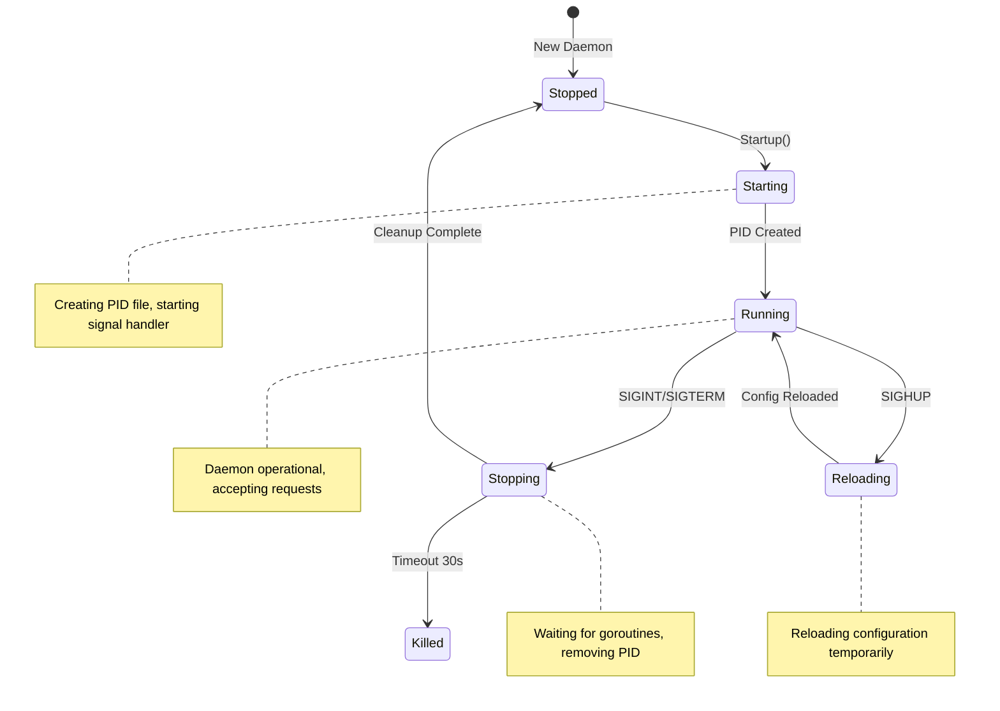
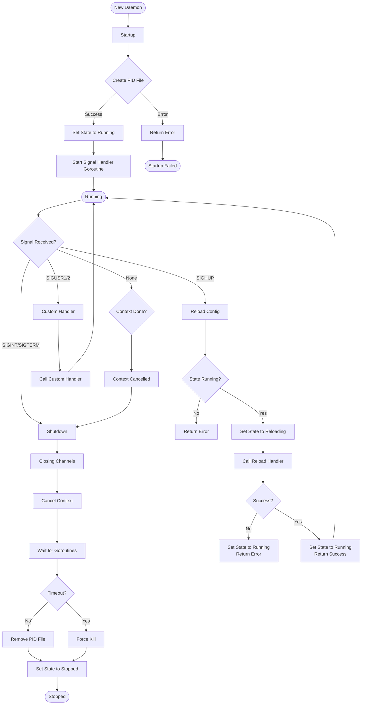

# Daemon Lifecycle - Startup and Shutdown

Complete daemon lifecycle management with signal handling.

## State Machine



## Lifecycle Flow



## Signal Handling Flow

```mermaid
sequenceDiagram
    participant OS as Operating System
    participant Daemon as Daemon Lifecycle
    participant Handlers as Signal Handlers
    participant PID as PID File
    participant Config as Configuration
    
    Daemon->>OS: Signal Notify
    Note over Daemon: Registering for SIGINT, SIGTERM,<br/>SIGHUP, SIGUSR1, SIGUSR2
    
    par Signal Reception
        OS->>Daemon: SIGINT (Ctrl+C)
    or
        OS->>Daemon: SIGTERM (kill)
    end
    
    Daemon->>Daemon: Shutdown()
    Daemon->>Daemon: Close shutdown channels
    Daemon->>Daemon: Cancel context
    Daemon->>Handlers: Wait for goroutines
    Handlers-->>Daemon: All goroutines done
    Daemon->>PID: Remove PID file
    Daemon->>Config: Save state
    Daemon-->>OS: Exit 0
    
    Note over OS,Daemon: Graceful shutdown complete
    
    par Reload Signal
        OS->>Daemon: SIGHUP
        Daemon->>Daemon: Reload()
        Daemon->>Config: Reload configuration
        Config-->>Daemon: New config loaded
        Daemon-->>OS: Continue running
    end
    
    par Custom Signals
        OS->>Daemon: SIGUSR1
        Daemon->>Handlers: Call handler for SigCustom1
        OS->>Daemon: SIGUSR2
        Daemon->>Handlers: Call handler for SigCustom2
    end
```

## Startup Sequence Flow

```mermaid
flowchart TD
    START([Startup]) --> ACQUIRE[Acquire Mutex]
    ACQUIRE --> SET_STATE[Set State to Starting]
    SET_STATE --> RELEASE[Release Mutex]
    RELEASE --> CREATE_PID[Create PID File]
    CREATE_PID -->{PID Exists?}
    {PID Exists?} -->|Yes| ERROR1[Return Error: PID File Exists]
    ERROR1 --> END1([Startup Failed])
    {PID Exists?} -->|No| LOCK_PID[Lock PID File]
    LOCK_PID --> STORE_PID[Store PID Handle]
    STORE_PID --> ACQUIRE2[Acquire Mutex]
    ACQUIRE2 --> SET_STATE2[Set State to Running]
    SET_STATE2 --> RELEASE2[Release Mutex]
    RELEASE2 --> ADD_GOROUTINE[Add 1 to WaitGroup]
    ADD_GOROUTINE --> START_HANDLER[Start signalHandler Goroutine]
    START_HANDLER --> DONE([Startup Complete])
    
    style {PID Exists?} fill:#ff9,stroke:#333
    style ERROR1 fill:#f99,stroke:#333
    style START fill:#9f9,stroke:#333
    style DONE fill:#9f9,stroke:#333
```

## File: internal/daemon/lifecycle/lifecycle.go

```go
package lifecycle

import (
	"context"
	"fmt"
	"os"
	"os/exec"
	"os/signal"
	"path/filepath"
	"strconv"
	"sync"
	"syscall"
	"time"
)

// Daemon manages process lifecycle
type Daemon struct {
	pidFile    string
	pidHandle  *PIDFile
	shutdownCh chan struct{}
	signals    chan os.Signal
	ctx        context.Context
	cancel     context.CancelFunc
	wg         sync.WaitGroup
	mu         sync.RWMutex
	state      State
	handlers   map[Signal]SignalHandler
}

// State represents daemon state
type State int

const (
	StateStopped State = iota
	StateStarting
	StateRunning
	StateStopping
	StateReloading
)

// Signal represents daemon signals
type Signal int

const (
	SigShutdown Signal = iota
	SigReload
	SigReopen
	SigCustom1
	SigCustom2
)

// SignalHandler handles daemon signals
type SignalHandler func() error

// Config defines lifecycle configuration
type Config struct {
	PIDFile         string
	ShutdownTimeout time.Duration
	SignalBuffer    int
}

// DefaultConfig returns default lifecycle config
func DefaultConfig() Config {
	return Config{
		PIDFile:         "/var/run/muster/daemon.pid",
		ShutdownTimeout: 30 * time.Second,
		SignalBuffer:    10,
	}
}

// New creates a new daemon lifecycle manager
func New(cfg Config) *Daemon {
	ctx, cancel := context.WithCancel(context.Background())
	return &Daemon{
		pidFile:    cfg.PIDFile,
		shutdownCh: make(chan struct{}),
		signals:    make(chan os.Signal, cfg.SignalBuffer),
		ctx:        ctx,
		cancel:     cancel,
		handlers:   make(map[Signal]SignalHandler),
		state:      StateStopped,
	}
}

// Startup executes daemon startup sequence
func (d *Daemon) Startup() error {
	d.mu.Lock()
	d.state = StateStarting
	d.mu.Unlock()

	// Create PID file
	pidFile, err := NewPIDFile(d.pidFile)
	if err != nil {
		return fmt.Errorf("create PID file: %w", err)
	}
	d.pidHandle = pidFile

	d.mu.Lock()
	d.state = StateRunning
	d.mu.Unlock()

	// Start signal handler
	d.wg.Add(1)
	go d.signalHandler()

	return nil
}

// Shutdown executes graceful shutdown sequence
func (d *Daemon) Shutdown() error {
	d.mu.Lock()
	if d.state == StateStopping {
		d.mu.Unlock()
		return nil
	}
	d.state = StateStopping
	d.mu.Unlock()

	close(d.shutdownCh)
	d.cancel()

	// Wait for goroutines with timeout
	done := make(chan struct{})
	go func() {
		d.wg.Wait()
		close(done)
	}()

	select {
	case <-done:
	case <-time.After(30 * time.Second):
	}

	// Cleanup
	if d.pidHandle != nil {
		d.pidHandle.Remove()
	}

	d.mu.Lock()
	d.state = StateStopped
	d.mu.Unlock()

	return nil
}

// Reload triggers configuration reload
func (d *Daemon) Reload() error {
	d.mu.Lock()
	if d.state != StateRunning {
		d.mu.Unlock()
		return fmt.Errorf("daemon not running")
	}
	d.state = StateReloading
	d.mu.Unlock()

	if handler, ok := d.handlers[SigReload]; ok {
		if err := handler(); err != nil {
			d.mu.Lock()
			d.state = StateRunning
			d.mu.Unlock()
			return err
		}
	}

	d.mu.Lock()
	d.state = StateRunning
	d.mu.Unlock()

	return nil
}

// signalHandler processes OS signals
func (d *Daemon) signalHandler() {
	defer d.wg.Done()

	signal.Notify(d.signals, syscall.SIGINT, syscall.SIGTERM,
		syscall.SIGHUP, syscall.SIGUSR1, syscall.SIGUSR2)

	for {
		select {
		case sig := <-d.signals:
			switch sig {
			case syscall.SIGINT, syscall.SIGTERM:
				d.Shutdown()
				return
			case syscall.SIGHUP:
				d.Reload()
			case syscall.SIGUSR1:
				if handler, ok := d.handlers[SigCustom1]; ok {
					handler()
				}
			case syscall.SIGUSR2:
				if handler, ok := d.handlers[SigCustom2]; ok {
					handler()
				}
			}
		case <-d.ctx.Done():
			return
		}
	}
}

// RegisterHandler registers a signal handler
func (d *Daemon) RegisterHandler(sig Signal, handler SignalHandler) {
	d.mu.Lock()
	defer d.mu.Unlock()
	d.handlers[sig] = handler
}

// Context returns daemon context
func (d *Daemon) Context() context.Context {
	return d.ctx
}

// State returns current daemon state
func (d *Daemon) State() State {
	d.mu.RLock()
	defer d.mu.RUnlock()
	return d.state
}
```

## File: internal/daemon/lifecycle/pid.go

```go
package lifecycle

import (
	"fmt"
	"os"
	"path/filepath"
	"strconv"
	"syscall"
)

// PIDFile manages daemon PID file
type PIDFile struct {
	path string
	pid  int
}

// NewPIDFile creates a new PID file
func NewPIDFile(path string) (*PIDFile, error) {
	dir := filepath.Dir(path)
	if err := os.MkdirAll(dir, 0755); err != nil {
		return nil, fmt.Errorf("create PID directory: %w", err)
	}

	if _, err := os.Stat(path); err == nil {
		data, err := os.ReadFile(path)
		if err == nil {
			if pid, err := strconv.Atoi(string(data)); err == nil {
				if processExists(pid) {
					return nil, fmt.Errorf("daemon already running (PID %d)", pid)
				}
			}
		}
		os.Remove(path)
	}

	pid := os.Getpid()
	if err := os.WriteFile(path, []byte(strconv.Itoa(pid)), 0644); err != nil {
		return nil, fmt.Errorf("write PID file: %w", err)
	}

	return &PIDFile{path: path, pid: pid}, nil
}

// Remove deletes the PID file
func (p *PIDFile) Remove() error {
	return os.Remove(p.path)
}

// Path returns PID file path
func (p *PIDFile) Path() string {
	return p.path
}

// PID returns process ID
func (p *PIDFile) PID() int {
	return p.pid
}

// processExists checks if process is running
func processExists(pid int) bool {
	proc, err := os.FindProcess(pid)
	if err != nil {
		return false
	}
	return proc.Signal(syscall.Signal(0)) == nil
}

// ReadPID reads PID from file
func ReadPID(path string) (int, error) {
	data, err := os.ReadFile(path)
	if err != nil {
		return 0, err
	}
	return strconv.Atoi(string(data))
}
```

## File: internal/daemon/lifecycle/daemonize.go

```go
package lifecycle

import (
	"fmt"
	"os"
	"os/exec"
	"syscall"
)

// Daemonize forks process into background
func Daemonize() error {
	if os.Getppid() == 1 {
		return nil // Already daemon
	}

	cmd := exec.Command(os.Args[0], os.Args[1:]...)
	cmd.Stdin = nil
	cmd.Stdout = nil
	cmd.Stderr = nil
	cmd.SysProcAttr = &syscall.SysProcAttr{
		Setsid: true,
	}

	if err := cmd.Start(); err != nil {
		return fmt.Errorf("fork process: %w", err)
	}

	fmt.Printf("Daemon started (PID %d)\n", cmd.Process.Pid)
	os.Exit(0)
	return nil
}

// IsDaemonized checks if running as daemon
func IsDaemonized() bool {
	return os.Getppid() == 1
}

// GetStatus returns daemon status
func GetStatus(pidFile string) (bool, int, error) {
	pid, err := ReadPID(pidFile)
	if err != nil {
		return false, 0, nil
	}

	if !processExists(pid) {
		os.Remove(pidFile)
		return false, 0, nil
	}

	return true, pid, nil
}
```

## Usage

```go
daemon := lifecycle.New(lifecycle.DefaultConfig())

if err := daemon.Startup(); err != nil {
	log.Fatal(err)
}

<-daemon.Context().Done()
```
