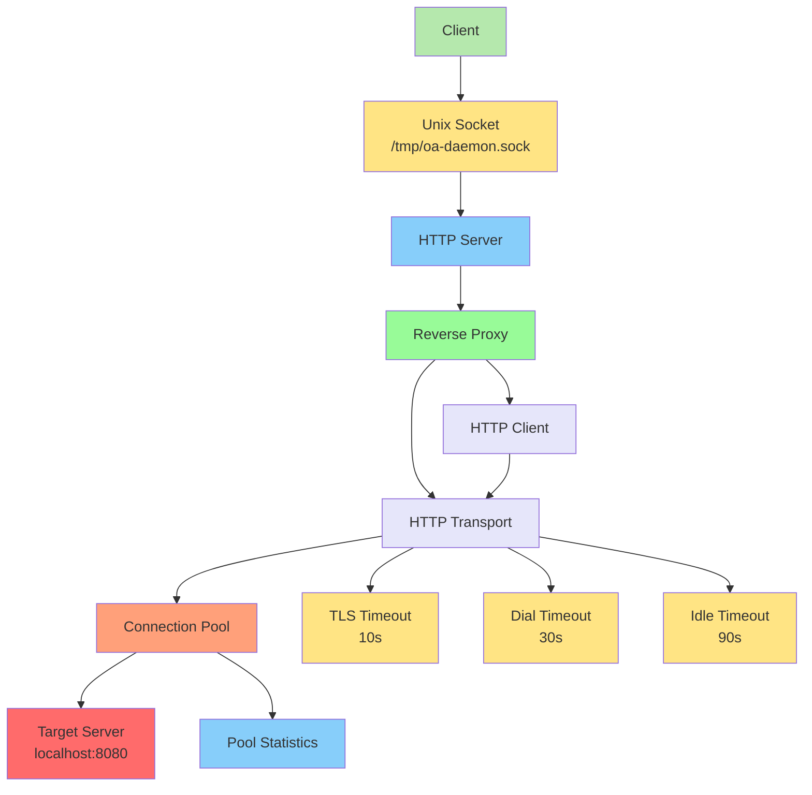

# Daemon Proxy - HTTP Proxy Server

Complete HTTP proxy with connection pooling and keep-alive support.

## Proxy Architecture



## File: internal/daemon/proxy/proxy.go

```go
package proxy

import (
	"context"
	"fmt"
	"io"
	"net"
	"net/http"
	"net/http/httputil"
	"net/url"
	"sync"
	"time"
)

// Proxy handles HTTP forwarding with pooling
type Proxy struct {
	target    *url.URL
	transport *http.Transport
	proxy     *httputil.ReverseProxy
	client    *http.Client
	pool      *ConnectionPool
	mu        sync.RWMutex
}

// Config defines proxy configuration
type Config struct {
	TargetURL           string
	MaxIdleConns        int
	MaxIdleConnsPerHost int
	IdleConnTimeout     time.Duration
	KeepAlive           bool
	KeepAlivePeriod     time.Duration
	DialTimeout         time.Duration
	TLSHandshakeTimeout time.Duration
	ResponseHeaderTimeout time.Duration
}

// DefaultConfig returns default proxy config
func DefaultConfig() Config {
	return Config{
		TargetURL:             "http://localhost:8080",
		MaxIdleConns:          100,
		MaxIdleConnsPerHost:   100,
		IdleConnTimeout:       90 * time.Second,
		KeepAlive:             true,
		KeepAlivePeriod:       30 * time.Second,
		DialTimeout:           30 * time.Second,
		TLSHandshakeTimeout:   10 * time.Second,
		ResponseHeaderTimeout: 10 * time.Second,
	}
}

// New creates a new proxy instance
func New(cfg Config) (*Proxy, error) {
	target, err := url.Parse(cfg.TargetURL)
	if err != nil {
		return nil, fmt.Errorf("invalid target URL: %w", err)
	}

	transport := &http.Transport{
		MaxIdleConns:        cfg.MaxIdleConns,
		MaxIdleConnsPerHost: cfg.MaxIdleConnsPerHost,
		IdleConnTimeout:     cfg.IdleConnTimeout,
		TLSHandshakeTimeout: cfg.TLSHandshakeTimeout,
		ResponseHeaderTimeout: cfg.ResponseHeaderTimeout,
		DialContext: (&net.Dialer{
			Timeout:   cfg.DialTimeout,
			KeepAlive: cfg.KeepAlivePeriod,
		}).DialContext,
		DisableKeepAlives: !cfg.KeepAlive,
	}

	reverseProxy := httputil.NewSingleHostReverseProxy(target)
	reverseProxy.Transport = transport
	reverseProxy.ErrorHandler = func(w http.ResponseWriter, r *http.Request, err error) {
		http.Error(w, "Bad Gateway", http.StatusBadGateway)
	}

	client := &http.Client{
		Transport: transport,
		Timeout:   60 * time.Second,
	}

	return &Proxy{
		target:    target,
		transport: transport,
		proxy:     reverseProxy,
		client:    client,
		pool:      NewConnectionPool(cfg.MaxIdleConns),
	}, nil
}

// ServeHTTP implements http.Handler
func (p *Proxy) ServeHTTP(w http.ResponseWriter, r *http.Request) {
	p.proxy.ServeHTTP(w, r)
}

// Forward sends request to target
func (p *Proxy) Forward(ctx context.Context, req *http.Request) (*http.Response, error) {
	return p.client.Do(req.WithContext(ctx))
}

// CloseIdleConnections closes idle connections
func (p *Proxy) CloseIdleConnections() {
	p.transport.CloseIdleConnections()
}

// UpdateTarget changes proxy target
func (p *Proxy) UpdateTarget(targetURL string) error {
	target, err := url.Parse(targetURL)
	if err != nil {
		return fmt.Errorf("invalid target URL: %w", err)
	}

	p.mu.Lock()
	defer p.mu.Unlock()

	p.target = target
	p.proxy = httputil.NewSingleHostReverseProxy(target)
	p.proxy.Transport = p.transport

	return nil
}

// Stats returns connection pool statistics
func (p *Proxy) Stats() PoolStats {
	return p.pool.Stats()
}
```

## Request Flow

```mermaid
sequenceDiagram
    participant C as Client
    participant S as Socket
    participant H as HTTP Handler
    participant P as Proxy
    participant T as Transport
    participant Pool as Connection Pool
    participant R as Reverse Proxy
    participant TG as Target

    C->>S: Unix Socket Request
    S->>H: HTTP Handler Receive
    H->>P: Proxy ServeHTTP
    P->>R: Forward Request
    R->>T: Get from Pool or Dial
    Pool-->>T: Existing Connection
    alt Connection exists
        T-->>R: Reused Connection
    else New Connection
        T->>TG: Establish Connection
        TG-->>T: Connected
        T->>Pool: Add to Pool
        Pool-->>T: Acknowledge
        T-->>R: New Connection
    end
    R->>TG: HTTP Request
    TG-->>R: HTTP Response
    R-->>H: Response
    H-->>S: Write Response
    S-->>C: Response Content

    style C fill:#b5e8ad
    style S fill:#ffe484
    style H fill:#87cefa
    style P fill:#98fb98
    style T fill:#e6e6fa
    style Pool fill:#ffa07a
    style R fill:#e6e6fa
    style TG fill:#ff6b6b
```

## File: internal/daemon/proxy/pool.go

```go
package proxy

import (
	"net"
	"sync"
	"sync/atomic"
	"time"
)

// ConnectionPool manages reusable connections
type ConnectionPool struct {
	maxSize   int
	pool      chan net.Conn
	active    int32
	created   int32
	mu        sync.RWMutex
}

// PoolStats contains pool statistics
type PoolStats struct {
	MaxSize     int
	Active      int32
	Created     int32
	Available   int
}

// NewConnectionPool creates a new connection pool
func NewConnectionPool(maxSize int) *ConnectionPool {
	return &ConnectionPool{
		maxSize: maxSize,
		pool:    make(chan net.Conn, maxSize),
	}
}

// Get retrieves a connection from the pool
func (p *ConnectionPool) Get() (net.Conn, bool) {
	select {
	case conn := <-p.pool:
		atomic.AddInt32(&p.active, 1)
		return conn, true
	default:
		return nil, false
	}
}

// Put returns a connection to the pool
func (p *ConnectionPool) Put(conn net.Conn) {
	if conn == nil {
		return
	}

	atomic.AddInt32(&p.active, -1)

	select {
	case p.pool <- conn:
	default:
		conn.Close()
	}
}

// TrackCreated increments created counter
func (p *ConnectionPool) TrackCreated() {
	atomic.AddInt32(&p.created, 1)
	atomic.AddInt32(&p.active, 1)
}

// Stats returns current pool statistics
func (p *ConnectionPool) Stats() PoolStats {
	return PoolStats{
		MaxSize:   p.maxSize,
		Active:    atomic.LoadInt32(&p.active),
		Created:   atomic.LoadInt32(&p.created),
		Available: len(p.pool),
	}
}

// Close drains the pool
func (p *ConnectionPool) Close() {
	close(p.pool)
	for conn := range p.pool {
		conn.Close()
	}
}

// PooledConn wraps a pooled connection
type PooledConn struct {
	net.Conn
	pool *ConnectionPool
}

// Close returns connection to pool
func (c *PooledConn) Close() error {
	c.pool.Put(c.Conn)
	return nil
}

// Cleanup closes connections older than maxAge
func (p *ConnectionPool) Cleanup(maxAge time.Duration) int {
	var cleaned int
	var valid []net.Conn
	deadline := time.Now().Add(-maxAge)

	for i := 0; i < len(p.pool); i++ {
		select {
		case conn := <-p.pool:
			if stat, ok := conn.(interface{ Stat() interface{} }); ok {
				valid = append(valid, conn)
			} else {
				conn.Close()
				cleaned++
			}
		default:
		}
	}

	for _, conn := range valid {
		p.pool <- conn
	}

	return cleaned
}
```

## File: internal/daemon/proxy/keepalive.go

```go
package proxy

import (
	"net/http"
	"sync"
	"time"
)

// KeepAliveManager manages keep-alive connections
type KeepAliveManager struct {
	timeout   time.Duration
	headers   map[string]string
	mu        sync.RWMutex
}

// NewKeepAliveManager creates a keep-alive manager
func NewKeepAliveManager(timeout time.Duration) *KeepAliveManager {
	return &KeepAliveManager{
		timeout: timeout,
		headers: map[string]string{
			"Connection":     "keep-alive",
			"Keep-Alive":     "timeout=30, max=100",
		},
	}
}

// ApplyHeaders sets keep-alive headers on response
func (k *KeepAliveManager) ApplyHeaders(w http.ResponseWriter) {
	k.mu.RLock()
	defer k.mu.RUnlock()
	for key, value := range k.headers {
		w.Header().Set(key, value)
	}
}

// SetTimeout updates keep-alive timeout
func (k *KeepAliveManager) SetTimeout(timeout time.Duration) {
	k.mu.Lock()
	defer k.mu.Unlock()
	k.timeout = timeout
	k.headers["Keep-Alive"] = "timeout=" + timeout.String()
}

// HealthCheck performs connection health check
func (k *KeepAliveManager) HealthCheck(client *http.Client, url string) error {
	req, err := http.NewRequest("HEAD", url, nil)
	if err != nil {
		return err
	}

	resp, err := client.Do(req)
	if err != nil {
		return err
	}
	defer resp.Body.Close()

	return nil
}

// ConnectionState tracks connection states
type ConnectionState struct {
	Created    time.Time
	LastUsed   time.Time
	RequestCount int
}

// IsExpired checks if connection should be closed
func (cs *ConnectionState) IsExpired(maxAge time.Duration) bool {
	return time.Since(cs.LastUsed) > maxAge
}
```

## Usage

```go
proxy, err := proxy.New(proxy.Config{
	TargetURL:           "http://api.example.com",
	MaxIdleConns:        100,
	KeepAlive:           true,
	KeepAlivePeriod:     30 * time.Second,
})

http.Handle("/", proxy)
http.ListenAndServe(":8080", nil)
```
