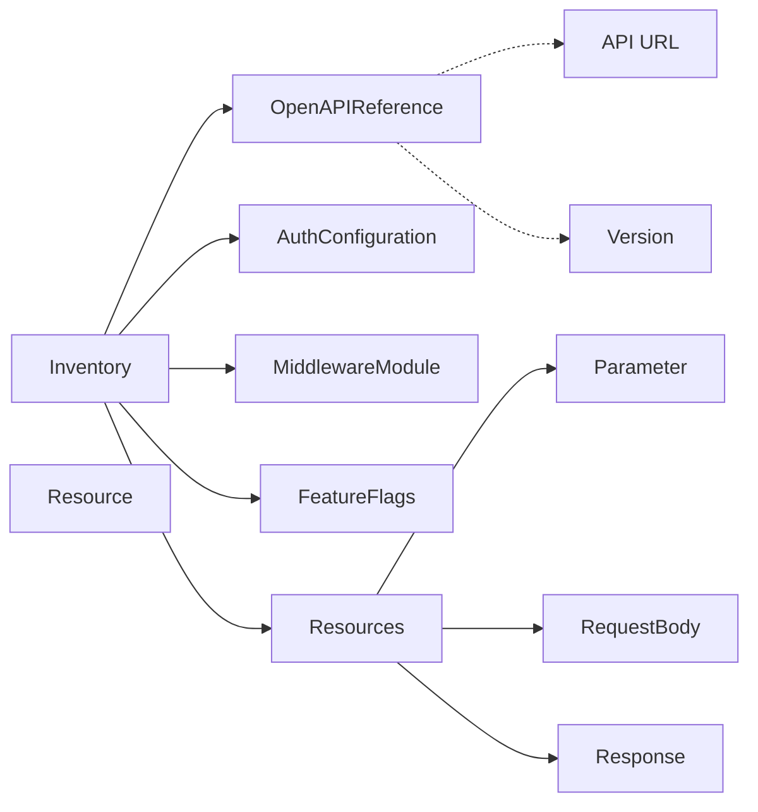
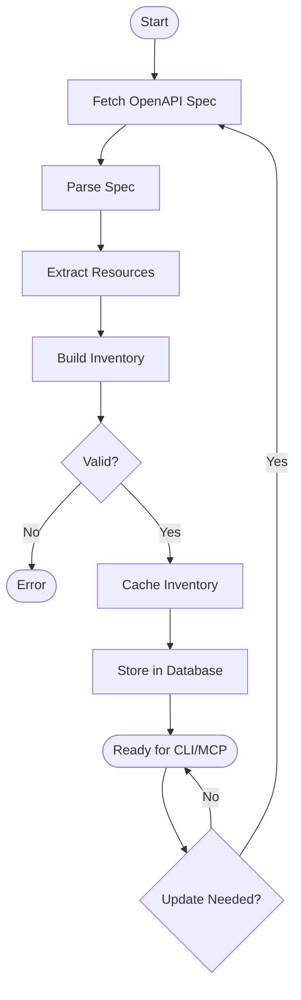
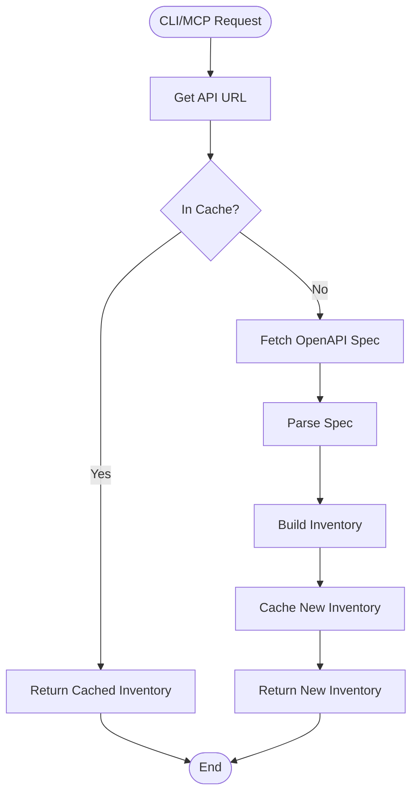

# Domain: Inventory

## Overview

This spec describes the actual Inventory implementation used for API specification cataloging. The implementation focuses on immediate OpenAPI spec fetching and caching rather than long-term repository management.

**Important**: Earlier versions of this spec described a more complex domain model with UUID-based IDs, multiple versions, and artifact tracking. That model was a theoretical design. The actual implementation below reflects the shipped system.

## Entity Relationships



## Inventory Generation Flow



## Inventory Query Flow



## Entities

### Inventory

API specification catalog with version compatibility and resource definitions. Identifies APIs by their URL/host rather than UUIDs, focusing on current specification state rather than version history.

```go
type Inventory struct {
    // Schema version for structural evolution
    SchemaVersion string `json:"schema_version" validate:"required"`

    // When this inventory was generated/fetched
    GeneratedAt time.Time `json:"generated_at" validate:"required"`

    // API interface version this inventory targets
    APIVersion string `json:"api_version" validate:"required,semver"`

    // API identification
    APIName        string `json:"api_name" validate:"required"`
    APIDescription string `json:"api_description" validate:"required"`
    BaseURL        string `json:"base_url" validate:"required,url"`

    // CLI version compatibility
    MinCLIVersion string `json:"min_cli_version" validate:"semver"`
    MaxCLIVersion string `json:"max_cli_version" validate:"semver"`

    // OpenAPI specification reference
    OpenAPISpec *OpenAPIReference `json:"openapi_spec" validate:"required"`

    // Authentication configuration (optional)
    Authentication *AuthConfiguration `json:"authentication,omitempty"`

    // Available resources/operations
    Resources []Resource `json:"resources" validate:"required,dive"`

    // Middleware modules (optional)
    Middleware []MiddlewareModule `json:"middleware,omitempty"`

    // Feature flags
    Features FeatureFlags `json:"features"`
}
```

### OpenAPIReference

Reference to the OpenAPI specification document.

```go
type OpenAPIReference struct {
    URL     string `json:"url" validate:"required,url"`
    Version string `json:"version" validate:"semver"`
    Format  string `json:"format" validate:"oneof=yaml json"`
}
```

### Resource

Individual API resource/operation definition.

```go
type Resource struct {
    Path        string      `json:"path" validate:"required"`
    Method      string      `json:"method" validate:"required,uppercase"`
    Description string      `json:"description"`
    Parameters  []Parameter `json:"parameters,omitempty"`
    RequestBody *RequestBody `json:"request_body,omitempty"`
    Responses   []Response  `json:"responses,omitempty"`
}

type Parameter struct {
    Name        string `json:"name" validate:"required"`
    In          string `json:"in" validate:"oneof=query path header cookie"`
    Required    bool   `json:"required"`
    Type        string `json:"type"`
    Description string `json:"description"`
}

type RequestBody struct {
    ContentType string                 `json:"content_type"`
    Schema      map[string]interface{} `json:"schema"`
}

type Response struct {
    StatusCode  int                    `json:"status_code"`
    Description string                 `json:"description"`
    Schema      map[string]interface{} `json:"schema"`
}
```

### AuthConfiguration

Authentication configuration for the API.

```go
type AuthConfiguration struct {
    Type   string                 `json:"type" validate:"oneof=none oauth2 apikey basic mtls"`
    Config map[string]interface{} `json:"config,omitempty"`
}
```

### MiddlewareModule

Optional middleware modules for request/response processing.

```go
type MiddlewareModule struct {
    Name    string                 `json:"name"`
    Config  map[string]interface{} `json:"config,omitempty"`
    Enabled bool                   `json:"enabled"`
}
```

### FeatureFlags

Feature availability flags.

```go
type FeatureFlags struct {
    EnableWASM    bool `json:"enable_wasm"`
    EnableDSL     bool `json:"enable_dsl"`
    EnableCache   bool `json:"enable_cache"`
    EnableMetrics bool `json:"enable_metrics"`
}
```

## Versioning

The current implementation uses a single API version string rather than multiple version tracking:

- **APIVersion**: SemVer string identifying the API interface version
- **MinCLIVersion/MaxCLIVersion**: CLI compatibility bounds
- **OpenAPISpec.Version**: Specific OpenAPI spec version being referenced

Multiple inventory versions are not tracked - the system always works with the current specification state.

## Validation

```go
func (i *Inventory) Validate() error {
    if err := validator.Validate(i); err != nil {
        return fmt.Errorf("inventory validation failed: %w", err)
    }

    // Ensure resources exist
    if len(i.Resources) == 0 {
        return errors.New("inventory must have at least one resource")
    }

    // Ensure OpenAPI spec reference is valid
    if i.OpenAPISpec == nil || i.OpenAPISpec.URL == "" {
        return errors.New("inventory must have valid OpenAPI specification")
    }

    return nil
}
```

## Design Rationale

The simplified inventory model (vs earlier spec) reflects actual shipped implementation:

1. **API URL as Identity**: Uses API URL/host for identification rather than UUIDs (simpler, directly references source)
2. **Single Spec Reference**: Maintains current OpenAPI spec only, not version history (supports dynamic inventory use case)
3. **HTTP Sources Only**: Simplified to HTTP-based fetching (most common use case, git/local sources handled via URL proxy)
4. **Limited Metadata**: Focuses on operational fields (API name, description, compatibility) over extended metadata (simplifies catalog management)
5. **No Version Tracking**: System fetches current spec on-demand rather than maintaining artifact version history (supports continuous integration use cases)

This design works well for the primary use case: dynamic CLI/MCP tool generation from live API specifications.

---

**Spec History**: Updated 2026-03-05 to match actual pkg/inventory/manager.go implementation. Previous version described theoretical domain model with UUID-based IDs, version tracking, and artifact management - those features were never implemented.
