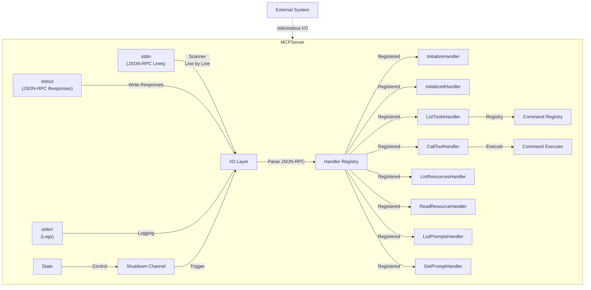
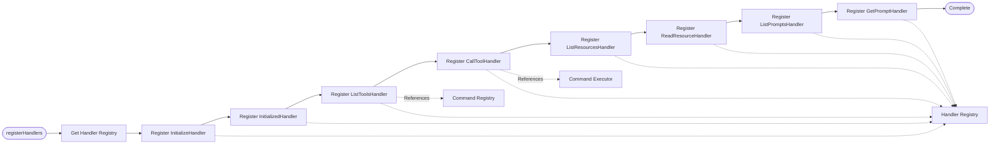
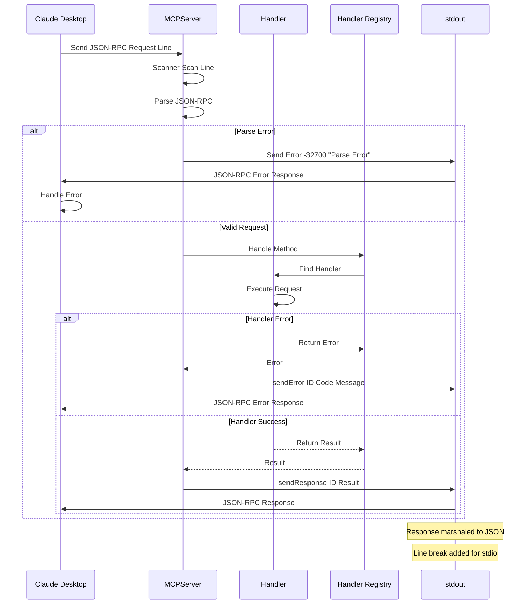
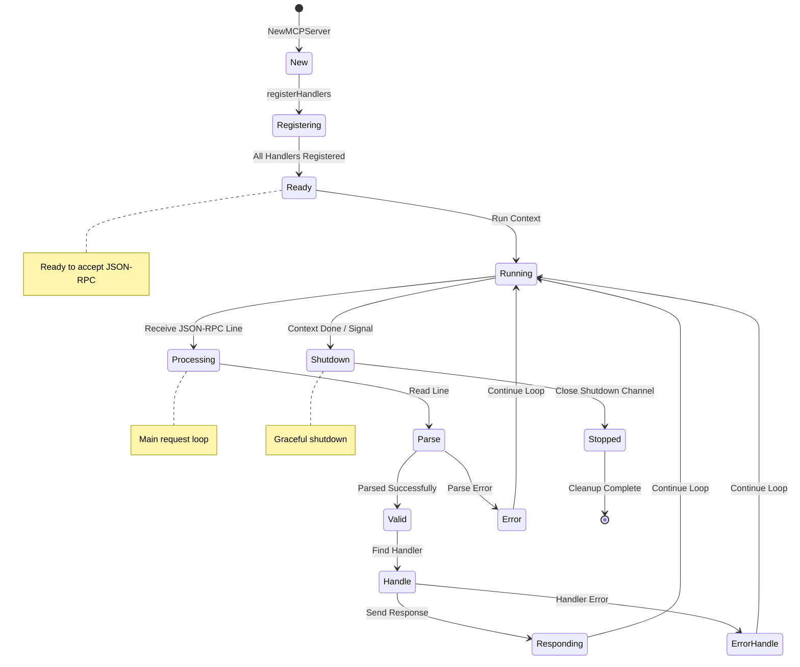

# MCP Server Implementation Specification

**Status**: ✅ COMPLETE  
**Version**: 1.0.0  
**Last Updated**: 2026-03-01  
**Component**: MCP Server

## Overview

Complete specification of the **MCP server implementation**, managing stdio communication, request routing, and lifecycle.

## Architecture



## Request Processing Flow

```mermaid
flowchart TD
    START([Start Run]) --> SCANNER[Create Scanner]
    SCANNER --> SCAN{Scanner Scan}
    SCAN -->|Line| CHECK_EMPTY{Empty Line?}
    CHECK_EMPTY -->|Yes| RESTART[Continue Loop]
    CHECK_EMPTY -->|No| PARSE[Parse JSON-RPC Request]
    
    PARSE -->{Parse Error?}
    {Parse Error?} -->|Yes| ERROR_MSG[Send Error -32700<br/>Parse Error]
    ERROR_MSG --> RESTART
    
    {Parse Error?} -->|No| CHECK_CTX{Context Done?}
    CHECK_CTX -->|Yes| ERROR_CTX[Return Context Error]
    CHECK_CTX -->|No| CHECK_SHUTDOWN{Shutdown Signal?}
    
    CHECK_SHUTDOWN -->|Yes| RETURN_DONE[Return nil]
    CHECK_SHUTDOWN -->|No| HANDLE[handleRequest Call]
    
    HANDLE --> HANDLE_REQ[handlers.Handle Method]
    HANDLE_REQ -->{Handler Error?}
    {Handler Error?} -->|Yes| SEND_ERROR[sendError]
    {Handler Error?} -->|No| SEND_RESULT[sendResponse]
    
    SEND_ERROR --> WRITE[writeResponse]
    SEND_RESULT --> WRITE
    WRITE --> STDOUT[Write to stdout]
    STDOUT --> LINEBREAK[Add Line Break]
    LINEBREAK --> RESTART
    
    RESTART --> SCAN
    
    ERROR_CTX -.-> END([End])
    RETURN_DONE -.-> END
    
    style {Parse Error?} fill:#ff9,stroke:#333
    style {Context Done?} fill:#ff9,stroke:#333
    style {Shutdown Signal?} fill:#ff9,stroke:#333
    style {Handler Error?} fill:#ff9,stroke:#333
    style START fill:#9f9,stroke:#333
    style END fill:#f99,stroke:#333
```

## Handler Registration Flow



## Response Flow



## Lifecycle Flow



## 1. Server Structure

```go
type MCPServer struct {
    // I/O
    stdin  io.Reader
    stdout io.Writer
    stderr io.Writer
    
    // Handlers
    handlers *HandlerRegistry
    
    // State
    initialized   bool
    shutdownChan  chan struct{}
    
    // Components
    commandRegistry *CommandRegistry
    executor        *CommandExecutor
}

func NewMCPServer(stdin io.Reader, stdout, stderr io.Writer) *MCPServer {
    s := &MCPServer{
        stdin:      stdin,
        stdout:     stdout,
        stderr:     stderr,
        handlers:   NewHandlerRegistry(),
        shutdownChan: make(chan struct{}),
    }
    
    s.registerHandlers()
    return s
}
```

## 2. Request Processing

```go
func (s *MCPServer) Run(ctx context.Context) error {
    scanner := bufio.NewScanner(s.stdin)
    
    for scanner.Scan() {
        select {
        case <-s.shutdownChan:
            return nil
        case <-ctx.Done():
            return ctx.Err()
        default:
        }
        
        line := scanner.Text()
        if line == "" {
            continue
        }
        
        var req JSONRPCRequest
        if err := json.Unmarshal([]byte(line), &req); err != nil {
            s.sendError(nil, -32700, "Parse error")
            continue
        }
        
        go s.handleRequest(ctx, &req)
    }
    
    return scanner.Err()
}

func (s *MCPServer) handleRequest(ctx context.Context, req *JSONRPCRequest) {
    result, err := s.handlers.Handle(ctx, req.Method, req.Params)
    
    if err != nil {
        s.sendError(req.ID, err)
    } else {
        s.sendResponse(req.ID, result)
    }
}
```

## 3. Response Handling

```go
func (s *MCPServer) sendResponse(id interface{}, result interface{}) {
    resp := JSONRPCResponse{
        JSONRPC: "2.0",
        ID:      id,
        Result:  mustMarshal(result),
    }
    
    s.writeResponse(resp)
}

func (s *MCPServer) sendError(id interface{}, code int, message string) {
    resp := JSONRPCResponse{
        JSONRPC: "2.0",
        ID:      id,
        Error: &JSONRPCError{
            Code:    code,
            Message: message,
        },
    }
    
    s.writeResponse(resp)
}

func (s *MCPServer) writeResponse(resp JSONRPCResponse) {
    data, _ := json.Marshal(resp)
    fmt.Fprintln(s.stdout, string(data))
}
```

## 4. Initialization Flow

```go
func (s *MCPServer) registerHandlers() {
    // Lifecycle
    s.handlers.Register(&InitializeHandler{server: s})
    s.handlers.Register(&InitializedHandler{server: s})
    
    // Tools
    s.handlers.Register(&ListToolsHandler{registry: s.commandRegistry})
    s.handlers.Register(&CallToolHandler{executor: s.executor})
    
    // Resources
    s.handlers.Register(&ListResourcesHandler{})
    s.handlers.Register(&ReadResourceHandler{})
    
    // Prompts
    s.handlers.Register(&ListPromptsHandler{})
    s.handlers.Register(&GetPromptHandler{})
}
```

## 5. Shutdown

```go
func (s *MCPServer) Shutdown() error {
    close(s.shutdownChan)
    return nil
}
```

---

**Bible Standard Compliance**: ✅ DETERMINISTIC
