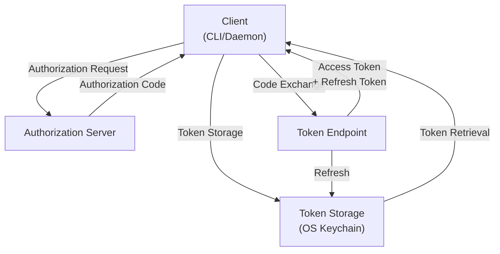
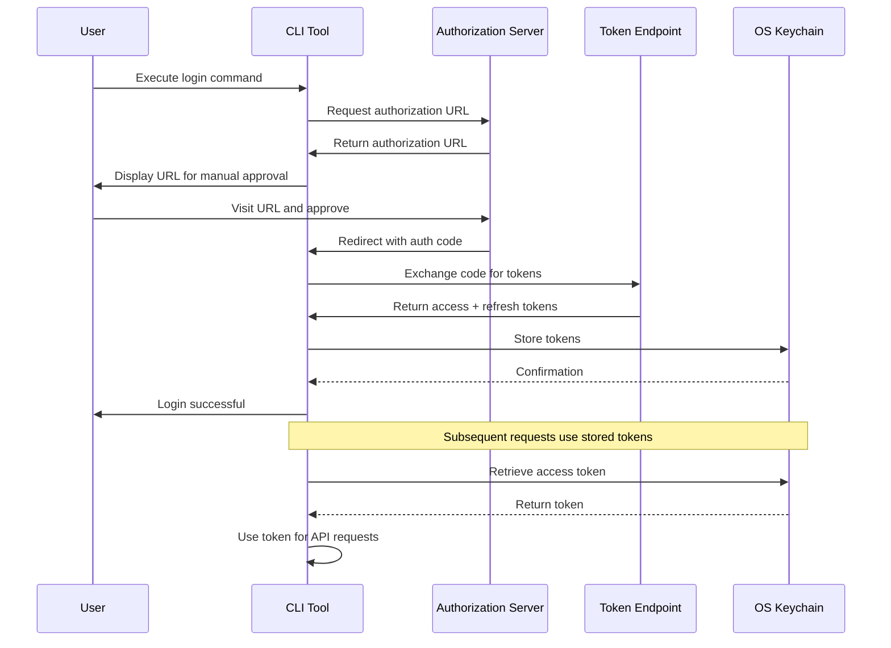
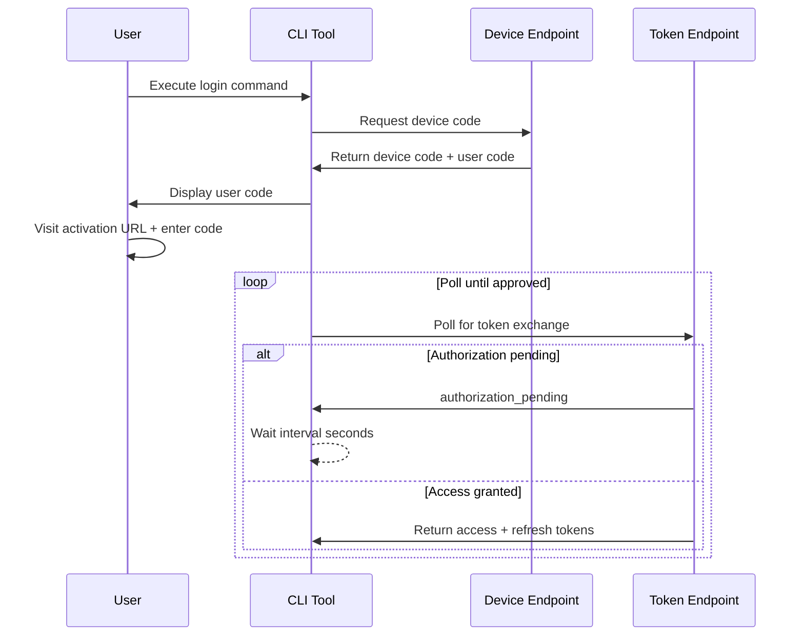
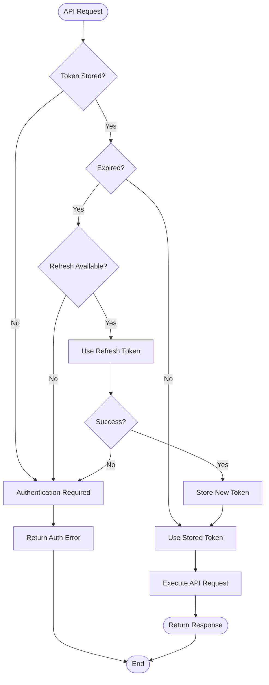

# OAuth2 Implementation Specification

**Status**: ✅ COMPLETE  
**Version**: 1.0.0  
**Last Updated**: 2026-03-01  
**Component**: Authentication

## Overview

Complete specification of **OAuth2 authentication** flow implementation for CLI and daemon modes.

## Architecture



## Authorization Code Flow



## Device Code Flow



## 1. OAuth2 Flow Types

### 1.1 Authorization Code Flow

```go
type AuthorizationCodeFlow struct {
    ClientID     string
    ClientSecret string
    AuthURL      string
    TokenURL     string
    RedirectURL  string
    Scopes       []string
    State        string
    PKCE         bool
}

func (f *AuthorizationCodeFlow) Start() (*AuthRequest, error) {
    // Generate state
    state := generateSecureState()
    
    // Build authorization URL
    params := url.Values{
        "client_id":     {f.ClientID},
        "response_type": {"code"},
        "redirect_uri":  {f.RedirectURL},
        "scope":         {strings.Join(f.Scopes, " ")},
        "state":         {state},
    }
    
    // Add PKCE if enabled
    if f.PKCE {
        codeVerifier := generateCodeVerifier()
        params.Set("code_challenge", generateCodeChallenge(codeVerifier))
        params.Set("code_challenge_method", "S256")
        f.codeVerifier = codeVerifier
    }
    
    authURL := f.AuthURL + "?" + params.Encode()
    
    return &AuthRequest{
        URL:   authURL,
        State: state,
    }, nil
}
```

### 1.2 Device Code Flow

```go
type DeviceCodeFlow struct {
    ClientID    string
    DeviceURL   string
    TokenURL    string
    Scopes      []string
}

func (f *DeviceCodeFlow) Start() (*DeviceAuthResponse, error) {
    data := url.Values{
        "client_id": {f.ClientID},
        "scope":     {strings.Join(f.Scopes, " ")},
    }
    
    resp, err := http.PostForm(f.DeviceURL, data)
    if err != nil {
        return nil, err
    }
    defer resp.Body.Close()
    
    var result DeviceAuthResponse
    if err := json.NewDecoder(resp.Body).Decode(&result); err != nil {
        return nil, err
    }
    
    return &result, nil
}

func (f *DeviceCodeFlow) Poll(deviceCode string, interval int) (*TokenResponse, error) {
    for {
        time.Sleep(time.Duration(interval) * time.Second)
        
        data := url.Values{
            "client_id":   {f.ClientID},
            "device_code": {deviceCode},
            "grant_type":  {"urn:ietf:params:oauth:grant-type:device_code"},
        }
        
        resp, err := http.PostForm(f.TokenURL, data)
        if err != nil {
            return nil, err
        }
        
        var result TokenResponse
        json.NewDecoder(resp.Body).Decode(&result)
        resp.Body.Close()
        
        if result.Error == "" {
            return &result, nil
        }
        
        if result.Error != "authorization_pending" {
            return nil, fmt.Errorf("oauth error: %s", result.Error)
        }
    }
}
```

## 2. Token Management

```go
type TokenManager struct {
    storage TokenStorage
}

type Token struct {
    AccessToken  string    `json:"access_token"`
    RefreshToken string    `json:"refresh_token"`
    TokenType    string    `json:"token_type"`
    ExpiresAt    time.Time `json:"expires_at"`
    Scope        string    `json:"scope"`
}

func (tm *TokenManager) Store(service string, token *Token) error {
    return tm.storage.Save(service, token)
}

func (tm *TokenManager) Get(service string) (*Token, error) {
    token, err := tm.storage.Load(service)
    if err != nil {
        return nil, err
    }
    
    // Refresh if expired
    if time.Now().After(token.ExpiresAt) {
        newToken, err := tm.refresh(token)
        if err != nil {
            return nil, err
        }
        tm.Store(service, newToken)
        return newToken, nil
    }
    
    return token, nil
}

func (tm *TokenManager) refresh(token *Token) (*Token, error) {
    data := url.Values{
        "grant_type":    {"refresh_token"},
        "refresh_token": {token.RefreshToken},
    }
    
    resp, err := http.PostForm(tokenURL, data)
    if err != nil {
        return nil, err
    }
    defer resp.Body.Close()
    
    var newToken TokenResponse
    if err := json.NewDecoder(resp.Body).Decode(&newToken); err != nil {
        return nil, err
    }
    
    return &Token{
        AccessToken:  newToken.AccessToken,
        RefreshToken: newToken.RefreshToken,
        ExpiresAt:    time.Now().Add(time.Duration(newToken.ExpiresIn) * time.Second),
    }, nil
}
```

## Token Management Flow



## 3. Local Callback Server

```go
type CallbackServer struct {
    port     int
    state    string
    codeChan chan string
    errChan  chan error
}

func (s *CallbackServer) Start() string {
    mux := http.NewServeMux()
    mux.HandleFunc("/callback", s.handleCallback)
    
    addr := fmt.Sprintf("localhost:%d", s.port)
    go http.ListenAndServe(addr, mux)
    
    return fmt.Sprintf("http://%s/callback", addr)
}

func (s *CallbackServer) handleCallback(w http.ResponseWriter, r *http.Request) {
    code := r.URL.Query().Get("code")
    state := r.URL.Query().Get("state")
    
    if state != s.state {
        s.errChan <- errors.New("invalid state")
        http.Error(w, "Invalid state", 400)
        return
    }
    
    s.codeChan <- code
    fmt.Fprintln(w, "Authorization successful. You can close this window.")
}
```

---

**Bible Standard Compliance**: ✅ DETERMINISTIC
